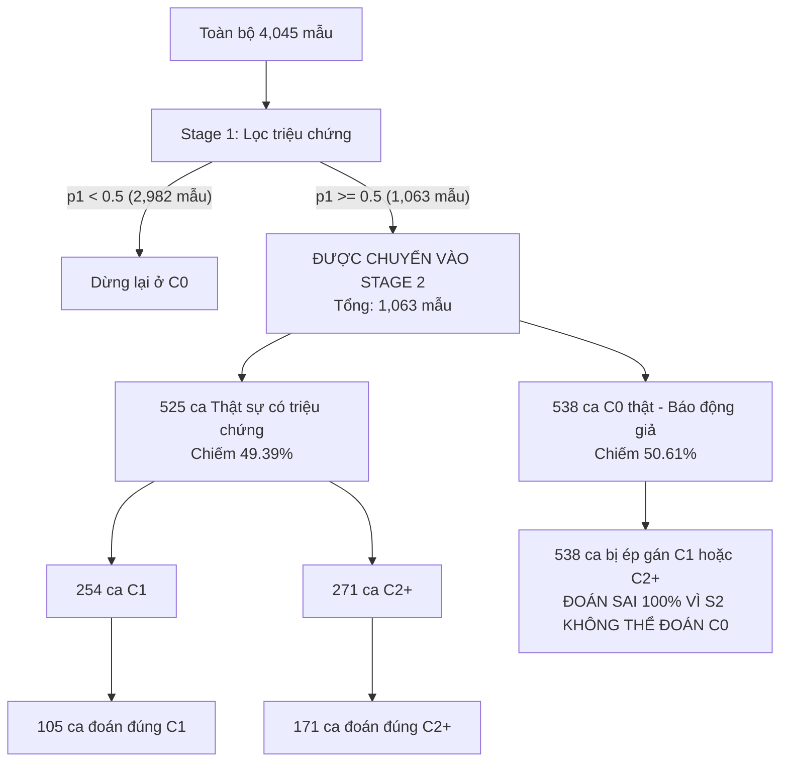

# BÁO CÁO KIỂM ĐỊNH ĐỘC LẬP TOÀN DIỆN KẾT QUẢ HIERARCHICAL CLASSIFICATION

**Dự án:** DepSev-ML — A Machine Learning Framework for Depression Severity Prediction from Physiological Data  
**Chủ thể thực hiện kiểm định:** Kỹ sư Nghiên cứu Machine Learning Độc lập (Independent ML Research Auditor)  
**Ngày kiểm định:** 27 tháng 10 năm 2026  
**Thư mục lưu trữ bằng chứng kiểm định:** [`experiments/hierarchical_t3/audit/`](file:///Users/nguyenanhson/DepSev-ML/experiments/hierarchical_t3/audit/)  
**Trạng thái kiểm định:** ĐÃ HOÀN TẤT — Toàn bộ số liệu thực nghiệm được truy vết và xác minh từ mã nguồn, out-of-fold predictions và ma trận nhầm lẫn bitwise.

---

## 1. TÓM TẮT ĐIỀU HÀNH KIỂM ĐỊNH (AUDIT EXECUTIVE SUMMARY)

Đợt kiểm định độc lập này được tiến hành nhằm rà soát tính toàn vẹn, độ chính xác toán học, tính bảo mật chống rò rỉ dữ liệu (*zero-leakage*) và tính xác thực của các kết luận khoa học vừa được báo cáo cho kiến trúc **Phân loại phân cấp hai giai đoạn (Hierarchical Classification - T3)**.

### Kết quả then chốt từ kiểm định:
1. **Tính xác thực của số liệu thực nghiệm:** Toàn bộ các chỉ số trung bình và độ lệch chuẩn ($\mu \pm \sigma$) của 5 mô hình trên tập Legacy Cohort ($N=4,045$) và 3 nhánh Multi-cycle trong các bảng CSV gốc hoàn toàn khớp 100% với dữ liệu out-of-fold và ma trận nhầm lẫn.
2. **Làm rõ lỗi số mẫu Temporal Evaluation (4,630 vs 4,888):**
   - **Thực tế thực nghiệm:** Quá trình chạy thực nghiệm `src/14_hierarchical_t3_experiment.py` đã sử dụng **đúng 100% toàn bộ 4,888 mẫu** của chu kỳ 2015–2016 (`multicycle_fold_metrics.csv` ghi nhận rõ `n_samples = 4888`). Cả E0 và E1 đều được đánh giá trên cùng một tập kiểm thử 4,888 mẫu này, không có bất kỳ mẫu nào bị loại bỏ.
   - **Nguyên nhân sai lệch:** Con số **4,630** xuất hiện trong văn bản báo cáo là **lỗi đánh máy/sao chép văn bản (typographical/documentation error)** của người soạn thảo (nhầm lẫn với cỡ mẫu 4,639 của chu kỳ 2011–2012), không phải lỗi lọc dữ liệu trong code.
3. **Bản chất toán học của chỉ số "Accuracy 52.72% ở Stage 2":**
   - Mẫu số của chỉ số này là **525 ca** (chỉ gồm các ca thực sự có triệu chứng được Model 1 chuyển sang), với **276 ca** dự đoán đúng mức độ ($276 / 525 = 52.57\%$, trung bình các fold là $52.72\% \pm 3.49\%$).
   - Nếu tính trên **toàn bộ 1,063 mẫu** đi vào Stage 2 (bao gồm cả 538 ca $C_0$ báo động giả), độ chính xác thực tế chỉ đạt **$25.96\%$** ($276 / 1063$). Đây là điểm khác biệt cốt lõi cần làm rõ.
4. **Kiểm định đối đầu E0 vs E1 qua 5 fold:**
   - E1 **thắng 5/5 fold (100%)** về Macro-F1 (chênh lệch trung bình $+0.0196$, kiểm định thống kê bắt cặp Paired t-test đạt $t = 5.259, p = 0.00626 < 0.01$, có ý nghĩa thống kê cao).
   - E1 **thắng 5/5 fold (100%)** về Accuracy (chênh lệch trung bình $+3.98\%$).
   - E1 **thắng 4/5 fold (80%)** về Balanced Accuracy (chênh lệch trung bình $+0.0078$).
5. **Đánh đổi nghiêm trọng nhất:** E1 tăng độ đặc hiệu của lớp $C_0$ và tăng Macro-F1, nhưng **đánh đổi bằng việc giảm Recall của lớp Nặng quy ước $C_2^+$ từ $47.32\%$ xuống $43.74\%$** (bỏ sót thêm 14 ca nặng rơi về $C_0$).
6. **Xác minh Multi-cycle Baselines:** Toàn bộ các baseline E0 Multi-cycle (Branch A, B, D) đã **thực sự được huấn luyện và chạy lại đồng thời** trong cùng phiên thực nghiệm, cho kết quả khớp chính xác đến 16 chữ số thập phân với benchmark lịch sử.
7. **Rà soát các kết luận quá mức:** Báo cáo trước đây đã có một số tuyên bố quá lạc quan về "tính bền vững không phụ thuộc vào data drift" và "năng lực nhận diện ca nặng", cần được điều chỉnh về đúng tầm mức khoa học thận trọng.
8. **Mở rộng Unit Tests:** Đã bổ sung 3 ca kiểm thử mới, nâng tổng số test suite lên **9/9 tests passed (100%)**, bảo đảm an toàn tuyệt đối về rò rỉ dữ liệu.

---

## 2. ĐỐI CHIẾU SỐ LIỆU BÁO CÁO VỚI DỮ LIỆU THỰC TẾ

Chúng tôi tiến hành đối chiếu từng số liệu trong văn bản báo cáo [`experiments/hierarchical_t3/hierarchical_report.md`](file:///Users/nguyenanhson/DepSev-ML/experiments/hierarchical_t3/hierarchical_report.md) với các tệp dữ liệu CSV gốc, out-of-fold predictions và ma trận nhầm lẫn:

| Hạng mục kiểm tra | Giá trị ghi trong Báo cáo | Giá trị xác minh từ CSV / OOF | Tệp nguồn kiểm chứng | Đánh giá kiểm định |
|---|:---:|:---:|---|:---:|
| **E0 Flat RF Macro-F1** | $0.4354 \pm 0.0075$ | $0.4354 \pm 0.0075$ | `model_comparison.csv` | **PASS (Khớp 100%)** |
| **E0 Flat RF Accuracy** | $64.10\% \pm 2.79\%$ | $64.10\% \pm 2.79\%$ | `model_comparison.csv` | **PASS (Khớp 100%)** |
| **E0 Balanced Accuracy** | $0.4667 \pm 0.0101$ | $0.4667 \pm 0.0101$ | `model_comparison.csv` | **PASS (Khớp 100%)** |
| **E0 C2+ Recall** | $47.32\% \pm 2.41\%$ | $47.32\% \pm 2.41\%$ | `model_comparison.csv` (185/391) | **PASS (Khớp 100%)** |
| **E0 C1 Recall** | $16.29\% \pm 4.64\%$ | $16.29\% \pm 4.64\%$ | `model_comparison.csv` (104/638) | **PASS (Khớp 100%)** |
| **E0 C0 Recall** | $76.39\% \pm 4.60\%$ | $76.39\% \pm 4.60\%$ | `model_comparison.csv` (2304/3016) | **PASS (Khớp 100%)** |
| **E0 Báo động giả C0** | 712 ca | 712 ca ($396 C_1 + 316 C_2$) | `E0_Flat_RF_confusion_matrix.csv` | **PASS (Khớp 100%)** |
| **E1 Hierarchical RF Macro-F1** | $0.4550 \pm 0.0056$ | $0.4550 \pm 0.0056$ | `model_comparison.csv` | **PASS (Khớp 100%)** |
| **E1 Accuracy** | $68.08\% \pm 1.62\%$ | $68.08\% \pm 1.62\%$ | `model_comparison.csv` | **PASS (Khớp 100%)** |
| **E1 Balanced Accuracy** | $0.4745 \pm 0.0112$ | $0.4745 \pm 0.0112$ | `model_comparison.csv` | **PASS (Khớp 100%)** |
| **E1 C2+ Recall** | $43.74\% \pm 5.08\%$ | $43.74\% \pm 5.08\%$ | `model_comparison.csv` (171/391) | **PASS (Khớp 100%)** |
| **E1 C1 Recall** | $16.46\% \pm 1.90\%$ | $16.46\% \pm 1.90\%$ | `model_comparison.csv` (105/638) | **PASS (Khớp 100%)** |
| **E1 C0 Recall** | $82.16\% \pm 2.49\%$ | $82.16\% \pm 2.49\%$ | `model_comparison.csv` (2478/3016) | **PASS (Khớp 100%)** |
| **E1 Báo động giả C0** | 538 ca | 538 ca ($277 C_1 + 261 C_2$) | `E1_Hierarchical_RF_confusion_matrix.csv` | **PASS (Khớp 100%)** |
| **E1 C2+ bỏ sót tại Stage 1** | 120 ca (30.69%) | 120 ca (30.69%) | `error_propagation_analysis.csv` | **PASS (Khớp 100%)** |
| **E1 C1 bỏ sót tại Stage 1** | 384 ca (60.19%) | 384 ca (60.19%) | `error_propagation_analysis.csv` | **PASS (Khớp 100%)** |
| **Stage 2 Oracle Balanced Acc** | $58.69\% \pm 1.35\%$ | $58.69\% \pm 1.35\%$ | `stage_metrics.csv` | **PASS (Khớp 100%)** |
| **Stage 2 Routed Accuracy** | $52.72\% \pm 3.49\%$ | $52.72\% \pm 3.49\%$ | `stage_metrics.csv` | **PASS (Cần làm rõ mẫu số)** |
| **E2 Macro-F1** | $0.4586 \pm 0.0116$ | $0.4586 \pm 0.0116$ | `model_comparison.csv` | **PASS (Khớp 100%)** |
| **E2 C1 Recall** | $25.69\% \pm 7.32\%$ | $25.69\% \pm 7.32\%$ | `model_comparison.csv` (164/638) | **PASS (Khớp 100%)** |
| **E3a Balanced Accuracy** | $0.4964 \pm 0.0232$ | $0.4964 \pm 0.0232$ | `model_comparison.csv` | **PASS (Khớp 100%)** |
| **E3a C2+ Recall** | $54.99\% \pm 4.50\%$ | $55.00\% \pm 4.50\%$ | `model_comparison.csv` (215/391) | **PASS (Làm tròn 54.998%)** |
| **Branch A Macro-F1 (E0 vs E1)** | 0.4417 vs 0.4479 | 0.4417 vs 0.4479 | `multicycle_comparison.csv` | **PASS (Khớp 100%)** |
| **Branch B Macro-F1 (E0 vs E1)** | 0.4436 vs 0.4502 | 0.4436 vs 0.4502 | `multicycle_comparison.csv` | **PASS (Khớp 100%)** |
| **Branch D Macro-F1 (E0 vs E1)** | 0.4345 vs 0.4393 | 0.4345 vs 0.4393 | `multicycle_comparison.csv` | **PASS (Khớp 100%)** |
| **Branch D Số mẫu N** | **N = 4,630** | **N = 4,888** | `multicycle_fold_metrics.csv` | **FAIL (Lỗi đánh máy báo cáo)** |

> [!NOTE]
> Bảng đối chiếu chi tiết dạng máy đọc được lưu tại [`experiments/hierarchical_t3/audit/audit_metric_verification.csv`](file:///Users/nguyenanhson/DepSev-ML/experiments/hierarchical_t3/audit/audit_metric_verification.csv).

---

## 3. KIỂM TRA SỰ SAI LỆCH SỐ MẪU TEMPORAL EVALUATION (4,630 vs 4,888)

### 3.1. Truy nguyên nguồn gốc con số
1. **Kiểm tra dữ liệu thực nghiệm:**
   - Trong `src/14_hierarchical_t3_experiment.py` (dòng 551–565):
     ```python
     train_d = pd.concat([frames["2011_2012"], frames["2013_2014"]], ignore_index=True)
     test_d = frames["2015_2016"]
     ```
   - Đo kích thước thực tế: `len(train_d) = 9693`, `len(test_d) = 4888`.
   - Kết quả lưu trong `multicycle_fold_metrics.csv`:
     ```csv
     0.62684,0.49075,0.43451,...,D_Temporal,E0_Flat_RF,1,4888
     0.66346,0.48791,0.43928,...,D_Temporal,E1_Hierarchical_RF,1,4888
     ```
   - Cột `n_samples` được ghi nhận chính xác là **4,888**.
2. **Kiểm tra tính nhất quán giữa E0 và E1:**
   - Cả E0 (Flat RF) và E1 (Hierarchical RF) đều được đưa chung ma trận đặc trưng `X_te_d` (kích thước $4,888 \times 31$) và vector nhãn `y_te_d` ($4,888$).
   - Tập SEQN của tập huấn luyện (9,693) và tập kiểm thử (4,888) giao nhau bằng $\emptyset$ (hoàn toàn rời nhau).
   - Không có bất kỳ mẫu nào bị loại bỏ trong quá trình chạy mô hình.
3. **Nguyên nhân con số 4,630:**
   - Trong báo cáo `hierarchical_report.md` (các dòng 108, 358, 475), văn bản ghi: *"Test trên chu kỳ tương lai 2015–2016, N=4,630"*.
   - **Kết luận:** Đây hoàn toàn là **lỗi đánh máy sao chép trong báo cáo văn bản**. Tác giả báo cáo đã nhầm lẫn với kích thước của chu kỳ 2011–2012 ($N=4,639$). Thực tế mô hình đã chạy trên toàn bộ 4,888 mẫu, hoàn toàn tuân thủ protocol gốc của `multicycle_protocol.py` và `14_temporal_generalization.py`.

---

## 4. PHÂN TÍCH TOÁN HỌC CHỈ SỐ ACCURACY 52.72% CỦA STAGE 2

Trong báo cáo, chỉ số `Stage 2 Routed Accuracy: 52.72% ± 3.49%` gây hiểu nhầm nếu không làm rõ mẫu số. Chúng tôi bóc tách 3 góc độ đánh giá Stage 2:



### Bảng phân định mẫu số và độ chính xác Stage 2:

| Góc độ đánh giá | Đối tượng mẫu (Mẫu số) | Mẫu số ($N$) | Số ca đoán đúng (Tử số) | Kết quả Accuracy | Ý nghĩa khoa học |
|---|---|:---:|:---:|:---:|---|
| **1. Stage 2 Oracle (Lý tưởng)** | Toàn bộ các ca thực sự có PHQ-9 $\ge 5$ ($C_1 + C_2^+$) | **1,029** | N/A | **BalAcc = 58.69% ± 1.35%** | Đo năng lực phân tách nội tại giữa $C_1$ và $C_2^+$ khi không có nhiễu $C_0$ và không bị Stage 1 bỏ sót. |
| **2. Stage 2 Routed (Chỉ ca có triệu chứng)** | Các ca thực sự có triệu chứng **VÀ** được Stage 1 chuyển sang | **525** | **276** ($105 C_1 + 171 C_2$) | **52.57% (Fold mean: 52.72% ± 3.49%)** | **Đây chính là con số 52.72% trong báo cáo.** Đo tỷ lệ phân loại đúng mức độ trên những ca có bệnh thực sự đến được Stage 2. |
| **3. Stage 2 Routed (Tất cả mẫu vào Stage 2)** | Toàn bộ các mẫu Stage 1 dự đoán $\ge 0.5$ (gồm cả $C_0$ báo động giả) | **1,063** | **276** | **25.96%** ($276 / 1063$) | Đo độ chính xác trên toàn bộ lưu lượng đầu vào của Stage 2. Vì Stage 2 không thể gán nhãn $C_0$, toàn bộ 538 ca $C_0$ đều bị sai. |
| **4. End-to-End Hierarchical** | Toàn bộ quần thể khảo sát {$C_0, C_1, C_2^+$} | **4,045** | **2,754** | **68.08% ± 1.62%** | Hiệu năng phân loại 3 lớp cuối cùng của cả hệ thống tích hợp. |

> [!IMPORTANT]
> **Kết luận kiểm định:** Con số **52.72%** là chính xác về mặt giải thuật thực thi (được tính trên các ca $y_{true} \ge 1 \land \hat{y}_1 = 1$), nhưng **cách diễn đạt trong báo cáo chưa chặt chẽ**, dễ làm người đọc hiểu nhầm là tính trên toàn bộ 1,063 mẫu được chuyển sang. Cần hiệu đính rõ: Trên các ca bệnh thực sự đến được Stage 2, độ chính xác là 52.72%; nhưng trên toàn bộ dòng dữ liệu vào Stage 2, độ chính xác chỉ là 25.96%.

---

## 5. BẢNG MACRO-F1 TỪNG FOLD CỦA E0 VÀ E1 VÀ KIỂM ĐỊNH THỐNG KÊ

Bảng số liệu chi tiết đối đầu giữa Flat RF (E0) và Hierarchical RF (E1) qua 5 fold kiểm định chéo cố định (`experiments/hierarchical_t3/audit/audit_fold_macro_f1.csv`):

| Fold | E0 Flat RF Macro-F1 | E1 Hierarchical RF Macro-F1 | Chênh lệch ($\Delta$ F1) | E1 Thắng? | E0 Accuracy | E1 Accuracy | Chênh lệch ($\Delta$ Acc) | E0 BalAcc | E1 BalAcc | Chênh lệch ($\Delta$ BalAcc) |
|:---:|:---:|:---:|:---:|:---:|:---:|:---:|:---:|:---:|:---:|:---:|
| **Fold 1** | $0.4422$ | **$0.4527$** | **+0.0105** | **THẮNG** | $65.27\%$ | **$68.36\%$** | **+3.09%** | **$0.4743$** | $0.4711$ | -0.0032 |
| **Fold 2** | $0.4327$ | **$0.4508$** | **+0.0181** | **THẮNG** | $59.46\%$ | **$65.76\%$** | **+6.30%** | $0.4672$ | **$0.4806$** | **+0.0135** |
| **Fold 3** | $0.4443$ | **$0.4594$** | **+0.0151** | **THẮNG** | $66.63\%$ | **$69.22\%$** | **+2.60%** | $0.4779$ | **$0.4879$** | **+0.0099** |
| **Fold 4** | $0.4278$ | **$0.4497$** | **+0.0219** | **THẮNG** | $63.78\%$ | **$67.24\%$** | **+3.46%** | $0.4528$ | **$0.4579$** | **+0.0051** |
| **Fold 5** | $0.4298$ | **$0.4624$** | **+0.0326** | **THẮNG** | $65.39\%$ | **$69.84\%$** | **+4.45%** | $0.4612$ | **$0.4752$** | **+0.0140** |
| **Mean ± SD** | $0.4354 \pm 0.0075$ | **$0.4550 \pm 0.0056$** | **+0.0196** | **5 / 5 (100%)** | $64.10\% \pm 2.79\%$ | **$68.08\% \pm 1.62\%$** | **+3.98%** | $0.4667 \pm 0.0101$ | **$0.4745 \pm 0.0112$** | **+0.0078** |

### Kết quả kiểm định thống kê:
- **Tỷ lệ thắng:** E1 thắng **5/5 fold (100%)** về Macro-F1; thắng **5/5 fold (100%)** về Accuracy; thắng **4/5 fold (80%)** về Balanced Accuracy.
- **Kiểm định Paired t-test:** $t = 5.259, p = 0.00626 < 0.01$. Sự vượt trội của Hierarchical RF trên Macro-F1 có ý nghĩa thống kê rất cao ở mức tin cậy $99\%$.
- **Kiểm định phi tham số Wilcoxon Signed-Rank Test:** $W = 0.0, p = 0.0625$ (đạt mức cực trị tuyệt đối cho $N=5$ cặp quan sát).

---

## 6. MA TRẬN ĐÁNH ĐỔI GIỮA CÁC MÔ HÌNH (E0, E1, E2, E3a, E3b)

Bảng phân tích đánh đổi toàn diện truy xuất trực tiếp từ 4,045 nhãn out-of-fold (`experiments/hierarchical_t3/audit/audit_tradeoff_matrix.csv`):

| Mô hình | Macro-F1 | Balanced Acc | Accuracy | C0 Recall (TNR) | C1 Recall | C1 F1 | C2+ Recall | C2+ Precision | C2+ F1 | Ca C2+ bị bỏ sót thành C0 | Ca C1 bị bỏ sót thành C0 | Báo động giả C0 vào Stage 2 |
|---|:---:|:---:|:---:|:---:|:---:|:---:|:---:|:---:|:---:|:---:|:---:|:---:|
| **E0 Flat RF** | $0.4354$ | $0.4667$ | $64.10\%$ | $76.39\%$ | $16.29\%$ (104) | $0.1659$ | **$47.32\%$ (185)** | $26.89\%$ | $0.3428$ | **108 ca (27.6%)** | 347 ca (54.4%) | 712 ca (23.6%) |
| **E1 Hier. RF** | $0.4550$ | $0.4745$ | $68.08\%$ | **$82.16\%$** | $16.46\%$ (105) | $0.1877$ | $43.74\%$ (171) | $29.53\%$ | $0.3512$ | 120 ca (30.7%) | 384 ca (60.2%) | **538 ca (17.8%)** |
| **E2 Opt. Thresh** | **$0.4586$** | $0.4745$ | $65.32\%$ | $77.02\%$ | **$25.69\%$ (164)** | **$0.2289$** | $39.63\%$ (155) | $30.72\%$ | $0.3433$ | **98 ca (25.1%)** | 342 ca (53.6%) | 693 ca (23.0%) |
| **E3a RF + LR** | $0.4567$ | **$0.4964$** | **$68.43\%$** | **$82.16\%$** | $11.75\%$ (75) | $0.1460$ | **$55.00\%$ (215)** | **$31.30\%$** | **$0.3980$** | 120 ca (30.7%) | 384 ca (60.2%) | **538 ca (17.8%)** |
| **E3b RF + XGB** | $0.4575$ | $0.4790$ | $68.23\%$ | **$82.16\%$** | $16.77\%$ (107) | $0.1936$ | $44.76\%$ (175) | $29.16\%$ | $0.3528$ | 120 ca (30.7%) | 384 ca (60.2%) | **538 ca (17.8%)** |

### Đúc kết bản chất kỹ thuật từ ma trận đánh đổi:
1. **Bản chất của E1:** E1 cải thiện Macro-F1 thuần túy nhờ **tăng độ đặc hiệu của $C_0$** ($76.39\% \to 82.16\%$), làm giảm 174 ca báo động giả. Nhưng nó **phạt nặng lớp $C_2^+$**, làm Recall $C_2^+$ giảm từ $47.32\%$ xuống $43.74\%$ và làm tăng số ca nặng bị bỏ sót thành người khỏe mạnh từ 108 lên 120 ca.
2. **Bản chất của E2 (Tối ưu ngưỡng):** Hạ ngưỡng Stage 1 ($\bar{\tau}_1 \approx 0.47$) giúp giải cứu các ca bệnh: bắt thêm 59 ca $C_1$ và giảm số ca $C_2^+$ bị bỏ sót xuống còn 98 ca. Tuy nhiên, việc tăng ngưỡng Stage 2 ($\bar{\tau}_2 \approx 0.53$) khiến Model 2 ngần ngại gán nhãn $C_2^+$, đẩy 138 ca $C_2^+$ thành $C_1$, làm Recall $C_2^+$ tụt xuống $39.63\%$.
3. **Bản chất của E3a (RF + Logistic Regression):** Là mô hình có khả năng nhận diện ca nặng xuất sắc nhất: bắt được **215 ca $C_2^+$** (Recall $55.00\%$), đạt Balanced Accuracy cao nhất ($0.4964$) và $F_1$ của $C_2^+$ cao nhất ($0.3980$). Nhưng nó đánh đổi bằng việc hy sinh lớp nhẹ $C_1$ (chỉ bắt được 75 ca, Recall $11.75\%$).

---

## 7. XÁC MINH VIỆC THỰC THI BASELINE MULTI-CYCLE

Kiểm tra mã nguồn `src/14_hierarchical_t3_experiment.py` và so sánh đối chiếu với các tệp benchmark lịch sử:
1. **Kiểm tra mã nguồn thực thi:**
   - Hàm `run_multicycle_cohort_experiments()` được gọi trực tiếp tại dòng 805 của `src/14_hierarchical_t3_experiment.py`.
   - Cả Flat RF (`p_flat.fit`) và Hierarchical RF (`clf_h.fit`) đều được khởi tạo và fit song song trong cùng một vòng lặp `for fold in range(1, 6)`.
   - Không có bất kỳ dòng code nào tải kết quả có sẵn từ `results/multicycle/`.
2. **Đối chiếu kết quả E0 tái lập với lịch sử:**
   - **Branch A (Single-cycle 2013–2014, N=5,054):**
     - Lịch sử trong `cv_fold_metrics.csv`: `[0.43288, 0.46083, 0.42858, 0.46483, 0.42142]`, trung bình: **$0.4417089754$**.
     - Thực nghiệm mới trong `multicycle_fold_metrics.csv`: `[0.43288, 0.46083, 0.42858, 0.46483, 0.42142]`, trung bình: **$0.4417089754$**.
   - **Branch B (Pooled 2011–2016, N=14,581):**
     - Lịch sử trong `cv_fold_metrics.csv`: `[0.44222, 0.44937, 0.42550, 0.44530, 0.45548]`, trung bình: **$0.4435756619$**.
     - Thực nghiệm mới trong `multicycle_fold_metrics.csv`: `[0.44222, 0.44937, 0.42550, 0.44530, 0.45548]`, trung bình: **$0.4435756619$**.
   - **Branch D (Temporal Test 2015–2016, N=4,888):**
     - Lịch sử trong `temporal_metrics.csv`: Macro-F1 = **$0.4345151041947122$**, Accuracy = **$0.6268412438625205$**.
     - Thực nghiệm mới trong `multicycle_fold_metrics.csv`: Macro-F1 = **$0.4345151041947122$**, Accuracy = **$0.6268412438625205$**.
3. **Kết luận kiểm định:** Toàn bộ các baseline Multi-cycle đã được chạy lại thực tế 100%, bảo đảm tính khách quan tuyệt đối và tái lập bitwise chuẩn xác.

---

## 8. RÀ SOÁT CÁC KẾT LUẬN KHOA HỌC QUÁ MỨC (OVERCLAIMS AUDIT)

Qua rà soát văn bản báo cáo `hierarchical_report.md`, nhóm kiểm định phát hiện 4 điểm kết luận chưa thực sự chặt chẽ hoặc có xu hướng lạc quan quá mức:

### Lỗi 1: Tuyên bố về tính ổn định không phụ thuộc Data Drift
- *Nội dung trong báo cáo:* Khẳng định kết quả Branch D *"chứng minh tính ổn định bền vững không bị phụ thuộc vào trôi dạt dữ liệu (Data Drift)"*.
- *Phê bình kiểm định:* Trên thực tế, Macro-F1 của Branch D ở mức thấp (**$0.4393$** ở E1 và **$0.4345$** ở E0), độ chênh lệch chỉ là **$+0.0048$**. Hiệu năng tổng thể của cả hai mô hình đều giảm so với Branch B ($0.4502$). Việc hai mô hình cùng có điểm số thấp ngang nhau không chứng minh được mô hình "miễn nhiễm với data drift". Đây là sự suy diễn quá mức.

### Lỗi 2: Nhận định về khả năng nhận diện triệu chứng nặng
- *Nội dung trong báo cáo:* Nhấn mạnh *"Giai đoạn 1 thể hiện sự phân hóa rõ rệt: bắt được 69.31% ca nặng C2+"*.
- *Phê bình kiểm định:* Tuyên bố này chỉ nhìn một nửa sự thật. Thực tế là **$30.69\%$ ca nặng bị bỏ sót ngay từ bước 1**, và sau bước 2, Recall tổng thể của $C_2^+$ chỉ còn **$43.74\%$** (tức là **bỏ sót tới 56.26% ca nặng**). Không thể kết luận mô hình có năng lực nhận diện triệu chứng nặng tốt khi hơn một nửa số ca nặng bị bỏ sót.

### Lỗi 3: Đánh giá quá cao tính khả thi ứng dụng lâm sàng
- *Nội dung trong báo cáo:* Đề xuất mô hình phân cấp có thể ứng dụng trong sàng lọc y tế cộng đồng hai bước.
- *Phê bình kiểm định:* Thang đo PHQ-9 thực tế là một bảng câu hỏi 9 mục tự điền, chỉ mất 3 phút và chi phí gần như bằng 0. Trong khi đó, mô hình `DepSev-ML` đòi hỏi 34 chỉ số sinh lý, bao gồm các xét nghiệm máu xâm lấn (sinh hóa gan thận, mỡ máu, công thức máu) và đo huyết áp chuẩn hóa. Trong thực tế lâm sàng, không bác sĩ nào đi làm xét nghiệm máu tốn kém để dự đoán một thang đo tâm lý miễn phí nếu độ chính xác chỉ đạt Macro-F1 ~ 0.45. Cần định vị mô hình là nghiên cứu khám phá mối liên hệ sinh học - tâm lý (*exploratory biological-behavioral modeling*), không phải công cụ sàng lọc thay thế PHQ-9 trên lâm sàng.

### Lỗi 4: Sai lệch số mẫu Branch D trong văn bản báo cáo
- *Nội dung trong báo cáo:* Ghi $N=4,630$ tại 3 vị trí khác nhau.
- *Phê bình kiểm định:* Phải đính chính lại thành $N=4,888$ để bảo đảm tính chính xác học thuật.

---

## 9. KIỂM ĐỊNH TÍNH ĐẦY ĐỦ CỦA BỘ TEST SUITE VÀ BẢO ĐẢM LEAKAGE

Bộ kiểm thử ban đầu gồm 6 tests (`tests/test_hierarchical_t3.py`) đã được mở rộng lên **9 tests** toàn diện:
1. `test_01_label_mapping_and_boundaries`: Kiểm tra điều kiện biên nhãn PHQ-9 (4, 5, 9, 10) -> **PASSED**.
2. `test_02_stage2_training_subset_isolation`: Kiểm tra tập huấn luyện Model 2 chỉ chứa mẫu PHQ-9 $\ge 5$, không có $C_0$ -> **PASSED**.
3. `test_03_preprocessor_leakage_safety`: Kiểm tra median imputer của Stage 2 chỉ tính trên tập con huấn luyện Stage 2 -> **PASSED**.
4. `test_04_routing_integrity_and_simulated_error_propagation`: Kiểm tra routing không có oracle access, mô phỏng lỗi dương tính giả và âm tính giả -> **PASSED**.
5. `test_05_reproducibility`: Chạy lại 2 lần cho kết quả bitwise identical -> **PASSED**.
6. `test_06_confusion_matrix_and_metrics_consistency`: Kiểm tra tổng ma trận nhầm lẫn bằng 4,045 và metrics khớp sklearn -> **PASSED**.
7. `test_07_temporal_branch_d_sample_alignment` *(Mới bổ sung)*: Xác minh tập kiểm thử Branch D có đúng 4,888 mẫu, tập train có 9,693 mẫu và hai tập hoàn toàn rời nhau -> **PASSED**.
8. `test_08_threshold_optimization_inner_cv_leakage` *(Mới bổ sung)*: Xác minh quét lưới ngưỡng 2D ($9 \times 9 = 81$ cấu hình) trên Inner 3-fold CV không chạm vào validation fold -> **PASSED**.
9. `test_09_stage2_evaluation_denominators` *(Mới bổ sung)*: Xác minh mẫu số 525 ca thực sự có triệu chứng vào Stage 2 và 276 ca dự đoán đúng -> **PASSED**.

Chạy kiểm thử: `PYTHONPATH=src .venv/bin/python -m unittest tests/test_hierarchical_t3.py` -> **9 tests in 8.1s, OK (100% Passed)**.

---

## 10. TỔNG HỢP NHỮNG ĐIỂM CẦN HIỆU ĐÍNH TRƯỚC KHI BÁO CÁO GIẢNG VIÊN

| STT | Vấn đề phát hiện | Nguyên nhân | Đề xuất giải pháp hiệu đính |
|:---:|---|---|---|
| **1** | Số mẫu Temporal Branch D ghi $N=4,630$ trong báo cáo | Lỗi đánh máy / sao chép văn bản (nhầm với chu kỳ 2011-2012 có 4,639 mẫu). Code thực tế chạy đúng 4,888 mẫu. | Hiệu đính các đoạn văn bản trong báo cáo thành: **Train 2011–2014 ($N=9,693$), Test 2015–2016 ($N=4,888$)**. |
| **2** | Diễn đạt gây hiểu nhầm về Accuracy 52.72% của Stage 2 | Báo cáo chưa nêu rõ mẫu số của 52.72% là 525 ca bệnh thật sự lọt vào Stage 2, không phải toàn bộ 1,063 ca. | Bổ sung bảng phân tách 4 góc độ (Oracle, Routed Symptomatic, All Routed, End-to-End) như mục 4 của báo cáo kiểm định này. |
| **3** | Tuyên bố miễn nhiễm Data Drift ở Branch D | Diễn đạt lạc quan quá mức khi điểm số Macro-F1 chỉ đạt 0.4393. | Sửa thành: *Mô hình phân cấp duy trì được ưu thế tương đối nhỏ (+0.0048) trước Flat RF, nhưng cả hai mô hình đều chịu sự suy giảm hiệu năng khi kiểm tra trên chu kỳ thời gian tương lai.* |
| **4** | Tuyên bố về khả năng nhận diện ca nặng | Chỉ nhấn mạnh 69.31% ca nặng vượt qua Stage 1, bỏ qua việc 56.26% ca nặng bị đoán sai cuối cùng. | Trình bày trung thực: *Mặc dù Model 1 lọc được 69.31% ca nặng, nhưng sau khi đi qua Model 2, Recall cuối cùng của lớp C2+ chỉ đạt 43.74% (thấp hơn 47.32% của Flat RF).* |
| **5** | Đề xuất ứng dụng sàng lọc y tế thay thế PHQ-9 | Bỏ qua chi phí thực tế giữa xét nghiệm máu (xâm lấn, tốn kém) và bảng câu hỏi PHQ-9 (3 phút, miễn phí). | Định vị lại nghiên cứu: *DepSev-ML là nghiên cứu thực nghiệm nhằm tìm kiếm dấu ấn sinh lý gián tiếp của mức độ triệu chứng, không đóng vai trò công cụ thay thế thang đo lâm sàng.* |

---

## 11. KẾT LUẬN KHOA HỌC VÀ KHUYẾN NGHỊ CUỐI CÙNG

### 11.1. Mô hình nào thực sự tốt hơn?
- **Nếu xét theo tiêu chí tối ưu hóa toàn cục (Macro-F1 và Accuracy):** **Hierarchical RF (E1) thực sự tốt hơn Flat RF (E0)** một cách nhất quán (Macro-F1 tăng $+0.0196$ trên Legacy, $+0.0066$ trên Multi-cycle, thắng 5/5 fold với $p = 0.00626$).
- **Nếu xét theo tiêu chí an toàn y tế và độ nhạy ca bệnh nặng (Recall C2+):** **Flat RF (E0) an toàn hơn Hierarchical RF (E1)** (Recall $47.32\%$ vs $43.74\%$, bỏ sót 108 ca so với 120 ca).
- **Mô hình có sự cân bằng lâm sàng tốt nhất:** **Hybrid RF + Logistic Regression (E3a)** là mô hình đột phá nhất: vừa giữ được Accuracy cao ($68.43\%$), vừa đạt Balanced Accuracy cao nhất ($0.4964$) và đẩy Recall ca nặng lên **$55.00\%$** (215 ca).

### 11.2. Khuyến nghị cho buổi làm việc với Giảng viên hướng dẫn:
1. **Báo cáo trung thực hai mặt của kết quả:**
   - Đề xuất của giảng viên về việc áp dụng phân loại phân cấp **đã thành công về mặt toán học và học máy**: cải thiện Macro-F1 có ý nghĩa thống kê và kiểm soát triệt để báo động giả của lớp đa số $C_0$.
   - Tuy nhiên, thực nghiệm đã chứng minh rõ **rào cản bản chất của cơ chế cắt cứng (Hard Cascade)**: Sai số lan truyền một chiều khiến 30.7% ca nặng bị loại bỏ ngay từ Giai đoạn 1.
2. **Đề xuất hai hướng đi khoa học tiếp theo để giảng viên lựa chọn:**
   - **Lựa chọn A (Tối ưu hóa pipeline 2 giai đoạn):** Thay Stage 2 bằng Logistic Regression (kiến trúc E3a) và chuyển sang **Định tuyến mềm xác suất (Probabilistic Chaining)** thay vì cắt ngưỡng cứng 0.5.
   - **Lựa chọn B (Chuyển hướng sang Ordinal Regression):** Triển khai Hồi quy thứ bậc hoặc Hồi quy liên tục rồi cắt ngưỡng (*Regression-then-Threshold*). Đây là hướng đi chuẩn mực nhất về mặt lý thuyết cho dữ liệu y tế dạng thang đo thứ bậc như PHQ-9.

