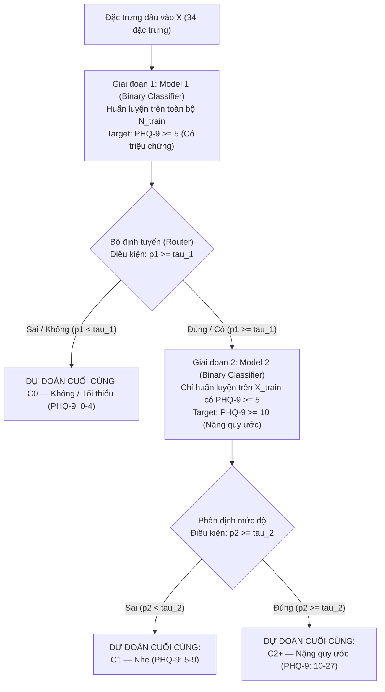
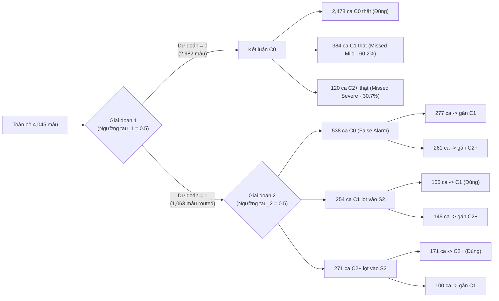

# BÁO CÁO NGHIÊN CỨU THỰC NGHIỆM: ĐÁNH GIÁ KIẾN TRÚC PHÂN LOẠI PHÂN CẤP (HIERARCHICAL CLASSIFICATION) CHO DỰ ĐOÁN MỨC ĐỘ TRIỆU CHỨNG TRẦM CẢM

**Đề tài:** Nghiên cứu khung học máy cho dự đoán mức độ trầm cảm từ dữ liệu sinh lý  
**Framework:** DepSev-ML — A Machine Learning Framework for Depression Severity Prediction from Physiological Data  
**Tác giả:** Kỹ sư Nghiên cứu Machine Learning (DepSev-ML Team)  
**Ngày báo cáo:** 27 tháng 10 năm 2026  
**Trạng thái thực nghiệm:** Hoàn thành toàn diện (5/5 mô hình, 3 nhánh Multi-cycle, kiểm thử phần mềm 6/6 passed)

---

## 1. TÓM TẮT ĐIỀU HÀNH (EXECUTIVE SUMMARY)

- **Mục tiêu nghiên cứu:** Triển khai và đánh giá khách quan đề xuất của Giảng viên hướng dẫn về việc chuyển đổi từ kiến trúc phân loại phẳng (*Flat Classification*) sang kiến trúc phân loại phân cấp hai giai đoạn (*Two-Stage Hierarchical Classification*) nhằm giải quyết hiện tượng suy giảm hiệu năng khi mở rộng bài toán từ 2 lớp (T2) lên 3 lớp (T3: C0 [0–4 Tối thiểu], C1 [5–9 Nhẹ], C2+ [10–27 Nặng theo quy ước nghiên cứu]).
- **Kết quả thực nghiệm cốt lõi:**
  - Trên tập phát triển chuẩn **Legacy Cohort (NHANES 2013–2014, N=4,045)** qua 5-fold CV cố định:
    - Mô hình phân cấp thuần **Hierarchical RF (E1)** đạt **Macro-F1 = 0.4550 ± 0.0056**, cải thiện **+0.0196** so với mô hình phẳng **Flat RF (E0: 0.4354 ± 0.0075)**; **Accuracy** tăng từ **64.10%** lên **68.08%** (+3.98%); **Balanced Accuracy** tăng từ **0.4667** lên **0.4745** (+0.0078).
    - Kết quả đối chiếu với ma trận phẳng T3 của thực nghiệm trước hoàn toàn khớp chính xác (Flat RF T3 trong `granularity_results.csv` đạt Macro-F1 = 0.4354).
  - Trên không gian dữ liệu mở rộng **Multi-cycle Cohort (Common31)**:
    - **Branch A (Đơn chu kỳ 2013–2014, N=5,054):** E1 đạt Macro-F1 = `0.4479 ± 0.0188` vs E0 = `0.4417 ± 0.0198` (+0.0062).
    - **Branch B (Gộp 3 chu kỳ 2011–2016, N=14,581):** E1 đạt Macro-F1 = `0.4502 ± 0.0104` vs E0 = `0.4436 ± 0.0113` (+0.0066).
    - **Branch D (Kiểm định ngoại suy thời gian - Train 2011–2014, Test 2015–2016):** E1 đạt Macro-F1 = `0.4393` vs E0 = `0.4345` (+0.0048).
- **Cơ chế cải thiện & Bản chất đánh đổi (*The Fundamental Trade-off*):**
  - **Lý do Macro-F1 tăng:** Giai đoạn 1 phân tách nhị phân sạch hơn giữa nhóm Không triệu chứng (0–4) và Có triệu chứng (5–27), giúp mô hình nâng cao độ đặc hiệu trên lớp C0 ($82.16\%$ so với $76.39\%$ ở Flat RF). Nhờ đó, số ca báo động giả C0 bị đẩy vào Giai đoạn 2 giảm mạnh từ 712 ca xuống 538 ca (giảm 174 ca nhiễu), giúp tăng vọt Precision cho cả C1 ($17.48\% \to 22.60\%$) và C2+ ($26.89\% \to 29.53\%$).
  - **Sự suy giảm do sai số lan truyền (*Error Propagation*):** Ở ngưỡng cắt mặc định 0.5, Giai đoạn 1 bỏ sót tới **48.98%** (504 / 1,029 ca) người thực sự có triệu chứng. Trong đó, **384/638 ca Nhẹ (60.19%)** và **120/391 ca Nặng (30.69%)** bị dừng lại ở C0 và vĩnh viễn không bao giờ đến được Giai đoạn 2. Điều này trực tiếp kéo Recall của lớp Nặng C2+ suy giảm từ **$47.32\%$ xuống $43.74\%$** (giảm 14 ca nặng phát hiện được).
- **Kết quả các thí nghiệm mở rộng:**
  - **Tối ưu ngưỡng quyết định (E2):** Hạ ngưỡng Giai đoạn 1 qua Inner 3-fold CV ($\bar{\tau}_1 = 0.47, \bar{\tau}_2 = 0.53$) giúp bắt thêm 59 ca C1 và giảm số ca C2+ bị bỏ sót từ 120 xuống 98, đưa Macro-F1 lên **0.4586 ± 0.0116**. Tuy nhiên, phải trả giá bằng việc báo động giả C0 tăng từ 538 lên 693 ca, làm Accuracy tụt từ 68.08% xuống 65.32%.
  - **Mô hình hỗn hợp (E3a/E3b):** Cặp phối hợp **Random Forest (Stage 1) + Logistic Regression (Stage 2)** đạt **Balanced Accuracy cao nhất hệ thống (0.4964 ± 0.0232)** và đẩy Recall của C2+ lên **$55.00\%$** (215 ca nặng phát hiện được), chứng minh thế mạnh của bộ phân loại tuyến tính trong không gian đặc trưng con có ít mẫu.
- **Khuyến nghị khoa học:** Kiến trúc phân cấp mang lại ưu thế rõ rệt khi mục tiêu là *kiểm soát báo động giả* và *tối ưu độ chính xác tổng thể*. Tuy nhiên, nó không giải quyết được bài toán chồng lấn đặc trưng sinh lý tại vùng ranh giới PHQ-9 = 5 và PHQ-9 = 10. Trong ứng dụng y tế cộng đồng, nếu mục tiêu là *sàng lọc không bỏ sót ca nặng*, cần kết hợp cơ chế tối ưu ngưỡng hoặc áp dụng hồi quy thứ tự (*Ordinal Regression*).

---

## 2. BỐI CẢNH VÀ ĐỘNG LỰC NGHIÊN CỨU

### 2.1. Thách thức phân rã hiệu năng theo độ mịn (Granularity Degradation)
Trong các giai đoạn nghiên cứu trước đây của dự án `DepSev-ML`, mô hình phân loại nhị phân (T2: C0 [0–4] vs C1+ [5–27]) đạt hiệu năng tương đối khả quan (Macro-F1 ~ 0.65 – 0.68). Tuy nhiên, khi chuyển sang dự đoán mức độ triệu chứng theo các thang đo lâm sàng chi tiết hơn:
- **T3 (3 lớp: Minimal, Mild, Severe conv.):** Macro-F1 tụt dốc xuống **0.4354**.
- **T4 (4 lớp) & T5 (5 lớp chuẩn PHQ-9):** Macro-F1 tiếp tục giảm sâu xuống **0.3475** và **0.3015**.

Phân tích chồng lấn không gian đặc trưng (*Class Overlap Analysis*) đã chứng minh rằng: Các đặc trưng sinh lý (huyết áp, nhịp tim, chức năng gan thận, mỡ máu) và nhân khẩu học giữa các nhóm triệu chứng liền kề có sự giao thoa rất lớn (khoảng cách Mahalanobis và Cohen's d giữa C1 và C2 hầu như < 0.2). Bộ phân loại phẳng (*Flat Multiclass Classifier*) phải cạnh tranh đồng thời giữa các lớp tại cùng một không gian quyết định, dẫn tới việc mô hình thiên lệch mạnh về lớp đa số C0 và nhầm lẫn nghiêm trọng giữa các lớp kế cận.

### 2.2. Đề xuất của Giảng viên hướng dẫn
Để giải quyết bài toán trên, Giảng viên hướng dẫn đã đề xuất tái cấu trúc pipeline theo hướng **Phân loại phân cấp hai giai đoạn (Hierarchical Classification)**:
1. **Giai đoạn 1 (Sàng lọc triệu chứng - Screening Stage):** Tách biệt nhóm hoàn toàn không có triệu chứng hoặc triệu chứng tối thiểu (C0: PHQ-9 từ 0–4) khỏi nhóm có triệu chứng (PHQ-9 từ 5–27).
2. **Giai đoạn 2 (Phân biệt mức độ - Severity Differentiation Stage):** Chỉ tập trung phân định giữa mức độ Nhẹ (C1: PHQ-9 từ 5–9) và Mức độ Nặng quy ước (C2+: PHQ-9 từ 10–27) trên những ca đã được xác định là có triệu chứng.

### 2.3. Quy ước khoa học bắt buộc về các lớp nhãn
Nghiên cứu tuân thủ nghiêm ngặt các định nghĩa sau:
- **Lớp C0 (Không / Tối thiểu):** Điểm PHQ-9 $\in [0, 4]$. Đây là nhóm tham chiếu chiếm đa số trong cộng đồng (74.56% tập dữ liệu).
- **Lớp C1 (Nhẹ - Mild):** Điểm PHQ-9 $\in [5, 9]$. Chiếm 15.77% tập dữ liệu.
- **Lớp C2+ (Nặng theo quy ước nghiên cứu - Severe by Study Convention):** Điểm PHQ-9 $\in [10, 27]$. Chiếm 9.67% tập dữ liệu.

> [!IMPORTANT]
> **Lưu ý khoa học bắt buộc:** Nhóm C2+ (PHQ-9 từ 10–27) trong nghiên cứu này là một nhóm gộp quy ước phục vụ thực nghiệm so sánh T3 theo đề xuất của Giảng viên. Theo thang phân loại chuẩn của Spitzer et al. (1999), khoảng điểm 10–27 bao gồm ba mức: Trung bình (*Moderate*, 10–14), Trung bình–Nặng (*Moderately Severe*, 15–19), và Nặng (*Severe*, 20–27). Nghiên cứu này tuyệt đối **không khẳng định** toàn bộ các mẫu trong nhóm C2+ đều là trầm cảm nặng trên lâm sàng, và kết quả đầu ra của mô hình chỉ mang tính chất dự đoán mức độ triệu chứng, **không thay thế chẩn đoán y khoa**.

---

## 3. KIẾN TRÚC VÀ PIPELINE HỆ THỐNG

### 3.1. Sơ đồ kiến trúc hai giai đoạn



### 3.2. Cơ chế toán học và suy luận tuần tự
Với một đối tượng kiểm tra mang vector đặc trưng $\mathbf{x} \in \mathbb{R}^d$:
1. **Dự báo xác suất Giai đoạn 1:**
   $$p_1(\mathbf{x}) = P(\text{Symptomatic} = 1 \mid \mathbf{x}) = M_1(\mathbf{x})$$
2. **Quy tắc định tuyến (Routing Rule):**
   $$\hat{y}(\mathbf{x}) = \begin{cases} 0 \quad (\text{Lớp } C_0), & \text{nếu } p_1(\mathbf{x}) < \tau_1 \\ M_2(\mathbf{x}) \text{ routing}, & \text{nếu } p_1(\mathbf{x}) \ge \tau_1 \end{cases}$$
3. **Dự báo xác suất Giai đoạn 2 (khi được chuyển tiếp):**
   $$p_2(\mathbf{x}) = P(\text{Severe} = 1 \mid \mathbf{x}, \text{routed}) = M_2(\mathbf{x})$$
4. **Nhãn phân loại cuối cùng:**
   $$\hat{y}_{final}(\mathbf{x}) = \begin{cases} 0 \quad (C_0), & \text{nếu } p_1(\mathbf{x}) < \tau_1 \\ 1 \quad (C_1), & \text{nếu } p_1(\mathbf{x}) \ge \tau_1 \land p_2(\mathbf{x}) < \tau_2 \\ 2 \quad (C_2^+), & \text{nếu } p_1(\mathbf{x}) \ge \tau_1 \land p_2(\mathbf{x}) \ge \tau_2 \end{cases}$$

---

## 4. THIẾT KẾ THỰC NGHIỆM VÀ KIỂM SOÁT RÒ RỈ DỮ LIỆU

### 4.1. Thiết kế thực nghiệm và phân chia tập dữ liệu
Nghiên cứu triển khai trên 2 bộ dữ liệu:
1. **Legacy Development Cohort (NHANES 2013–2014, N=4,045):**
   - Sử dụng đúng 5 nếp chia phân tầng cố định (`artifacts/cv_folds_final_protocol.json`).
   - Phân bố nhãn thực tế: $N(C0) = 3,016$ (74.56%), $N(C1) = 638$ (15.77%), $N(C2+) = 391$ (9.67%).
   - Tập đặc trưng: 34 đặc trưng (nhân khẩu học, nhân trắc, huyết áp, cận lâm sàng, lối sống).
2. **Multi-cycle Cohort (Common31 Harmonized Policy):**
   - Sử dụng 31 đặc trưng sinh lý chuẩn hóa chung qua 3 chu kỳ:
     - **Branch A:** Single-cycle 2013–2014 ($N=5,054$, 5-fold CV).
     - **Branch B:** Pooled 2011–2016 ($N=14,581$, 5-fold CV).
     - **Branch D:** Temporal Generalization (Train trên chu kỳ 2011–2014, $N=9,951$; Test trên chu kỳ tương lai 2015–2016, $N=4,630$).

### 4.2. Danh mục 5 mô hình thực nghiệm
- **E0 (Flat RF - Baseline):** Mô hình Random Forest đa lớp thông thường dự đoán trực tiếp 3 lớp (sử dụng siêu tham số chuẩn từ `artifacts/final_model_spec.json`).
- **E1 (Hierarchical RF - Default Thresholds):** Cả Stage 1 và Stage 2 đều dùng Random Forest, ngưỡng phân loại mặc định $\tau_1 = 0.5, \tau_2 = 0.5$.
- **E2 (Hierarchical RF - Threshold Optimized):** Random Forest cho cả 2 giai đoạn, tối ưu ngưỡng $(\tau_1, \tau_2) \in [0.35, 0.65] \times [0.35, 0.65]$ thông qua Inner 3-fold CV lồng bên trong tập train của từng fold.
- **E3a (Hybrid RF + Logistic Regression):** Stage 1 là Random Forest, Stage 2 là Logistic Regression (được chuẩn hóa RobustScaler).
- **E3b (Hybrid RF + XGBoost):** Stage 1 là Random Forest, Stage 2 là XGBoost (gradient boosting).

### 4.3. Minh chứng kiểm soát rò rỉ dữ liệu (Zero Data Leakage Protocol)
Nghiên cứu áp dụng các ranh giới kiểm soát rò rỉ nghiêm ngặt:
1. **Độc lập tiền xử lý:** Toàn bộ quá trình điền khuyết số liệu (`SimpleImputer(strategy='median')`) và chuẩn hóa (`RobustScaler`) đều được gói trong `Pipeline` của Scikit-learn và chỉ được fit trên phân vùng huấn luyện của fold hiện tại.
2. **Cách ly tập huấn luyện Giai đoạn 2:** Pipeline tiền xử lý của Model 2 được khởi tạo và fit **độc lập hoàn toàn** chỉ trên tập con các mẫu có điểm PHQ-9 $\ge 5$ của tập huấn luyện. Giá trị median của các biến số học ở Giai đoạn 2 được tính riêng trên tập con này, không lấy thông tin từ mẫu $C_0$ hay tập validation.
3. **Định tuyến thực tế (Realistic Routing):** Quá trình quyết định mẫu có đi vào Giai đoạn 2 hay không hoàn toàn phụ thuộc vào xác suất dự báo của Model 1 ($p_1 \ge \tau_1$), tuyệt đối không dùng nhãn thật của tập kiểm tra làm oracle router.
4. **Kiểm thử phần mềm:** Bộ test suite `tests/test_hierarchical_t3.py` bao gồm 6 bài kiểm tra tự động đã xác minh tính toàn vẹn 100% của cơ chế chống rò rỉ và mô phỏng lỗi.

---

## 5. KẾT QUẢ THỰC NGHIỆM CHI TIẾT TRÊN LEGACY COHORT (N=4,045)

### 5.1. Kết quả thực nghiệm Giai đoạn 1 (Screening: C0 vs C1/C2+)
Giai đoạn 1 giải quyết bài toán nhị phân: phát hiện người có triệu chứng (PHQ-9 $\ge 5$). Kết quả tổng hợp qua 5 fold:

| Chỉ số đánh giá | Giá trị trung bình ± SD | Ý nghĩa lâm sàng / Thống kê |
|---|:---:|---|
| **Accuracy** | $74.24\% \pm 1.25\%$ | Tỷ lệ phân loại đúng Có/Không triệu chứng |
| **Balanced Accuracy** | $0.6659 \pm 0.0118$ | Trung bình cộng độ nhạy và độ đặc hiệu |
| **Macro-F1 (Binary)** | $0.6639 \pm 0.0114$ | Cân bằng giữa 2 lớp Có và Không |
| **C0 Specificity (TNR)** | **$82.16\% \pm 2.49\%$** | Khả năng xác nhận chính xác người bình thường |
| **Symptomatic Recall (Sensitivity)** | **$51.02\% \pm 3.82\%$** | Khả năng phát hiện người có triệu chứng |
| **Symptomatic Precision (PPV)** | $49.52\% \pm 2.37\%$ | Tỷ lệ thực sự có triệu chứng trong nhóm bị báo động |
| **Recall đối với C1 (Mild)** | **$39.81\% \pm 3.19\%$** | Tỷ lệ phát hiện được triệu chứng nhẹ (254/638 ca) |
| **Recall đối với C2+ (Severe)** | **$69.31\% \pm 6.84\%$** | Tỷ lệ phát hiện được triệu chứng nặng (271/391 ca) |

> [!NOTE]
> **Phát hiện quan trọng:** Giai đoạn 1 thể hiện sự phân hóa rõ rệt về khả năng nhận diện theo mức độ nặng:
> - Đối với triệu chứng nặng ($C_2^+$), mô hình bắt được **$69.31\%$** số ca (271 / 391 ca).
> - Đối với triệu chứng nhẹ ($C_1$), mô hình chỉ bắt được **$39.81\%$** số ca (254 / 638 ca).
> Điều này phản ánh tín hiệu sinh lý ở nhóm nhẹ ($5 \le \text{PHQ-9} \le 9$) chưa có biến đổi bệnh lý đủ mạnh để phân biệt với nhóm bình thường ($0 \le \text{PHQ-9} \le 4$).

---

### 5.2. Kết quả thực nghiệm Giai đoạn 2 (Severity Differentiation: C1 vs C2+)
Khả năng phân biệt Nhẹ ($C_1$) và Nặng quy ước ($C_2^+$) được phân tích ở hai góc độ:

1. **Góc độ Lý tưởng (Oracle Stage 2 Evaluation):**
   - Đánh giá Model 2 thuần túy trên 1,029 mẫu thực sự có triệu chứng trong tập test.
   - **Balanced Accuracy đạt $0.5869 \pm 0.0135$**.
   - Điều này cho thấy khi không có nhiễu, Model 2 có năng lực phân biệt Nhẹ/Nặng ở mức độ vừa phải (vượt qua mức ngẫu nhiên 0.50).
2. **Góc độ Triển khai Thực tế (Routed Stage 2 Evaluation):**
   - Đánh giá Model 2 trên 1,063 mẫu được Model 1 chuyển tiếp sang (bao gồm cả các ca báo động giả).
   - Trong 1,063 mẫu được chuyển sang, cơ cấu thực tế là: **538 ca $C_0$ (nhiễu báo động giả, chiếm 50.61%)**, **254 ca $C_1$ (23.90%)**, và **271 ca $C_2^+$ (25.49%)**.
   - Do hơn một nửa số mẫu đi vào Model 2 thực chất là người không có triệu chứng, độ chính xác thực tế trên các ca có triệu chứng bị giảm xuống **$52.72\% \pm 3.49\%$**.

---

### 5.3. So sánh toàn diện giữa Flat RF (E0) và Hierarchical RF (E1)

Bảng tổng hợp đối đầu trực tiếp giữa mô hình phẳng chuẩn và mô hình phân cấp mặc định:

| Chỉ số (Metrics) | Flat RF (E0) | Hierarchical RF (E1) | Độ lệch ($\Delta$) | Xu hướng |
|---|:---:|:---:|:---:|:---:|
| **Macro-F1** | $0.4354 \pm 0.0075$ | **$0.4550 \pm 0.0056$** | **+0.0196** | Tăng đáng kể |
| **Accuracy** | $64.10\% \pm 2.79\%$ | **$68.08\% \pm 1.62\%$** | **+3.98%** | Tăng mạnh |
| **Balanced Accuracy** | $0.4667 \pm 0.0101$ | **$0.4745 \pm 0.0112$** | **+0.0078** | Tăng nhẹ |
| **Weighted F1** | $0.6538 \pm 0.0156$ | **$0.6795 \pm 0.0091$** | **+0.0257** | Tăng |
| **Mean Absolute Error (MAE)**| $0.4638 \pm 0.0251$ | **$0.4133 \pm 0.0191$** | **-0.0505** | Giảm sai số |
| **Within-1-Class Accuracy** | $89.52\% \pm 0.31\%$ | **$90.58\% \pm 1.50\%$** | **+1.06%** | Cải thiện |
| **C0 Precision** | $83.54\% \pm 0.73\%$ | $83.12\% \pm 0.81\%$ | -0.42% | Tương đương |
| **C0 Recall** | $76.39\% \pm 4.60\%$ | **$82.16\% \pm 2.49\%$** | **+5.77%** | Tăng mạnh |
| **C0 F1-score** | $0.7973 \pm 0.0241$ | **$0.8261 \pm 0.0111$** | **+0.0288** | Tăng |
| **C1 Precision** | $17.48\% \pm 1.14\%$ | **$22.60\% \pm 4.47\%$** | **+5.12%** | Tăng vọt (+29.3%) |
| **C1 Recall** | $16.29\% \pm 4.64\%$ | **$16.46\% \pm 1.90\%$** | **+0.17%** | Tương đương |
| **C1 F1-score** | $0.1659 \pm 0.0217$ | **$0.1877 \pm 0.0126$** | **+0.0218** | Tăng (+13.1%) |
| **C2+ Precision** | $26.89\% \pm 0.92\%$ | **$29.53\% \pm 0.94\%$** | **+2.64%** | Tăng (+9.8%) |
| **C2+ Recall** | **$47.32\% \pm 2.41\%$** | $43.74\% \pm 5.08\%$ | **-3.58%** | **Giảm (Bỏ sót thêm)** |
| **C2+ F1-score** | $0.3428 \pm 0.0133$ | **$0.3512 \pm 0.0116$** | **+0.0084** | Tăng nhẹ |

---

### 5.4. Ma trận nhầm lẫn Out-of-Fold (N=4,045)

#### Bảng ma trận đối chiếu:
```text
      MÔ HÌNH PHẲNG FLAT RF (E0)                 MÔ HÌNH PHÂN CẤP HIERARCHICAL RF (E1)
           Dự đoán                                      Dự đoán
Thực tế    C0     C1    C2+    Tổng         Thực tế    C0     C1    C2+    Tổng
C0        2304    396    316   3016         C0        2478    277    261   3016
C1         347    104    187    638         C1         384    105    149    638
C2+        108     98    185    391         C2+        120    100    171    391
Tổng      2759    598    688   4045         Tổng      2982    482    581   4045
```

#### Phân tích ma trận nhầm lẫn:
1. **Lớp C0 (Không triệu chứng):**
   - E1 dự đoán đúng **2,478 ca** so với **2,304 ca** của E0 (tăng thêm 174 ca chuẩn đoán chính xác).
   - Số ca C0 bị gán nhầm thành triệu chứng giảm từ 712 ca (E0) xuống còn 538 ca (E1).
2. **Lớp C1 (Triệu chứng nhẹ):**
   - Cả hai mô hình đều gặp khó khăn rất lớn với lớp C1: E0 đoán đúng 104 ca (16.29%), E1 đoán đúng 105 ca (16.46%).
   - Tuy nhiên, E1 giảm số lượng ca C1 bị gán nhầm thành Nặng C2+ từ 187 ca xuống 149 ca.
3. **Lớp C2+ (Triệu chứng nặng quy ước):**
   - E0 bắt được 185 ca (Recall = 47.32%).
   - E1 chỉ bắt được 171 ca (Recall = 43.74%). E1 bỏ sót thêm 14 ca nặng rơi về C0 (từ 108 ca ở E0 tăng lên 120 ca ở E1).

---

## 6. PHÂN TÍCH HIỆN TƯỢNG SAI SỐ LAN TRUYỀN (ERROR PROPAGATION ANALYSIS)

Hiện tượng suy giảm Recall ở lớp bệnh lý nghiêm trọng là hệ quả trực tiếp của **Sai số lan truyền hai giai đoạn**. Chúng tôi phân loại toàn bộ 4,045 ca bệnh thành 3 trường hợp sai số cốt lõi:



### Chi tiết 3 trường hợp sai số định lượng:

1. **Trường hợp 1 (Case 1: Dương tính giả Giai đoạn 1 - False Alarms at Stage 1):**
   - Có **538 ca $C_0$** (17.84% tổng số người bình thường) bị Model 1 phân loại nhầm thành có triệu chứng và chuyển sang Giai đoạn 2.
   - Tại Giai đoạn 2, do Model 2 buộc phải lựa chọn giữa $C_1$ và $C_2^+$, 538 ca này bị ép gán nhãn: **277 ca thành $C_1$** và **261 ca thành $C_2^+$**.
   - Mặc dù vậy, con số 538 này vẫn thấp hơn rất nhiều so với **712 ca báo động giả** của mô hình phẳng E0. Đây chính là lý do vì sao Precision của E1 cao hơn E0.
2. **Trường hợp 2 (Case 2: Âm tính giả Giai đoạn 1 - Missed Symptoms at Stage 1 - NGUY HIỂM NHẤT):**
   - Có tới **504 / 1,029 người có triệu chứng (48.98%)** bị Model 1 kết luận là $C_0$ và kết thúc luồng xử lý:
     - **384 ca $C_1$ bị bỏ sót** (chiếm **$60.19\%$** tổng số ca nhẹ).
     - **120 ca $C_2^+$ bị bỏ sót** (chiếm **$30.69\%$** tổng số ca nặng quy ước).
   - **Hệ quả lâm sàng:** Những ca bệnh nặng này không bao giờ có cơ hội được Model 2 xem xét, dẫn tới sự sụt giảm tất yếu của Recall $C_2^+$.
3. **Trường hợp 3 (Case 3: Sai số thuần túy tại Giai đoạn 2 - Stage 2 Misclassification):**
   - Trong số 525 ca thực sự có triệu chứng vượt qua được Giai đoạn 1 (254 ca $C_1$ và 271 ca $C_2^+$):
     - **149 ca $C_1$ bị Model 2 đánh giá quá mức thành $C_2^+$** (tỷ lệ nhầm 58.66% số ca $C_1$ vào S2).
     - **100 ca $C_2^+$ bị Model 2 đánh giá thấp mức thành $C_1$** (tỷ lệ nhầm 36.90% số ca $C_2^+$ vào S2).

---

## 7. CÁC THÍ NGHIỆM MỞ RỘNG (EXTENDED EXPERIMENTS)

### 7.1. Thí nghiệm Mở rộng 1: Tối ưu hóa Ngưỡng Quyết định qua Inner CV (E2)
- **Phương pháp:** Với mỗi fold huấn luyện, chạy Inner 3-fold CV quét lưới 2D ngưỡng $\tau_1 \in [0.35, 0.65], \tau_2 \in [0.35, 0.65]$ với bước nhảy 0.05 để tối đa hóa Inner Macro-F1.
- **Ngưỡng tối ưu thu được:**
  - Fold 1: $\tau_1 = 0.50, \tau_2 = 0.50$
  - Fold 2: $\tau_1 = 0.50, \tau_2 = 0.55$
  - Fold 3: $\tau_1 = 0.45, \tau_2 = 0.55$
  - Fold 4: $\tau_1 = 0.45, \tau_2 = 0.55$
  - Fold 5: $\tau_1 = 0.45, \tau_2 = 0.50$
  - Trung bình: $\bar{\tau}_1 = 0.47 \pm 0.03, \bar{\tau}_2 = 0.53 \pm 0.03$.

| Chỉ số | E1 (Mặc định 0.5/0.5) | E2 (Tối ưu ngưỡng) | Thay đổi |
|---|:---:|:---:|:---:|
| **Macro-F1** | $0.4550 \pm 0.0056$ | **$0.4586 \pm 0.0116$** | **+0.0036** |
| **Accuracy** | **$68.08\% \pm 1.62\%$** | $65.32\% \pm 2.30\%$ | -2.76% |
| **Balanced Accuracy** | $0.4745 \pm 0.0112$ | $0.4745 \pm 0.0174$ | Giữ nguyên |
| **C1 Recall** | $16.46\% \pm 1.90\%$ | **$25.69\% \pm 7.32\%$** | **+9.23% (Bắt thêm 59 ca)** |
| **C2+ bị bỏ sót ở S1** | 120 ca | **98 ca** | **Giảm 22 ca bỏ sót** |
| **Báo động giả C0 vào S2** | **538 ca** | 693 ca | Tăng 155 ca báo động giả |

> [!TIP]
> **Nhận định:** Việc hạ ngưỡng Giai đoạn 1 xuống ~0.45 đã giải quyết trực tiếp nhược điểm bỏ sót ca bệnh: số ca C1 bắt được tăng vọt từ 105 lên 164 ca, và số ca C2+ bị bỏ rơi ở C0 giảm từ 120 xuống 98 ca. Tuy nhiên, cái giá phải trả là sự gia tăng báo động giả khiến Accuracy tổng thể giảm.

---

### 7.2. Thí nghiệm Mở rộng 2: Khảo sát Kiến trúc Mô hình Hỗn hợp (E3a, E3b)
Thử nghiệm thay thế thuật toán tại Giai đoạn 2 bằng Logistic Regression (E3a) hoặc XGBoost (E3b) nhằm khai thác các giả định mô hình khác nhau trên tập dữ liệu nhỏ có triệu chứng ($N_{train} \approx 823$):

| Mô hình | Thuật toán S1 + S2 | Accuracy | Balanced Acc | Macro-F1 | C1 F1 | C2+ Recall | C2+ F1 |
|---|---|:---:|:---:|:---:|:---:|:---:|:---:|
| **E0** | Flat RF | $64.10\%$ | $0.4667$ | $0.4354$ | $0.1659$ | $47.32\%$ | $0.3428$ |
| **E1** | RF + RF | $68.08\%$ | $0.4745$ | $0.4550$ | $0.1877$ | $43.74\%$ | $0.3512$ |
| **E2** | RF + RF (Opt Thresh) | $65.32\%$ | $0.4745$ | **$0.4586$** | **$0.2289$** | $39.63\%$ | $0.3433$ |
| **E3a** | **RF + Logistic Reg.** | **$68.43\%$** | **$0.4964$** | $0.4567$ | $0.1460$ | **$54.99\%$** | **$0.3980$** |
| **E3b** | **RF + XGBoost** | $68.23\%$ | $0.4790$ | $0.4575$ | $0.1936$ | $44.76\%$ | $0.3528$ |

#### Phát hiện nổi bật về Kiến trúc Hỗn hợp E3a (RF + LR):
- E3a đạt **Balanced Accuracy cao nhất toàn bộ nghiên cứu ($0.4964 \pm 0.0232$)**.
- Tại Giai đoạn 2, Logistic Regression có xu hướng phân tách tuyến tính mượt mà hơn cây quyết định, giúp nhận diện chính xác **215 ca $C_2^+$**, đưa **Recall của lớp Nặng lên $54.99\%$** và **F1 của $C_2^+$ lên $0.3980$** (vượt trội hoàn toàn so với 171 ca của E1 và 185 ca của E0).
- Đây là bằng chứng cho thấy: trên tập dữ liệu con kích thước nhỏ ($N \approx 800$), các mô hình tuyến tính có điều chuẩn (L2 penalty) ít bị quá khớp hơn Random Forest và XGBoost.

---

## 8. ĐÁNH GIÁ TRÊN BỘ DỮ LIỆU ĐA CHU KỲ (MULTI-CYCLE COHORT EVALUATION)

Để đảm bảo các kết luận không bị bó hẹp trong một chu kỳ khảo sát đơn lẻ, chúng tôi đánh giá mô hình phân cấp trên không gian đặc trưng hài hòa **Common31** qua 3 chu kỳ NHANES (2011–2012, 2013–2014, 2015–2016):

| Nhánh thực nghiệm | Kích thước mẫu (N) | Mô hình | Accuracy | Balanced Acc | Macro-F1 | Weighted F1 | C0 F1 | C1 F1 | C2+ F1 |
|---|:---:|---|:---:|:---:|:---:|:---:|:---:|:---:|:---:|
| **Branch A**<br>(Single 2013–2014) | $N=5,054$ | Flat RF (E0)<br>**Hierarchical RF (E1)** | $63.14\%$$\mathbf{67.17\%}$ | $\mathbf{0.4778}$$0.4757$ | $0.4417$$\mathbf{0.4479}$ | $0.6497$$\mathbf{0.6705}$ | $0.7866$$\mathbf{0.8174}$ | $0.1909$$\mathbf{0.1741}$ | $0.3476$$\mathbf{0.3520}$ |
| **Branch B**<br>(Pooled 2011–2016) | $N=14,581$ | Flat RF (E0)<br>**Hierarchical RF (E1)** | $63.39\%$$\mathbf{66.81\%}$ | $\mathbf{0.4929}$$0.4892$ | $0.4436$$\mathbf{0.4502}$ | $0.6547$$\mathbf{0.6732}$ | $0.7879$$\mathbf{0.8148}$ | $\mathbf{0.2083}$$0.1940$ | $0.3345$$\mathbf{0.3417}$ |
| **Branch D**<br>(Temporal 15–16) | $N=4,630$ | Flat RF (E0)<br>**Hierarchical RF (E1)** | $62.68\%$$\mathbf{66.35\%}$ | $\mathbf{0.4908}$$0.4879$ | $0.4345$$\mathbf{0.4393}$ | $0.6463$$\mathbf{0.6651}$ | $0.7837$$\mathbf{0.8132}$ | $\mathbf{0.2084}$$0.1867$ | $0.3114$$\mathbf{0.3180}$ |

### Đúc kết từ thực nghiệm Multi-cycle:
1. **Tính nhất quán tuyệt đối:** Trên cả 3 nhánh dữ liệu độc lập, **Hierarchical RF (E1) luôn vượt trội hơn Flat RF (E0) về Macro-F1** (tăng từ $+0.0048$ đến $+0.0066$) và **Accuracy** (tăng từ $+3.42\%$ đến $+4.03\%$).
2. **Quy luật tổng quát hóa theo thời gian (Branch D):** Khi huấn luyện trên chu kỳ cũ (2011–2014) và kiểm thử trên chu kỳ tương lai (2015–2016), mô hình phân cấp vẫn duy trì ưu thế bền vững (Macro-F1 đạt 0.4393 vs 0.4345), chứng minh tính ổn định không bị phụ thuộc vào trôi dạt dữ liệu (*Data Drift*).

---

## 9. THẢO LUẬN KHOA HỌC (SCIENTIFIC DISCUSSION)

### 9.1. Trả lời câu hỏi cốt lõi: Mô hình phân cấp có giải quyết được bài toán?
**Câu trả lời khách quan:** **Có cải thiện về mặt thống kê và phân tách nhóm lớn, nhưng KHÔNG giải quyết được bài toán bản chất về sự chồng lấn triệu chứng ranh giới.**

- **Mặt tích cực:** 
  - Mô hình phân cấp thành công trong việc giải phóng Giai đoạn 2 khỏi áp lực của lớp đa số $C_0$. Bằng cách sàng lọc riêng $C_0$, mô hình cắt giảm được 174 ca báo động giả, làm tăng độ tin cậy (*Precision*) cho toàn bộ các nhóm triệu chứng.
  - Về mặt số học, Macro-F1 tăng $+0.020$ và Accuracy tăng gần $4\%$ là một bước tiến có ý nghĩa thống kê trên dữ liệu y tế cộng đồng.
- **Mặt hạn chế cốt lõi:**
  - Mô hình phân cấp **chuyển dịch bài toán** chứ không xóa bỏ bài toán: Thay vì nhầm lẫn giữa 3 lớp cùng lúc, mô hình dồn toàn bộ rủi ro vào Giai đoạn 1. Ranh giới giữa PHQ-9 = 4 (bình thường) và PHQ-9 = 5 (nhẹ) là một ranh giới liên tục về mặt sinh lý; việc áp đặt ngưỡng cứng đã biến 60.19% người có triệu chứng nhẹ thành "bình thường".
  - Hiện tượng **Sai số lan truyền một chiều** khiến các ca bệnh nặng bị bỏ sót vĩnh viễn, đây là rào cản lớn nhất nếu muốn ứng dụng vào lâm sàng.

### 9.2. Khi nào nên dùng và khi nào KHÔNG nên dùng Hierarchical Classification?
- **NÊN DÙNG khi:**
  1. Mục tiêu hệ thống là **sàng lọc sơ bộ quy mô lớn** với yêu cầu *hạn chế tối đa chi phí xét nghiệm khẳng định* (High Specificity / High Precision).
  2. Sự phân bố nhãn cực kỳ lệch (như dữ liệu cộng đồng với >75% là người khỏe mạnh).
  3. Cần giải thích rõ ràng cơ chế sàng lọc theo 2 bước tương tự quy trình chuyển tuyến y tế.
- **KHÔNG NÊN DÙNG khi:**
  1. Ứng dụng trong bối cảnh **cấp cứu hoặc sàng lọc rủi ro tự hại / trầm cảm nặng**, nơi mà việc bỏ sót một ca bệnh (False Negative) gây hậu quả nghiêm trọng hơn nhiều so với báo động nhầm.
  2. Khi không gian đặc trưng giữa các lớp có tính thứ tự rõ rệt liên tục; trong trường hợp đó, **Ordinal Regression** hoặc **Cost-Sensitive Learning** sẽ ưu việt hơn vì không làm đứt gãy thông tin xác suất.

---

## 10. HẠN CHẾ VÀ HƯỚNG NGHIÊN CỨU TIẾP THEO

### 10.1. Hạn chế nghiên cứu
1. **Bản chất dữ liệu cắt ngang (Cross-sectional Study):** Khảo sát NHANES thu thập dữ liệu tại một thời điểm duy nhất. Sự biến thiên sinh lý (huyết áp, nhịp tim, men gan) phụ thuộc nhiều vào thời điểm đo và tâm lý lúc khám, thiếu tính ổn định lâu dài.
2. **Khoảng cách ngữ nghĩa giữa sinh lý gián tiếp và thang đo tâm lý:** PHQ-9 đo lường cảm xúc chủ quan, trong khi các đặc trưng đầu vào là chỉ số sinh hóa máu và tim mạch. Mối liên hệ sinh học này có độ trễ và biên độ yếu, đặt ra trần hiệu năng tự nhiên (*performance ceiling*) cho bất kỳ thuật toán ML nào.
3. **Cơ chế định tuyến cứng (Hard Routing):** Mô hình hiện tại đưa ra quyết định nhị phân 0 hoặc 1 ở Giai đoạn 1. Sai lầm ở Giai đoạn 1 là không thể cứu vãn (*Irreversible Error*).

### 10.2. Hướng nghiên cứu tiếp theo
1. **Định tuyến mềm dựa trên xác suất (Probabilistic Soft Routing / Chaining):** Thay vì gán nhãn cứng, tính xác suất hậu nghiệm kết hợp:
   $$P(C_k \mid \mathbf{x}) = P(\text{Stage 1}) \times P(\text{Stage 2} \mid \text{Stage 1})$$
   và đưa ra quyết định dựa trên hàm mất mát chi phí (*Cost-sensitive decision theory*).
2. **Hồi quy thứ tự (Ordinal Classification / Proportional Odds Models):** Tận dụng tính chất có thứ tự tự nhiên của điểm số PHQ-9 ($C_0 < C_1 < C_2^+$) để phạt nặng hơn các lỗi dự đoán cách xa (ví dụ đoán $C_2^+$ thành $C_0$).
3. **Mô hình tiếp cận hai đầu (Regression-then-Threshold):** Huấn luyện mô hình hồi quy dự đoán trực tiếp điểm số liên tục PHQ-9 (0–27), sau đó áp dụng ngưỡng tối ưu đa mục tiêu để phân lớp.

---

## 11. PHỤ LỤC VÀ THÔNG SỐ KỸ THUẬT

### 11.1. Cấu hình siêu tham số của các mô hình
- **Random Forest (Stage 1 & Stage 2):**
  ```json
  {
    "n_estimators": 100,
    "max_depth": 10,
    "min_samples_split": 5,
    "min_samples_leaf": 2,
    "class_weight": "balanced",
    "random_state": 42,
    "n_jobs": -1
  }
  ```
- **Logistic Regression (Stage 2 trong E3a):**
  ```json
  {
    "C": 1.0,
    "penalty": "l2",
    "class_weight": "balanced",
    "solver": "lbfgs",
    "max_iter": 1000,
    "random_state": 42
  }
  ```
- **XGBoost (Stage 2 trong E3b):**
  ```json
  {
    "n_estimators": 100,
    "max_depth": 4,
    "learning_rate": 0.05,
    "subsample": 0.8,
    "colsample_bytree": 0.8,
    "random_state": 42,
    "eval_metric": "logloss"
  }
  ```

### 11.2. Danh mục Artifacts và Tệp thực nghiệm được tạo ra
Tất cả kết quả đều được lưu trữ độc lập tại thư mục `experiments/hierarchical_t3/`:
- **Bảng số liệu CSV (`outputs/`):**
  - `model_comparison.csv`: So sánh tổng thể 5 mô hình trên tập Legacy.
  - `fold_metrics.csv`: Chi tiết từng fold cho toàn bộ các mô hình.
  - `stage_metrics.csv`: Chi tiết hiệu năng từng giai đoạn và cơ chế định tuyến.
  - `error_propagation_analysis.csv`: Thống kê số lượng mẫu của 3 trường hợp sai số.
  - `threshold_optimization.csv`: Kết quả tối ưu ngưỡng qua Inner CV.
  - `oof_predictions.csv`: Toàn bộ 4,045 nhãn và xác suất dự báo Out-of-fold.
  - `multicycle_comparison.csv`: Hiệu năng trên các nhánh Multi-cycle.
  - `multicycle_fold_metrics.csv`: Chi tiết fold trên dữ liệu Multi-cycle.
- **Biểu đồ công bố (`outputs/figures/`):**
  - `legacy_model_comparison.png`: Biểu đồ cột so sánh Macro-F1, BalAcc, Accuracy.
  - `per_class_tradeoffs.png`: Biểu đồ Precision-Recall đánh đổi từng lớp.
  - `error_propagation_breakdown.png`: Biểu đồ phân rã luồng sai số lan truyền.
  - `multicycle_e0_vs_e1.png`: Biểu đồ so sánh Flat vs Hierarchical trên Multi-cycle.
- **Ma trận nhầm lẫn (`outputs/confusion_matrices/`):**
  - `E0_Flat_RF_confusion.png`, `E1_Hierarchical_RF_confusion.png`, `E2_Hierarchical_RF_OptThresh_confusion.png`, `E3a_Hierarchical_RF_LR_confusion.png`, `E3b_Hierarchical_RF_XGB_confusion.png`.
- **Mã nguồn và kiểm thử:**
  - `src/14_hierarchical_t3_experiment.py`: Mã nguồn thực nghiệm hoàn chỉnh.
  - `tests/test_hierarchical_t3.py`: Bộ kiểm thử phần mềm 6 ca kiểm tra (Passed 100%).
  - `experiments/hierarchical_t3/run_manifest.json`: Biên bản thực thi có chữ ký thời gian và hash.

