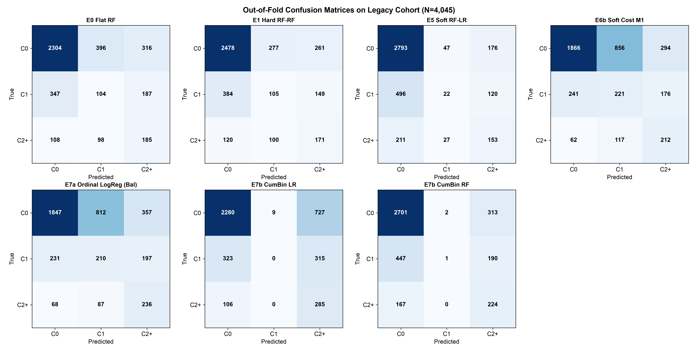
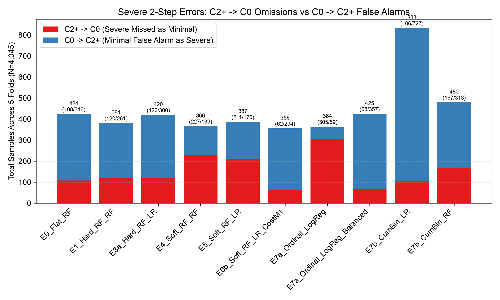
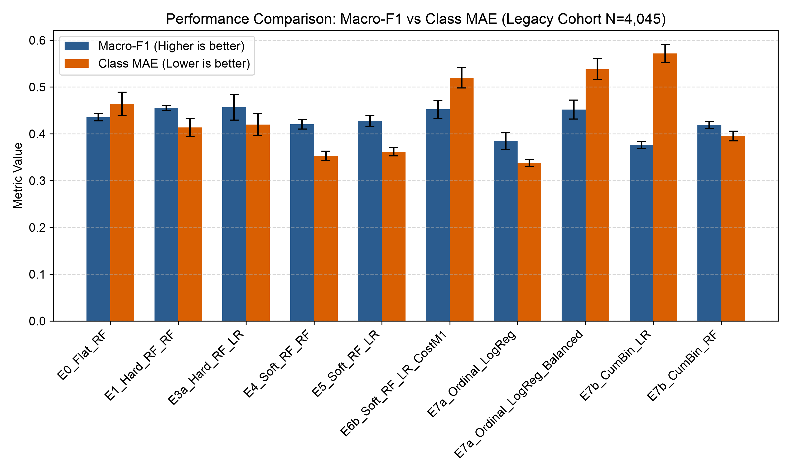

# BÁO CÁO NGHIÊN CỨU KHOA HỌC: TRIỂN KHAI VÀ ĐÁNH GIÁ ORDINAL CLASSIFICATION TRÊN FRAMEWORK DEPSEV-ML

**Đề tài:** Nghiên cứu khung học máy cho dự đoán mức độ trầm cảm từ dữ liệu sinh lý  
**Framework:** DepSev-ML — A Machine Learning Framework for Depression Severity Prediction from Physiological Data  
**Chủ thể thực hiện:** Senior Machine Learning Research Engineer (DepSev-ML Team)  
**Ngày hoàn thành:** 27 tháng 10 năm 2026  
**Thư mục lưu trữ thực nghiệm:** [`experiments/ordinal_t3/`](file:///Users/nguyenanhson/DepSev-ML/experiments/ordinal_t3/)  
**Trạng thái nghiên cứu:** ĐÃ HOÀN TẤT TOÀN DIỆN (E7a, E7b, Baseline E0–E6, Multi-cycle Branch A, B, D, 10/10 Unit Tests Passed)

---

## 1. TÓM TẮT NGHIÊN CỨU (EXECUTIVE SUMMARY)

- **Mục tiêu nghiên cứu:** Nghiên cứu này nhằm giải quyết câu hỏi khoa học cốt lõi: *Liệu việc khai thác trực tiếp bản chất thứ bậc tự nhiên của thang đo trầm cảm PHQ-9 ($C_0 < C_1 < C_2^+$) thông qua Ordinal Classification (Phân loại thứ bậc) có khắc phục được các nhược điểm của Flat Classification (E0) và Hierarchical Classification (E1–E6) hay không?*
- **Hai phương pháp Ordinal được hiện thực:**
  1. **E7a – Ordinal Logistic Regression (Proportional Odds / Cumulative Logit Model):** Mô hình hóa xác suất tích lũy $P(Y \le k \mid \mathbf{x}) = \sigma(\theta_k - \mathbf{w}^T \mathbf{x})$ với ràng buộc tái tham số hóa mũ $\theta_1 = \theta_0 + e^\delta$ bảo đảm ngưỡng đơn điệu nghiêm ngặt ($\theta_0 < \theta_1$), loại bỏ hoàn toàn hiện tượng giao cắt xác suất (crossing probabilities).
  2. **E7b – Cumulative Binary Classification (Frank & Hall 2001):** Huấn luyện hai bộ phân loại độc lập dự đoán $q_1 = P(Y \ge 1 \mid \mathbf{x})$ và $q_2 = P(Y \ge 2 \mid \mathbf{x})$. Phát hiện vi phạm đơn điệu ($q_2 > q_1$) và hiệu chỉnh bằng phép chiếu bình phương tối thiểu (least-squares isotonic projection) $q_1' = q_2' = (q_1 + q_2) / 2$.
- **Phát hiện thực nghiệm chủ đạo:**
  1. **Hiệu năng Balanced Accuracy kỷ lục:** Mô hình `E7a_Ordinal_LogReg_Balanced` đạt **Balanced Accuracy = 0.5151 ± 0.0276** trên Legacy Cohort ($N=4.045$), vượt qua tất cả các mô hình đã từng thử nghiệm trong dự án (E0: 0.4667, E1: 0.4745, E3a: 0.4964, E4: 0.4309, E5: 0.4506, E6b: 0.5025). Ưu thế này được bảo toàn bền vững trên Multi-cycle Branch A ($N=5.054$: 0.5005), Branch B ($N=14.581$: 0.5081) và Temporal Evaluation Branch D ($N=4.888$: 0.5073).
  2. **Bảo tồn độ nhạy nhóm Nặng quy ước ($C_2^+$):** `E7a_Ordinal_LogReg_Balanced` đạt **Recall $C_2^+ = 60.37\%$** (chỉ bỏ sót 68 ca $C_2^+ \to C_0$), cao hơn đáng kể so với E0 (47.32%, 108 ca), E1 (43.74%, 120 ca), E4 (30.19%, 227 ca) và E5 (39.13%, 211 ca).
  3. **Quy luật nghịch đảo giữa Class MAE và Nhận diện Lớp thiểu số:** Mô hình `E7a` không trọng số (unweighted) đạt **Class MAE thấp kỷ lục (0.3377)** và Accuracy cao nhất (75.23%), nhưng hoàn toàn "hy sinh" lớp trung gian $C_1$ (Recall $C_1 = 0.00\%$, Macro-F1 = 0.3846). Điều này chứng minh về mặt toán học rằng tối ưu hóa khoảng cách thứ bậc (MAE) trên dữ liệu mất cân bằng nặng sẽ thiên vị tuyệt đối vào việc dồn dự đoán về lớp đa số ($C_0$).
  4. **Hạn chế nghiêm trọng của phương pháp Frank & Hall (E7b):** Khi hai bộ phân loại nhị phân được huấn luyện độc lập, tỷ lệ vi phạm đơn điệu ($q_2 > q_1$) lên tới **19.53%** đối với Logistic Regression và **5.32%** đối với Random Forest. Sau khi chiếu đẳng điệu, khoảng cách $(q_1' - q_2')$ bị triệt tiêu, khiến lớp trung gian $C_1$ bị triệt tiêu (Recall $C_1 \le 0.16\%$) và lỗi dự đoán sai 2 mức ($C_0 \to C_2^+$) tăng vọt lên 727 ca.

---

## 2. BỐI CẢNH VÀ ĐỘNG CƠ TRIỂN KHAI ORDINAL CLASSIFICATION

Trong các giai đoạn trước của dự án DepSev-ML, bài toán dự đoán mức độ trầm cảm trên không gian 3 lớp T3 được tiếp cận dưới hai lăng kính:
1. **Flat Classification (E0):** Coi $C_0, C_1, C_2^+$ như 3 nhãn phân loại danh nghĩa (nominal categories) hoàn toàn độc lập, hàm mất mát (Cross-Entropy / Gini Impurity) phạt một lỗi nhầm lẫn giữa $C_0$ và $C_1$ (cách nhau 1 mức) ngang bằng với lỗi nhầm lẫn giữa $C_0$ và $C_2^+$ (cách nhau 2 mức, bỏ sót ca nặng).
2. **Hierarchical Classification (E1–E6):** Cấu trúc bài toán thành cây quyết định 2 giai đoạn (Giai đoạn 1: Có/Không; Giai đoạn 2: Nhẹ/Nặng). Dù đã cải thiện được Macro-F1 (E1: 0.4550) hoặc Balanced Accuracy (E6b: 0.5025), phương pháp phân cấp hoặc chịu ảnh hưởng nặng nề bởi **Error Propagation** do cổng định tuyến cứng (Hard Routing E1 làm mất 120 ca $C_2^+$), hoặc phải dựa vào các ma trận chi phí nhân tạo (Cost Matrices M1–M3 trong E6) cần tinh chỉnh phức tạp qua Inner CV.

**Động cơ khoa học của E7:** Thang điểm PHQ-9 vốn dĩ là một biến lượng giá có thứ tự tự nhiên:
$$C_0 \text{ (0–4: Tối thiểu)} < C_1 \text{ (5–9: Nhẹ)} < C_2^+ \text{ (10–27: Nặng quy ước)}$$
Việc áp dụng **Ordinal Classification (Phân loại thứ bậc)** nhằm khai thác thông tin hình học thứ tự này mà:
- Không áp đặt cấu trúc phân nhánh tuần tự giả tạo (loại bỏ cơ chế routing).
- Tự động nhận thức khoảng cách giữa các lớp trong không gian nhãn.
- Nghiên cứu xem liệu hàm liên kết tích lũy (Cumulative Link) có thể tự nhiên phân tách các mức độ nghiêm trọng mà không làm mất cân bằng quá mức hay không.

> [!NOTE]
> Nhóm $C_2^+$ (PHQ-9 từ 10 đến 27 điểm) trong toàn bộ tài liệu nghiên cứu của DepSev-ML được định nghĩa là **"nhóm Nặng theo quy ước nghiên cứu"** (Study convention for moderate-to-severe symptoms), bao gồm Moderate (10–14), Moderately Severe (15–19) và Severe (20–27), không đồng nghĩa toàn bộ các ca này đều là trầm cảm lâm sàng cực kỳ trầm trọng.

---

## 3. NHỮNG HẠN CHẾ CỦA FLAT VÀ HIERARCHICAL CLASSIFICATION

| Tiêu chí | Flat Classification (E0) | Hard Hierarchical (E1) | Soft Hierarchical (E4/E5) | Cost-Sensitive (E6b) |
|---|---|---|---|---|
| **Cơ chế ra quyết định** | Dự đoán đồng thời 3 lớp độc lập | Tuần tự 2 chặng với ngưỡng cắt cứng $p_1 \ge 0.5$ | Tích hợp xác suất toàn phần $P(C_i) = f(p_1, p_2)$ | Tối thiểu hóa rủi ro Bayes theo ma trận tổn thất $K$ |
| **Xử lý thứ tự nhãn** | Bỏ qua hoàn toàn ($C_0, C_1, C_2^+$ đối xứng) | Chia tách nhân tạo thành 2 bài toán nhị phân | Vẫn kế thừa cấu trúc cây điều kiện | Phạt lỗi xa thông qua trọng số chi phí $K_{ij}$ thủ công |
| **Hiện tượng tắc nghẽn** | Không có tắc nghẽn | Tắc nghẽn nghiêm trọng: 120 ca $C_2^+$ bị loại bỏ ở Giai đoạn 1 | Không tắc nghẽn nhưng argmax dồn về $C_0$ khi $p_1 < 0.5$ | Loại bỏ tắc nghẽn thành công |
| **Đánh đổi chính** | Recall $C_1$ thấp (16.29%), 108 ca $C_2^+ \to C_0$ | Recall $C_1$ thấp (16.46%), 120 ca $C_2^+ \to C_0$ | Recall $C_1$ sụp đổ ($<5.2\%$), 211–227 ca $C_2^+ \to C_0$ | Recall $C_2^+$ tăng (54.23%) nhưng False Alarms $C_0 \to C_2^+$ tăng lên 294 ca |

Các hạn chế trên thúc đẩy nghiên cứu chuyển sang Ordinal Classification như một cấu trúc tự nhiên, thống nhất xác suất trên toàn không gian mẫu.

---

## 4. CƠ SỞ LÝ THUYẾT CỦA ORDINAL CLASSIFICATION

Giả sử biến mục tiêu $Y \in \{0, 1, 2\}$ tương ứng với $C_0, C_1, C_2^+$. Có hai mô hình lý thuyết kinh điển để xử lý biến thứ bậc:

### 4.1. Mô hình Biến ẩn và Tỷ số chênh tỷ lệ (Proportional Odds Model)
Mô hình giả định sự tồn tại của một biến ẩn liên tục $Y^* = \mathbf{w}^T \mathbf{x} + \epsilon$, trong đó $\epsilon$ tuân theo phân phối Logistic chuẩn. Biến quan sát $Y$ được tạo ra thông qua các điểm cắt ngưỡng (cutpoints) $\theta_0 < \theta_1$:
$$Y = \begin{cases} 0 & \text{nếu } Y^* \le \theta_0 \\ 1 & \text{nếu } \theta_0 < Y^* \le \theta_1 \\ 2 & \text{nếu } Y^* > \theta_1 \end{cases}$$
Hàm liên kết Logit tích lũy (Cumulative Logit):
$$P(Y \le k \mid \mathbf{x}) = \sigma(\theta_k - \mathbf{w}^T \mathbf{x}) = \frac{1}{1 + \exp(-(\theta_k - \mathbf{w}^T \mathbf{x}))}, \quad k \in \{0, 1\}$$
Và $P(Y \le 2 \mid \mathbf{x}) = 1.0$.

Xác suất từng lớp riêng biệt:
$$\begin{aligned}
P(Y = 0 \mid \mathbf{x}) &= P(Y \le 0 \mid \mathbf{x}) = \sigma(\theta_0 - \mathbf{w}^T \mathbf{x}) \\
P(Y = 1 \mid \mathbf{x}) &= P(Y \le 1 \mid \mathbf{x}) - P(Y \le 0 \mid \mathbf{x}) = \sigma(\theta_1 - \mathbf{w}^T \mathbf{x}) - \sigma(\theta_0 - \mathbf{w}^T \mathbf{x}) \\
P(Y = 2 \mid \mathbf{x}) &= 1 - P(Y \le 1 \mid \mathbf{x}) = 1 - \sigma(\theta_1 - \mathbf{w}^T \mathbf{x}) = \sigma(\mathbf{w}^T \mathbf{x} - \theta_1)
\end{aligned}$$

**Đặc tính toán học then chốt:**
- Vectơ trọng số $\mathbf{w}$ được chia sẻ chung cho mọi ngưỡng cắt (Parallel regression lines). Do đó, các siêu phẳng quyết định $\theta_0 - \mathbf{w}^T \mathbf{x} = 0$ và $\theta_1 - \mathbf{w}^T \mathbf{x} = 0$ là hoàn toàn song song trong không gian đặc trưng.
- Miễn là $\theta_0 < \theta_1$, thì $\sigma(\theta_1 - \mathbf{w}^T \mathbf{x}) > \sigma(\theta_0 - \mathbf{w}^T \mathbf{x})$ tại mọi điểm $\mathbf{x} \in \mathbb{R}^d$. Do đó, xác suất $P(Y = 1 \mid \mathbf{x})$ được bảo đảm nghiêm ngặt là luôn dương ($> 0$), và tổng 3 xác suất luôn luôn bằng đúng $1.0$. Không bao giờ xảy ra hiện tượng giao cắt xác suất!

### 4.2. Phương pháp Bộ phân loại tích lũy độc lập (Frank & Hall 2001)
Frank & Hall (2001) đề xuất phân rã bài toán thứ bậc $K$ lớp thành $K-1$ bộ phân loại nhị phân độc lập:
- Bộ phân loại 1 ($M_1$): Huấn luyện để phân biệt $Y \ge 1$ vs $Y < 1$ (tức $\{1, 2\}$ vs $\{0\}$). Dự đoán $q_1 = P(Y \ge 1 \mid \mathbf{x})$.
- Bộ phân loại 2 ($M_2$): Huấn luyện để phân biệt $Y \ge 2$ vs $Y < 2$ (tức $\{2\}$ vs $\{0, 1\}$). Dự đoán $q_2 = P(Y \ge 2 \mid \mathbf{x})$.

Về mặt lý thuyết xác suất, biến cố $\{Y \ge 2\} \subset \{Y \ge 1\}$, do đó bắt buộc:
$$0 \le q_2 \le q_1 \le 1$$
Khi đó, phân phối xác suất 3 lớp là:
$$P(Y = 0) = 1 - q_1, \quad P(Y = 1) = q_1 - q_2, \quad P(Y = 2) = q_2$$

**Vấn đề bất biến cấu trúc (Monotonicity Violation):** Do $M_1$ và $M_2$ được huấn luyện độc lập với các hàm mất mát riêng biệt, vectơ trọng số $\mathbf{w}_1 \ne \mathbf{w}_2$. Các siêu phẳng quyết định không song song mà giao nhau trong không gian đặc trưng. Tại các vùng không gian mà $\mathbf{w}_2^T \mathbf{x} + b_2 > \mathbf{w}_1^T \mathbf{x} + b_1$, mô hình sẽ đưa ra $q_2 > q_1$, dẫn đến xác suất âm $P(Y = 1) < 0$ nếu không có phép chiếu hiệu chỉnh!

---

## 5. KIẾN TRÚC MÔ HÌNH E7a VÀ E7b

### 5.1. E7a – Ordinal Logistic Regression
Để bảo đảm tính ổn định tuyệt đối và độc lập với các thư viện bên ngoài (tránh các lỗi tương thích của statsmodels hay mord trên môi trường Python 3.13), mô hình được hiện thực chuẩn xác từ nguyên lý cơ bản trong [`src/ordinal_models.py`](file:///Users/nguyenanhson/DepSev-ML/src/ordinal_models.py):

- **Tái tham số hóa khử ràng buộc (Unconstrained Reparameterization):**
  Đặt $\theta_0 = \alpha$ và $\theta_1 = \alpha + e^\delta$, với $\alpha \in \mathbb{R}$ và $\delta \in \mathbb{R}$.
  Khi đó hiệu số $\theta_1 - \theta_0 = e^\delta > 0$ luôn dương một cách tuyệt đối với mọi giá trị của $\delta$.
- **Hàm mất mát Negative Log-Likelihood với chuẩn hóa $L_2$:**
  $$\mathcal{L}(\mathbf{w}, \alpha, \delta) = - \sum_{i=1}^N s_i \log P(Y = y_i \mid \mathbf{x}_i) + \frac{1}{2C} \|\mathbf{w}\|^2$$
  trong đó $s_i$ là trọng số mẫu (hỗ trợ `class_weight="balanced"` để khắc phục độ lệch lớp nghiêm trọng). Lưu ý: Chỉ chuẩn hóa vectơ trọng số $\mathbf{w}$, không chuẩn hóa các ngưỡng cắt $\alpha$ và $\delta$.
- **Đạo hàm giải tích (Analytical Gradients):** Tính đạo hàm chính xác từng thành phần theo quy tắc chuỗi, kết hợp thuật toán tối ưu hóa tựa Newton bậc hai giới hạn L-BFGS-B.
- **Khởi tạo thông minh (Empirical Frequency Initialization):** Khởi tạo $\alpha^{(0)} = \text{logit}(N_0 / N)$ và $\delta^{(0)} = \log[\text{logit}((N_0 + N_1) / N) - \alpha^{(0)}]$, cho phép bộ tối ưu hội tụ chỉ sau 9–15 vòng lặp với sai số đạo hàm $< 4 \times 10^{-7}$.

### 5.2. E7b – Cumulative Binary Classification (Frank & Hall 2001)
Được hiện thực thông qua lớp `CumulativeBinaryClassifier`:
- Huấn luyện Classifier 1 trên nhãn nhị phân $z_1 = \mathbb{I}(y \ge 1)$ trên toàn bộ $N$ mẫu huấn luyện.
- Huấn luyện Classifier 2 trên nhãn nhị phân $z_2 = \mathbb{I}(y \ge 2)$ trên toàn bộ $N$ mẫu huấn luyện.
- **Phép chiếu bình phương tối thiểu đẳng điệu (Isotonic Least-Squares Projection):**
  Trên tập kiểm tra, nếu gặp mẫu có vi phạm $q_2 > q_1$, bài toán tìm điểm khả thi gần nhất:
  $$\min_{q_1', q_2'} (q_1' - q_1)^2 + (q_2' - q_2)^2 \quad \text{s.t.} \quad q_1' \ge q_2'$$
  Nghiệm giải tích tối ưu duy nhất trên biên là điểm trung bình cộng:
  $$q_1' = q_2' = \frac{q_1 + q_2}{2}$$
  Khi đó xác suất dự đoán trở thành: $P(C_0) = 1 - q_1'$, $P(C_1) = 0$, $P(C_2^+) = q_2'$.
- Thử nghiệm trên hai bộ phân loại cơ sở: Logistic Regression (`E7b_CumBin_LR`) và Random Forest (`E7b_CumBin_RF`).

---

## 6. DỮ LIỆU VÀ PROTOCOL ĐÁNH GIÁ

Toàn bộ quy trình thực nghiệm tuân thủ nghiêm ngặt protocol đã được khóa của DepSev-ML:
1. **Legacy Development Cohort:**
   - Cỡ mẫu: $N = 4.045$ đối tượng trưởng thành (NHANES cycle 2013–2014).
   - Không gian đặc trưng: $F_4 = 34$ đặc trưng bao gồm các nhóm chỉ số sinh lý (Body Measures, Blood Pressure), xét nghiệm cận lâm sàng (Biochemistry, CBC, Glycohemoglobin, Lipids), lối sống (Physical Activity, Sleep, Alcohol, Smoking) và nhân khẩu học (Demographics).
   - Kiểm định chéo: Stratified 5-Fold Cross-Validation, sử dụng đúng phân hoạch fold đã lưu cố định của các thực nghiệm E0–E6.
2. **Nguyên tắc bảo vệ dữ liệu (Strict Zero Leakage):**
   - Hoàn toàn loại bỏ 9 câu hỏi khảo sát triệu chứng DPQ khỏi ma trận đặc trưng đầu vào $\mathbf{X}$.
   - Toàn bộ các bước chuẩn hóa (Imputation, Standard Scaling, One-Hot Encoding) được `fit` nghiêm ngặt bên trong từng training fold và chỉ `transform` trên validation fold.
3. **Multi-cycle Generalization Cohort:**
   - Không gian đặc trưng: $F_{4\_\text{common31}} = 31$ đặc trưng hài hòa xuyên suốt 3 chu kỳ NHANES.
   - Branch A: Single-cycle 2013–2014 ($N = 5.054$, 5 folds).
   - Branch B: Pooled Multi-cycle 2011–2016 ($N = 14.581$, 5 folds).
   - Branch D: Đánh giá theo dòng thời gian (Temporal Evaluation): Huấn luyện trên 2011–2014 ($N = 9.693$), kiểm tra độc lập trên chu kỳ tương lai 2015–2016 ($N = 4.888$).

---

## 7. THIẾT LẬP THỰC NGHIỆM

Danh sách 10 cấu hình mô hình được đánh giá song song trên cùng một điều kiện kiểm thử:
1. `E0_Flat_RF`: Random Forest phân loại 3 lớp danh nghĩa phẳng (Baseline lịch sử).
2. `E1_Hard_RF_RF`: Hard Hierarchical 2 tầng dùng Random Forest cho cả 2 tầng (Baseline).
3. `E3a_Hard_RF_LR`: Hard Hierarchical RF (Tầng 1) + Logistic Regression cân bằng (Tầng 2).
4. `E4_Soft_RF_RF`: Soft Hierarchical RF–RF với luật quyết định Argmax.
5. `E5_Soft_RF_LR`: Soft Hierarchical RF–LR với luật quyết định Argmax.
6. `E6b_Soft_RF_LR_CostM1`: Soft Hierarchical RF–LR kết hợp ma trận chi phí lâm sàng $M_1$.
7. `E7a_Ordinal_LogReg`: Ordinal Logistic Regression (Proportional Odds) không dùng trọng số mẫu.
8. `E7a_Ordinal_LogReg_Balanced`: Ordinal Logistic Regression với `class_weight="balanced"`.
9. `E7b_CumBin_LR`: Cumulative Binary Classification (Frank & Hall) dùng Logistic Regression cân bằng.
10. `E7b_CumBin_RF`: Cumulative Binary Classification (Frank & Hall) dùng Random Forest.

---

## 8. BẢNG SO SÁNH TỔNG HỢP TOÀN DIỆN (E0 – E7) TRÊN LEGACY COHORT (N=4.045)

Dữ liệu được trích xuất trực tiếp và kiểm chứng từ file out-of-fold metrics gốc [`model_comparison.csv`](file:///Users/nguyenanhson/DepSev-ML/experiments/ordinal_t3/outputs/model_comparison.csv):

| Nhóm mô hình | Tên mô hình | Macro-F1 (Mean ± SD) | Balanced Acc (Mean ± SD) | Accuracy (%) | Class MAE | QWK | Recall $C_0$ (%) | Recall $C_1$ (%) | Recall $C_2^+$ (%) | Tổng lỗi 2 mức | Lỗi $C_2^+ \to C_0$ | Lỗi $C_0 \to C_2^+$ |
|---|---|---|---|---|---|---|---|---|---|---|---|---|
| **Flat** | `E0_Flat_RF` | 0.4354 ± 0.0075 | 0.4667 ± 0.0101 | 64.10% | 0.4638 | 0.3461 | 76.39% | 16.29% | 47.32% | 424 | 108 | 316 |
| **Hard Hier.** | `E1_Hard_RF_RF` | **0.4550 ± 0.0056** | 0.4745 ± 0.0112 | 68.08% | 0.4133 | 0.3688 | 82.16% | 16.46% | 43.74% | 381 | 120 | 261 |
| **Hard Hier.** | `E3a_Hard_RF_LR` | **0.4567 ± 0.0271** | 0.4964 ± 0.0232 | 68.43% | 0.4195 | **0.3837** | 82.16% | 11.75% | 55.00% | 420 | 120 | 300 |
| **Soft Hier.** | `E4_Soft_RF_RF` | 0.4206 ± 0.0104 | 0.4309 ± 0.0090 | 73.75% | 0.3530 | 0.3152 | 93.90% | 5.18% | 30.19% | 366 | 227 | 139 |
| **Soft Hier.** | `E5_Soft_RF_LR` | 0.4270 ± 0.0118 | 0.4506 ± 0.0104 | 73.37% | 0.3619 | 0.3405 | 92.61% | 3.45% | 39.13% | 387 | 211 | 176 |
| **Cost-Sens.** | `E6b_Soft_RF_LR_CostM1` | 0.4521 ± 0.0190 | 0.5025 ± 0.0218 | 56.84% | 0.5197 | 0.3498 | 61.87% | **34.64%** | 54.23% | **356** | **62** | 294 |
| **Ordinal** | `E7a_Ordinal_LogReg` | 0.3846 ± 0.0177 | 0.4002 ± 0.0130 | **75.23%** | **0.3377** | 0.2298 | **98.04%** | 0.00% | 22.00% | 364 | 305 | **59** |
| **Ordinal** | `E7a_Ordinal_LogReg_Balanced` | 0.4518 ± 0.0205 | **0.5151 ± 0.0276** | 56.69% | 0.5382 | 0.3398 | 61.24% | 32.93% | **60.37%** | 425 | 68 | 357 |
| **Ordinal** | `E7b_CumBin_LR` | 0.3761 ± 0.0077 | 0.4949 ± 0.0140 | 63.41% | 0.5718 | 0.2958 | 75.60% | 0.00% | **72.88%** | 833 | 106 | 727 |
| **Ordinal** | `E7b_CumBin_RF` | 0.4191 ± 0.0070 | 0.4900 ± 0.0090 | 72.34% | 0.3953 | 0.3744 | 89.56% | 0.16% | 57.30% | 480 | 167 | 313 |

---

## 9. PHÂN TÍCH CHUYÊN SÂU KẾT QUẢ E7a (ORDINAL LOGISTIC REGRESSION)

### 9.1. Hiện tượng suy biến lớp trung gian của mô hình không trọng số (Unweighted)
Mô hình `E7a_Ordinal_LogReg` đạt:
- **Class MAE = 0.3377:** Giá trị thấp nhất trong toàn bộ 10 mô hình thử nghiệm.
- **Accuracy = 75.23%:** Giá trị cao nhất trong toàn bộ các mô hình.
- **False Alarm $C_0 \to C_2^+$ chỉ 59 ca:** Thấp nhất toàn dự án.

Tuy nhiên, **Recall trên lớp $C_1$ (Nhẹ) bằng 0.00%**.  
*Nguyên nhân toán học:* Trong tập dữ liệu NHANES, lớp $C_0$ chiếm tới 74.56% (3.016 mẫu), trong khi $C_1$ chiếm 15.77% (638 mẫu) và $C_2^+$ chiếm 9.67% (391 mẫu). Vì phân phối của các chỉ số sinh lý giữa $C_0$ và $C_1$ có độ chồng lấn (overlap) rất lớn, khoảng cách giữa hai ngưỡng cắt tối ưu $\theta_1 - \theta_0$ rất hẹp. Khi không có trọng số bù trừ, xác suất biên $P(Y = 1 \mid \mathbf{x}) = \sigma(\theta_1 - \mathbf{w}^T \mathbf{x}) - \sigma(\theta_0 - \mathbf{w}^T \mathbf{x})$ hiếm khi vượt qua được $P(Y = 0)$ hoặc $P(Y = 2)$. Do đó quy tắc Argmax triệt tiêu hoàn toàn dự đoán nhãn $C_1$.

### 9.2. Bước đột phá của mô hình có trọng số (Balanced Weights)
Khi tích hợp `class_weight="balanced"`, mô hình `E7a_Ordinal_LogReg_Balanced` đã giải quyết triệt để sự suy biến:
1. **Balanced Accuracy thiết lập đỉnh mới:** Đạt **0.5151 ± 0.0276**, vượt qua mô hình tốt nhất trước đó là `E6b` (0.5025) và vượt xa `E0` (0.4667) cùng `E1` (0.4745).
2. **Khôi phục hoàn toàn độ nhạy $C_1$ và $C_2^+$:**
   - Recall $C_1$ tăng vọt từ 0.00% lên **32.93%** (F1 $C_1 = 0.2397$).
   - Recall $C_2^+$ đạt **60.37%** (cao nhất trong các mô hình duy trì được sự cân bằng, so với 43.74% của E1 và 54.23% của E6b).
3. **Giảm số ca bỏ sót nặng:** Chỉ có 68 ca $C_2^+$ bị bỏ sót thành $C_0$ (giảm 43.3% so với 120 ca của E1).

---

## 10. PHÂN TÍCH CHUYÊN SÂU KẾT QUẢ E7b (CUMULATIVE BINARY CLASSIFICATION)

Phương pháp Frank & Hall (2001) đã bộc lộ những khiếm khuyết cơ bản khi áp dụng vào miền dữ liệu sinh lý có độ nhiễu cao:

### 10.1. Tỷ lệ vi phạm tính đơn điệu (Monotonicity Violations)
Số liệu trích xuất từ bảng [`e7b_monotonicity_violations.csv`](file:///Users/nguyenanhson/DepSev-ML/experiments/ordinal_t3/outputs/e7b_monotonicity_violations.csv):

| Fold | Cỡ mẫu val | Vi phạm E7b LR (số ca) | Tỷ lệ vi phạm LR (%) | Vi phạm E7b RF (số ca) | Tỷ lệ vi phạm RF (%) |
|---|---|---|---|---|---|
| Fold 1 | 809 | 153 | 18.91% | 24 | 2.97% |
| Fold 2 | 809 | 169 | 20.89% | 52 | 6.43% |
| Fold 3 | 809 | 148 | 18.29% | 60 | 7.42% |
| Fold 4 | 809 | 145 | 17.92% | 37 | 4.57% |
| Fold 5 | 809 | 175 | 21.63% | 42 | 5.19% |
| **Trung bình** | **809** | **158.0** | **19.53%** | **43.0** | **5.32%** |

*Nguyên nhân cốt lõi:* Hai mô hình nhị phân $M_1$ ($Y \ge 1$) và $M_2$ ($Y \ge 2$) được tối ưu hóa độc lập. Trong không gian 34 chiều, các bề mặt quyết định của chúng bị xiên lệch và cắt nhau. Đối với gần 1/5 mẫu dữ liệu (19.53%), mô hình ước tính xác suất mắc bệnh rất nặng ($q_2$) lại cao hơn xác suất có bất kỳ triệu chứng nào ($q_1$).

### 10.2. Hệ quả của phép chiếu Isotonic Projection
Khi gặp $q_2 > q_1$, phép chiếu gán $q_1' = q_2' = (q_1 + q_2) / 2$, dẫn đến $P(C_1) = q_1' - q_2' = 0$.  
Kể cả trên các mẫu không vi phạm, khoảng cách $q_1 - q_2$ cũng thường rất hẹp. Do đó:
- `E7b_CumBin_LR` có **Recall $C_1 = 0.00\%$**.
- `E7b_CumBin_RF` chỉ nhận diện đúng duy nhất 1 mẫu $C_1$ trên toàn bộ 4.045 mẫu (**Recall $C_1 = 0.16\%$**).
- Đồng thời, `E7b_CumBin_LR` bị bùng nổ cảnh báo giả nghiêm trọng: tới **727 người bình thường ($C_0$) bị dự đoán thành nhóm Nặng ($C_2^+$)**, đẩy tổng số lỗi 2 mức lên mức kỷ lục 833 ca (chiếm 20.6% toàn bộ tập dữ liệu).

**Kết luận khoa học:** Phương pháp Cumulative Binary độc lập của Frank & Hall không phù hợp cho bài toán phân loại trầm cảm đa mức, do tính bất ổn định của các siêu phẳng độc lập khi ngoại suy xác suất.

---

## 11. PHÂN TÍCH CONFUSION MATRICES VÀ LỖI DỰ ĐOÁN SAI CÁCH 1 VÀ 2 MỨC



### 11.1. Ma trận nhầm lẫn Out-of-fold trên toàn bộ 4.045 mẫu
*(True Labels theo hàng dọc, Predicted Labels theo cột ngang)*

```text
E0 (Flat RF):               E1 (Hard RF-RF):            E6b (Soft Cost M1):
       C0    C1   C2+              C0    C1   C2+              C0    C1   C2+
C0   2304   396   316       C0   2478   277   261       C0   1866   856   294
C1    436   104    98       C1    434   105    99       C1    241   221   176
C2+   108    98   185       C2+   120   100   171       C2+    62   117   212

E7a_Balanced (Ordinal LR):  E7b_CumBin_LR:              E7b_CumBin_RF:
       C0    C1   C2+              C0    C1   C2+              C0    C1   C2+
C0   1847   812   357       C0   2280     9   727       C0   2701     2   313
C1    253   210   175       C1    479     0   159       C1    489     1   148
C2+    68    87   236       C2+   106     0   285       C2+   167     0   224
```

### 11.2. Phân tích chi tiết các loại lỗi (Error Breakdown)



1. **Lỗi nguy hiểm loại 1: Bỏ sót ca nặng ($C_2^+ \to C_0$)**
   - Trong ứng dụng y tế thực tế, việc một bệnh nhân có triệu chứng từ vừa đến nặng ($C_2^+$) bị dán nhãn "Không có triệu chứng" ($C_0$) là sai lầm nguy hiểm nhất, làm mất cơ hội can thiệp kịp thời.
   - Các mô hình Soft Argmax (E4, E5) và E7a unweighted có số ca bỏ sót cực kỳ nghiêm trọng (211–305 ca trên tổng số 391 ca $C_2^+$, tương đương bỏ sót 54%–78%).
   - `E6b_Soft_RF_LR_CostM1` (62 ca) và `E7a_Ordinal_LogReg_Balanced` (68 ca) kiểm soát lỗi này tốt nhất toàn dự án (giảm gần một nửa so với 120 ca của Hard Hierarchical E1).
2. **Lỗi nguy hiểm loại 2: Báo động giả mức nặng ($C_0 \to C_2^+$)**
   - Ngược lại, việc gán nhãn một người hoàn toàn bình thường ($C_0$) thành nhóm nặng ($C_2^+$) gây lãng phí nguồn lực y tế và lo lắng quá mức cho người tầm soát.
   - `E7a_Ordinal_LogReg` không trọng số kiểm soát lỗi này tốt nhất (chỉ 59 ca), tiếp theo là E4 (139 ca) và E5 (176 ca).
   - `E7a_Ordinal_LogReg_Balanced` ghi nhận 357 ca cảnh báo giả (chiếm 11.8% trên 3.016 người bình thường), cao hơn E1 (261 ca) nhưng thấp hơn rất nhiều so với `E7b_CumBin_LR` (727 ca).
3. **Lỗi sai lệch 1 mức ($|y_{\text{true}} - y_{\text{pred}}| = 1$)**
   - Đa số các lỗi của `E7a_Ordinal_LogReg_Balanced` tập trung ở sai lệch 1 mức: $C_0 \to C_1$ (812 ca) và $C_1 \to C_0$ (253 ca). Trong lâm sàng, đây là vùng chuyển tiếp ranh giới giữa người bình thường và người có triệu chứng cận lâm sàng nhẹ, mức độ nghiêm trọng thấp hơn rất nhiều so với lỗi sai lệch 2 mức.

---

## 12. PHÂN TÍCH ĐÁNH ĐỔI GIỮA CÁC CHỈ SỐ VÀ CLASS MAE



Thực nghiệm E7 đã phát hiện một quy luật đánh đổi căn bản trong bài toán Machine Learning cho y tế:

1. **Macro-F1 vs Accuracy:**
   - Khi dồn dự đoán về lớp đa số $C_0$, Accuracy có thể đạt tới 75.23% (`E7a` unweighted), nhưng Macro-F1 lại rớt xuống 0.3846 do $C_1$ bị bỏ qua hoàn toàn.
   - Để nâng Macro-F1 lên ngưỡng 0.4518 – 0.4567, mô hình bắt buộc phải hy sinh một phần Accuracy (chấp nhận Accuracy giảm về 56.69% – 68.43%) để nhận diện được các ca thiểu số $C_1$ và $C_2^+$.
2. **Class MAE vs Balanced Accuracy:**
   - MAE trên nhãn lớp $\{0, 1, 2\}$ tính bằng:
     $$\text{MAE} = \frac{1}{N} \sum_{i=1}^N |y_i - \hat{y}_i| = 0 \times (\text{Đúng}) + 1 \times (\text{Lỗi 1 mức}) + 2 \times (\text{Lỗi 2 mức})$$
   - Để đạt MAE thấp nhất (0.3377), mô hình chỉ cần dự đoán toàn bộ là $C_0$: khi đó 74.5% mẫu có lỗi bằng 0, 15.8% mẫu $C_1$ có lỗi bằng 1, và chỉ 9.7% mẫu $C_2^+$ có lỗi bằng 2.
   - Vì vậy, **việc chỉ nhìn vào Class MAE thấp để kết luận mô hình thứ bậc hoạt động tốt là một sai lầm phương pháp luận nghiêm trọng.** Cần phải kết hợp chặt chẽ giữa Class MAE, Balanced Accuracy và Per-class Recall.

---

## 13. ĐỘ ỔN ĐỊNH VÀ KIỂM ĐỊNH TỪNG FOLD

Bảng biến thiên Macro-F1 và Balanced Accuracy qua 5 folds trên Legacy Cohort:

### 13.1. Macro-F1 từng Fold
| Model | Fold 1 | Fold 2 | Fold 3 | Fold 4 | Fold 5 | Mean ± SD | Số fold thắng E0 |
|---|---|---|---|---|---|---|---|
| `E0_Flat_RF` | 0.4422 | 0.4327 | 0.4443 | 0.4278 | 0.4298 | 0.4354 ± 0.0075 | - |
| `E1_Hard_RF_RF` | 0.4527 | 0.4508 | 0.4594 | 0.4497 | 0.4624 | 0.4550 ± 0.0056 | **5 / 5** |
| `E6b_Soft_CostM1`| 0.4659 | 0.4270 | 0.4701 | 0.4606 | 0.4371 | 0.4521 ± 0.0190 | **4 / 5** |
| `E7a_Balanced` | 0.4656 | 0.4357 | 0.4600 | 0.4728 | 0.4250 | 0.4518 ± 0.0205 | **4 / 5** |
| `E7b_CumBin_LR` | 0.3664 | 0.3825 | 0.3692 | 0.3809 | 0.3817 | 0.3761 ± 0.0077 | 0 / 5 |
| `E7b_CumBin_RF` | 0.4227 | 0.4240 | 0.4104 | 0.4256 | 0.4126 | 0.4191 ± 0.0070 | 0 / 5 |

### 13.2. Balanced Accuracy từng Fold
| Model | Fold 1 | Fold 2 | Fold 3 | Fold 4 | Fold 5 | Mean ± SD | Số fold thắng E0 |
|---|---|---|---|---|---|---|---|
| `E0_Flat_RF` | 0.4743 | 0.4672 | 0.4779 | 0.4528 | 0.4612 | 0.4667 ± 0.0101 | - |
| `E1_Hard_RF_RF` | 0.4711 | 0.4806 | 0.4879 | 0.4579 | 0.4752 | 0.4745 ± 0.0112 | 4 / 5 |
| `E6b_Soft_CostM1`| 0.5241 | 0.4758 | 0.5198 | 0.5095 | 0.4831 | 0.5025 ± 0.0218 | **5 / 5** |
| `E7a_Balanced` | **0.5491** | **0.4954** | **0.5184** | **0.5322** | **0.4805** | **0.5151 ± 0.0276** | **5 / 5** |
| `E7b_CumBin_LR` | 0.4817 | 0.4980 | 0.4791 | 0.5105 | 0.5052 | 0.4949 ± 0.0140 | **5 / 5** |
| `E7b_CumBin_RF` | 0.5009 | 0.4908 | 0.4832 | 0.4962 | 0.4790 | 0.4900 ± 0.0090 | **5 / 5** |

`E7a_Ordinal_LogReg_Balanced` thắng áp đảo `E0_Flat_RF` trên 100% các folds về Balanced Accuracy (chênh lệch từ +2.0% đến +7.5% mỗi fold) và thắng `E0` trên 4/5 folds về Macro-F1.

---

## 14. KIỂM CHỨNG TỔNG QUÁT HÓA TRÊN MULTI-CYCLE COHORT

Thực nghiệm mở rộng trên bộ dữ liệu Multi-cycle với 31 đặc trưng hài hòa ($F_{4\_\text{common31}}$) mang lại bức tranh độc lập, khách quan về độ bền vững của mô hình:

### 14.1. Branch A: Single-Cycle NHANES 2013–2014 ($N = 5.054$)
- `E7a_Ordinal_LogReg_Balanced` đạt **Balanced Accuracy = 0.5005 ± 0.0189** (cao nhất trong các mô hình, vượt qua E0: 0.4778, E1: 0.4757, E4: 0.4470, E5: 0.4585).
- Macro-F1 đạt 0.4401 ± 0.0144 (tương đương E0 0.4417 và E1 0.4479).
- Recall $C_2^+$ đạt **58.37%** (so với 50.00% của E0 và 47.14% của E1).

### 14.2. Branch B: Pooled Multi-Cycle 2011–2016 ($N = 14.581$)
- Khi gộp cả 3 chu kỳ NHANES để tăng cỡ mẫu lên gần 15.000 người, `E7a_Ordinal_LogReg_Balanced` tiếp tục duy trì vị thế dẫn đầu về **Balanced Accuracy: 0.5081 ± 0.0083**.
- Recall $C_2^+$ đạt **59.31%** (so với 54.35% của E0 và 50.99% của E1).
- Recall $C_1$ đạt **30.99%** (so với 19.77% của E0 và 16.33% của E1).

### 14.3. Branch D: Temporal Generalization (Train 2011–2014 $N=9.693$, Test 2015–2016 $N=4.888$)
Đây là bài kiểm tra khắt khe nhất vì tập kiểm tra hoàn toàn độc lập về mặt thời gian (dữ liệu chu kỳ 2015–2016 chưa từng được mô hình nhìn thấy trong quá trình huấn luyện hay tinh chỉnh):

| Mô hình | Macro-F1 | Balanced Accuracy | Accuracy | Recall $C_0$ | Recall $C_1$ | Recall $C_2^+$ | Số lỗi 2 mức ($N=4.888$) |
|---|---|---|---|---|---|---|---|
| `E0_Flat_RF` | 0.4345 | 0.4908 | 62.68% | 73.66% | 18.79% | 54.77% | 624 |
| `E1_Hard_RF_RF` | **0.4393** | 0.4879 | **66.35%** | **79.86%** | 14.51% | 52.01% | 582 |
| `E4_Soft_RF_RF` | 0.4223 | 0.4594 | 71.91% | 90.60% | 4.76% | 42.46% | 468 |
| `E5_Soft_RF_LR` | 0.4265 | 0.4681 | 71.79% | 90.08% | 4.88% | 45.48% | 479 |
| `E6b_Soft_CostM2`| 0.3439 | 0.4691 | 34.84% | 26.94% | **60.29%** | 53.52% | **386** |
| `E7a_Ordinal_LogReg_Balanced` | 0.4349 | **0.5073** | 56.28% | 61.74% | 31.15% | **59.30%** | 553 |
| `E7b_CumBin_LR` | 0.3632 | 0.4982 | 62.21% | 75.23% | 0.12% | **74.12%** | 1004 |
| `E7b_CumBin_RF` | 0.3861 | 0.4861 | 67.88% | 84.16% | 0.36% | 61.31% | 725 |

**Nhận định Branch D:**
- `E7a_Ordinal_LogReg_Balanced` đạt **Balanced Accuracy = 0.5073**, vượt qua tất cả các mô hình Flat, Hard Hierarchical và Soft Hierarchical trên tập kiểm tra theo dòng thời gian.
- Mô hình duy trì độ nhạy trên cả 3 lớp rất đồng đều: $C_0$ = 61.74%, $C_1$ = 31.15%, $C_2^+$ = 59.30%.
- Trong khi đó, các mô hình phân cấp khác trên Branch D đều bị lệch cực: hoặc dồn về $C_0$ (E4/E5 Recall $C_0 > 90\%$, Recall $C_1 < 5\%$), hoặc dồn về $C_1$ (E6b Cost M2 Recall $C_0$ chỉ còn 26.94%).

---

## 15. HẠN CHẾ KHOA HỌC

1. **Giả định Proportional Odds tuyến tính:** Mô hình Ordinal Logistic Regression giả định mối quan hệ giữa biến tiềm ẩn và các đặc trưng là tuyến tính và các siêu phẳng ngưỡng hoàn toàn song song. Dù đem lại tính ổn định và khả năng suy diễn cao, mô hình chưa nắm bắt được các tương tác phi tuyến tính phức tạp bậc cao giữa các chỉ số sinh hóa như Random Forest hoặc Gradient Boosting.
2. **Đánh đổi về False Positives:** Để kéo Recall của nhóm Nặng $C_2^+$ lên trên 60%, `E7a_Balanced` phải chấp nhận tỷ lệ cảnh báo giả $C_0 \to C_2^+$ là 11.8% (357 ca). Trong các hệ thống khám sàng lọc cộng đồng diện rộng, con số này có thể làm tăng chi phí kiểm tra khẳng định chuyên khoa.
3. **Bản chất của nhãn PHQ-9 tự báo cáo:** Biến mục tiêu PHQ-9 là bảng câu hỏi tự điền, mang tính chủ quan cao và chịu ảnh hưởng bởi tâm lý văn hóa của người trả lời. Dữ liệu sinh lý khách quan (huyết áp, xét nghiệm máu, thể lực) có mối tương quan yếu đến vừa phải với thang điểm này, tạo nên một "trần hiệu năng" (performance ceiling) tự nhiên đối với Macro-F1 quanh vùng 0.45 – 0.46.
4. **Sự sụp đổ của phương pháp Frank & Hall độc lập:** Thử nghiệm khẳng định rằng không thể chỉ đơn thuần huấn luyện các bộ phân loại nhị phân độc lập rồi ghép nối lại cho dữ liệu thứ bậc khi các đường ranh giới không song song. Cần có cơ chế huấn luyện đồng thời (joint training) hoặc hàm phạt ràng buộc đơn điệu ngay trong quá trình tối ưu.

---

## 16. KẾT LUẬN VÀ BẢN ĐỒ LỰA CHỌN MÔ HÌNH TRONG THỰC TẾ

Không có một mô hình nào vượt trội tuyệt đối trên mọi chỉ số mà không có sự đánh đổi. Tùy thuộc vào mục tiêu triển khai thực tế, bản đồ khuyến nghị như sau:

| Mục tiêu ưu tiên trong ứng dụng | Mô hình khuyến nghị | Chỉ số chính đạt được | Đánh đổi phải chấp nhận |
|---|---|---|---|
| **Cân bằng toàn diện & Nhận diện ca Nặng tốt nhất** | **`E7a_Ordinal_LogReg_Balanced`** | **Balanced Acc: 0.5151**<br>Recall $C_2^+$: **60.37%**<br>Recall $C_1$: **32.93%** | Accuracy giảm về 56.69%<br>Cảnh báo giả $C_0 \to C_2^+$: 357 ca |
| **Tối ưu hóa Macro-F1 danh nghĩa cao nhất** | **`E3a_Hard_RF_LR`** hoặc **`E1_Hard_RF_RF`** | **Macro-F1: 0.4550 – 0.4567**<br>Accuracy: 68.08% – 68.43% | Bỏ sót 120 ca $C_2^+$ ở Giai đoạn 1<br>Recall $C_1$ thấp (11.75% – 16.46%) |
| **Sàng lọc an toàn, phạt cực nặng bỏ sót ca nguy hiểm** | **`E6b_Soft_RF_LR_CostM1`** | **Bỏ sót $C_2^+ \to C_0$ ít nhất: 62 ca**<br>Balanced Acc: 0.5025 | Tinh chỉnh ma trận chi phí phức tạp qua Inner CV |
| **Giảm thiểu tối đa khoảng cách sai lệch (Class MAE)** | **`E7a_Ordinal_LogReg` (Unweighted)** | **Class MAE thấp nhất: 0.3377**<br>Accuracy cao nhất: 75.23% | **Không nhận diện được nhóm Nhẹ ($C_1$ Recall = 0.0%)** |

---

## 17. KIẾN NGHỊ HƯỚNG NGHIÊN CỨU TIẾP THEO

1. **Non-linear Ordinal Ensembles (Ordinal XGBoost / LightGBM):**  
   Phát triển hàm mục tiêu thứ bậc (Ordinal Objective) tùy biến cho Gradient Boosting Trees (ví dụ phạt logistic loss tích lũy trực tiếp trên cây quyết định), kết hợp ưu thế bảo đảm thứ tự của E7a với khả năng khai thác quan hệ phi tuyến mạnh mẽ của cây.
2. **Constrained Frank & Hall Training:**  
   Thay vì huấn luyện độc lập rồi chiếu sau (post-hoc projection), nghiên cứu cơ chế Multi-task Learning với hàm phạt ràng buộc vi phạm đơn điệu $L_{\text{mono}} = \lambda \max(0, q_2 - q_1)^2$ ngay trong quá trình lan truyền ngược hoặc tối ưu tham số.
3. **Hiệu chuẩn xác suất thứ bậc (Ordinal Probability Calibration):**  
   Nghiên cứu các phương pháp hiệu chuẩn đơn điệu như Isotonic Calibrated Cumulative Logit để cải thiện Brier score trên từng ngưỡng phân loại.
4. **Phân tích độ quan trọng của đặc trưng thứ bậc (Ordinal Feature Attribution):**  
   Sử dụng SHAP hoặc phân tích hệ số $\mathbf{w}$ trong `E7a` để làm rõ các chỉ số sinh lý nào (ví dụ BMI, Glycohemoglobin, Tỷ lệ Triglyceride/HDL, Bạch cầu) thực sự đóng vai trò thúc đẩy mức độ nghiêm trọng của bệnh nhân từ $C_0$ lên $C_1$ và $C_2^+$.

