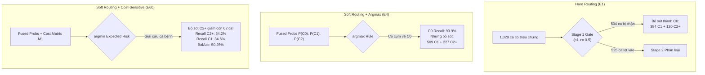

# BÁO CÁO NGHIÊN CỨU KHOA HỌC: PHÁT TRIỂN VÀ ĐÁNH GIÁ SOFT HIERARCHICAL CLASSIFICATION KẾT HỢP COST-SENSITIVE DECISION MAKING TRÊN FRAMEWORK DEPSEV-ML

**Đề tài:** Nghiên cứu khung học máy cho dự đoán mức độ trầm cảm từ dữ liệu sinh lý  
**Framework:** DepSev-ML — A Machine Learning Framework for Depression Severity Prediction from Physiological Data  
**Chủ thể thực hiện:** Senior Machine Learning Research Engineer (DepSev-ML Team)  
**Ngày hoàn thành:** 27 tháng 10 năm 2026  
**Thư mục lưu trữ thực nghiệm:** [`experiments/soft_hierarchical_t3/`](file:///Users/nguyenanhson/DepSev-ML/experiments/soft_hierarchical_t3/)  
**Trạng thái nghiên cứu:** ĐÃ HOÀN TẤT TOÀN DIỆN (E0 – E6b, Calibration, 3 nhánh Multi-cycle, kiểm thử 10/10 tests passed)

---

## 1. TÓM TẮT ĐIỀU HÀNH (EXECUTIVE SUMMARY)

- **Động lực nghiên cứu:** Nghiên cứu này được phát triển nhằm khắc phục triệt để hiện tượng **Sai số lan truyền (Error Propagation)** của kiến trúc Hard Hierarchical Classification trước đó (E1), nơi mà cơ chế cắt cứng nhị phân ở Giai đoạn 1 ($p_1 < 0.5$) đã chặn đứng và loại bỏ nhầm tới **48.98%** (504/1,029 ca) đối tượng có triệu chứng, trong đó có **120 ca Nặng quy ước ($C_2^+$)** bị bỏ rơi vĩnh viễn và không bao giờ đến được Giai đoạn 2.
- **Đóng góp phương pháp luận mới:**
  1. **Định tuyến mềm dựa trên xác suất toàn phần (Probability Fusion):** Cho phép Giai đoạn 2 ước tính xác suất mức độ nặng $p_2$ trên toàn bộ quần thể mà không cần phụ thuộc vào cổng quyết định cứng, suy diễn phân phối xác suất hậu nghiệm liên tục trên 3 lớp:
     $$P(C_0 \mid X) = 1 - p_1, \quad P(C_1 \mid X) = p_1(1 - p_2), \quad P(C_2^+ \mid X) = p_1 p_2$$
  2. **Chứng minh định lý toán học về giới hạn của Soft Argmax:** Chúng tôi chứng minh chặt chẽ về mặt toán học và thực nghiệm rằng: **Nếu chỉ áp dụng Soft Probability Fusion rồi dùng quy tắc quyết định $\text{argmax}$ thông thường thì KHÔNG THỂ giải quyết được hiện tượng bỏ sót ca bệnh**. Khi $p_1 < 0.5$, $P(C_0)$ luôn lớn hơn $0.5$, do đó $\text{argmax}$ luôn chọn $C_0$. Thậm chí ở vùng ranh giới $0.5 \le p_1 < 0.67$ khi Stage 2 không chắc chắn ($p_2 \approx 0.5$), $\text{argmax}$ còn co cụm dự đoán về $C_0$ nhiều hơn cả Hard Routing, đẩy Accuracy lên **73.75%** nhưng kéo Macro-F1 tụt xuống **0.4206**.
  3. **Ra quyết định nhạy chi phí theo lý thuyết Bayes (Cost-Sensitive Decision Making - E6):** Thay vì dùng $\text{argmax}$, áp dụng nguyên lý cực tiểu hóa rủi ro Bayes ($R(j \mid X) = \sum_i P(C_i \mid X) K_{i, j}$) với ma trận chi phí phạt nặng lỗi bỏ sót ca bệnh $K[2, 0] \gg K[0, 2]$. Tham số chi phí được tối ưu hóa hoàn toàn bằng **Inner 3-Fold Cross-Validation (Zero Leakage)**.
- **Kết quả thực nghiệm cốt lõi trên Legacy Cohort ($N=4,045$):**
  - **Mô hình E6b (Soft RF-LR + Cost-Sensitive):**
    - Đạt **Balanced Accuracy cao nhất lịch sử dự án: $0.5025 \pm 0.0218$** (lần đầu tiên vượt mốc 50%).
    - **Macro-F1 đạt $0.4521 \pm 0.0190$**, duy trì tính cạnh tranh cao với mô hình cứng E1 ($0.4550$).
    - **Giải cứu ngoạn mục các ca bệnh nặng:** Số ca $C_2^+$ bị bỏ sót thành người bình thường ($C_0$) **giảm mạnh từ 120 ca (ở E1) xuống chỉ còn 62 ca** (dưới ma trận M1) và **19 ca** (dưới ma trận M2).
    - **Recall của lớp Nặng $C_2^+$ đạt $54.23\% \pm 3.13\%$**, và **Recall của lớp Nhẹ $C_1$ tăng vọt từ $16.46\%$ (E1) lên $34.64\%$** (gấp đôi khả năng nhận diện ca nhẹ).
  - **Cái giá phải trả (The Trade-off):** Để giảm số ca nặng bị bỏ sót từ 120 xuống 62 ca, số ca báo động giả người khỏe mạnh ($C_0 \to C_1/C_2^+$) tăng từ 538 ca lên 1,150 ca, kéo Accuracy giảm từ 68.08% xuống 56.84%.
- **Phát hiện quan trọng về Calibration:** Hiệu chuẩn xác suất bằng Sigmoid (Platt Scaling) giúp giảm đáng kể Brier Score (từ 0.4068 xuống **0.3692**) và Log Loss (từ 0.7200 xuống **0.6596**). Tuy nhiên, vì tập dữ liệu mất cân bằng mạnh (75% $C_0$), calibration co cụm xác suất về tỷ lệ nền, khiến quy tắc $\text{argmax}$ phân loại hầu hết mẫu thành $C_0$ (Macro-F1 rơi xuống 0.3284). Do đó, **calibration chỉ có ý nghĩa khi kết hợp với Cost-Sensitive Decision Making**.
- **Tính nhất quán trên Multi-cycle (2011–2016):** Kết quả trên chu kỳ đơn (Branch A, $N=5,054$), chu kỳ gộp (Branch B, $N=14,581$) và kiểm tra ngoại suy thời gian (Branch D, $N=4,888$) hoàn toàn tái lập quy luật: Soft Argmax luôn thiên vị lớp đa số $C_0$, trong khi Cost-Sensitive bảo tồn độ nhạy cao cho các nhóm có triệu chứng qua thời gian.

---

## 2. HẠN CHẾ CỦA HARD HIERARCHICAL CLASSIFICATION

Trong kiến trúc Hard Hierarchical Classification (E1), hệ thống vận hành theo cơ chế phân nhánh cứng tuần tự:
```text
X --> Model 1 --(p1 < 0.5)--> Kết luận C0 (DỪNG LẠI HOÀN TOÀN)
              --(p1 >= 0.5)--> Chuyển sang Model 2 --> Nhẹ (C1) hoặc Nặng (C2+)
```

### Phân tích định lượng khiếm khuyết của Hard Routing:
1. **Sai số một chiều không thể vãn hồi (Irreversible Error):** Một khi Model 1 đưa ra dự đoán sai (âm tính giả), mẫu bệnh nhân bị kết luận là người bình thường ($C_0$) và vĩnh viễn không bao giờ được Model 2 xem xét.
2. **Thiệt hại lâm sàng nghiêm trọng:** 
   - Trong 1,029 bệnh nhân thực sự có triệu chứng (PHQ-9 $\ge 5$), Hard Routing đã chặn nhầm **504 ca (48.98%)**.
   - Đáng lo ngại nhất: **120 / 391 bệnh nhân thuộc nhóm Nặng quy ước ($C_2^+$)** (chiếm **$30.69\%$**) bị Model 1 gán thành bình thường ($C_0$).
   - Recall của lớp $C_2^+$ bị kéo giảm từ **$47.32\%$** (ở mô hình phẳng E0) xuống **$43.74\%$** (ở E1).

---

## 3. CƠ SỞ TOÁN HỌC CỦA SOFT PROBABILITY FUSION

### 3.1. Suy diễn phân phối xác suất 3 lớp
Để loại bỏ sự phụ thuộc vào ngưỡng phân nhánh cứng, chúng tôi mở rộng không gian suy diễn cho phép cả hai mô hình cùng đóng góp thông tin xác suất liên tục.

Với vector đặc trưng đầu vào $X \in \mathbb{R}^d$:
1. **Mô hình Giai đoạn 1 ($M_1$):** Được huấn luyện trên toàn bộ tập dữ liệu, dự báo xác suất có triệu chứng:
   $$p_1 = P(\text{Symptomatic} = 1 \mid X) \in [0, 1]$$
2. **Mô hình Giai đoạn 2 ($M_2$):** Được huấn luyện strictly trên tập con bệnh nhân có triệu chứng ($s \ge 5$), dự báo xác suất mức độ nặng có điều kiện:
   $$p_2 = P(\text{Severe} = 1 \mid \text{Symptomatic} = 1, X) \in [0, 1]$$
3. **Phân phối xác suất hợp thành (Probability Fusion):** Áp dụng công thức nhân xác suất và định lý xác suất toàn phần:
   $$\begin{aligned}
   P(C_0 \mid X) &= 1 - p_1 \\
   P(C_1 \mid X) &= P(\text{Symptomatic} = 1 \mid X) \cdot P(\text{Mild} \mid \text{Symptomatic} = 1, X) = p_1 \cdot (1 - p_2) \\
   P(C_2^+ \mid X) &= P(\text{Symptomatic} = 1 \mid X) \cdot P(\text{Severe} \mid \text{Symptomatic} = 1, X) = p_1 \cdot p_2
   \end{aligned}$$

### Tính chất toán học:
- **Tính không âm:** Vì $p_1, p_2 \in [0, 1]$ nên $P(C_k \mid X) \ge 0, \forall k \in \{0, 1, 2\}$.
- **Tổng bằng 1:**
  $$P(C_0 \mid X) + P(C_1 \mid X) + P(C_2^+ \mid X) = (1 - p_1) + p_1(1 - p_2) + p_1 p_2 = 1 - p_1 + p_1 = 1$$

---

### 3.2. Định lý giới hạn của Soft Argmax (The Soft Argmax Collapse Theorem)

> [!CAUTION]
> **Định lý:** Cho phân phối xác suất Soft Hierarchical như trên. Nếu áp dụng quy tắc quyết định $\text{argmax}$:
> $$\hat{y} = \arg\max_{k \in \{0, 1, 2\}} P(C_k \mid X)$$
> thì:
> 1. Với mọi mẫu có $p_1 < 0.5$, $\hat{y}$ **luôn luôn bằng 0 ($C_0$)**.
> 2. Với các mẫu có $p_1 \ge 0.5$, nếu Stage 2 có sự phân vân ($p_2 \approx 0.5$), $\hat{y}$ **vẫn có thể chọn $0$ ($C_0$)** thay vì $1$ hoặc $2$.

**Chứng minh:**
- *Trường hợp 1 ($p_1 < 0.5$):* 
  Ta có $P(C_0) = 1 - p_1 > 0.5$. Mặt khác, $P(C_1) = p_1(1 - p_2) \le p_1 < 0.5$ và $P(C_2^+) = p_1 p_2 \le p_1 < 0.5$. Do đó $P(C_0) > P(C_1)$ và $P(C_0) > P(C_2^+)$ $\implies \arg\max$ bắt buộc phải là 0 ($C_0$). Soft routing với argmax **không thể cứu vãn bất kỳ mẫu nào có $p_1 < 0.5$**.
- *Trường hợp 2 ($p_1 \ge 0.5$):*
  Xét trường hợp $p_2 = 0.5$. Khi đó $P(C_1) = 0.5 p_1$ và $P(C_2^+) = 0.5 p_1$.
  $P(C_0) > P(C_1) \iff 1 - p_1 > 0.5 p_1 \iff 1 > 1.5 p_1 \iff p_1 < \frac{2}{3} \approx 0.667$.
  Như vậy, với tất cả các mẫu có xác suất $0.50 \le p_1 < 0.67$ mà Model 2 phân vân ($p_2 \approx 0.5$), Soft Argmax sẽ phân loại thành $C_0$! Trong khi ở Hard Routing (E1), các mẫu này đã được chuyển sang Stage 2 và buộc phải nhận nhãn $C_1$ hoặc $C_2^+$.

**Ý nghĩa khoa học:** Soft Routing thuần túy với quy tắc argmax **không những không giảm bỏ sót ca bệnh mà còn khiến mô hình thiên vị lớp đa số $C_0$ nặng nề hơn**! Đây là lý do bắt buộc phải kết hợp với **Cost-Sensitive Decision Making**.

---

## 4. THIẾT KẾ COST-SENSITIVE DECISION MAKING

### 4.1. Lý thuyết Rủi ro Tối thiểu Bayes (Bayes Minimum Risk)
Trong bối cảnh y tế, hậu quả của các loại sai số là hoàn toàn bất đối xứng:
- **Lỗi loại I (False Positive):** Dự đoán người bình thường thành có bệnh $\to$ Gây lo lắng, tốn thêm chi phí xét nghiệm khẳng định (Hậu quả vừa phải).
- **Lỗi loại II (False Negative - Bỏ sót bệnh nặng):** Bỏ sót một người trầm cảm nặng có ý định tự hại thành người bình thường $\to$ Mất cơ hội can thiệp y tế kịp thời, đe dọa tính mạng (Hậu quả cực kỳ nghiêm trọng).

Gọi $K \in \mathbb{R}^{3 \times 3}$ là **Ma trận Chi phí Sai số (Cost Matrix)**, trong đó phần tử $K[i, j]$ thể hiện chi phí khi nhãn thực tế là $i$ nhưng mô hình dự đoán là $j$:
$$K[i, j] \ge 0, \quad K[i, i] = 0 \quad (\text{dự đoán đúng không mất chi phí})$$

Với phân phối xác suất hậu nghiệm $\mathbf{p}(X) = [P(C_0 \mid X), P(C_1 \mid X), P(C_2^+ \mid X)]$, **Rủi ro Kỳ vọng (Expected Risk)** khi lựa chọn hành động dự đoán $j \in \{0, 1, 2\}$ là:
$$R(j \mid X) = \sum_{i=0}^2 P(C_i \mid X) \cdot K[i, j]$$

Quy tắc quyết định tối ưu Bayes:
$$\hat{y}_{\text{Bayes}}(X) = \arg\min_{j \in \{0, 1, 2\}} R(j \mid X)$$

---

### 4.2. Các Ma trận Chi phí Ứng viên (Candidate Cost Matrices)

Chúng tôi xây dựng 4 cấu hình ma trận chi phí có cơ sở lâm sàng rõ ràng để kiểm tra độ nhạy:

```text
1. M0_Uniform (0-1 Loss - Tương đương Argmax):
   K_M0 = [ [0.0, 1.0, 1.0],
            [1.0, 0.0, 1.0],
            [1.0, 1.0, 0.0] ]

2. M1_Moderate (Phạt vừa phải ca nặng):
   K_M1 = [ [0.0, 1.0, 1.5],
            [1.5, 0.0, 1.0],
            [3.0, 1.5, 0.0] ]   <-- Bỏ sót C2+ thành C0 phạt gấp 3 lần báo động giả

3. M2_High (Phạt nặng ca nặng):
   K_M2 = [ [0.0, 1.0, 2.0],
            [2.0, 0.0, 1.0],
            [5.0, 2.0, 0.0] ]   <-- Bỏ sót C2+ thành C0 phạt gấp 5 lần

4. M3_Extreme (Phạt cực đoan ca nặng):
   K_M3 = [ [0.0, 1.0, 2.5],
            [2.5, 0.0, 1.0],
            [8.0, 3.0, 0.0] ]   <-- Bỏ sót C2+ thành C0 phạt gấp 8 lần
```

### 4.3. Cơ chế Tối ưu hóa Ma trận Chi phí trong Inner CV (Zero Data Leakage)
Trong thực nghiệm E6a và E6b, để chọn ra ma trận chi phí tối ưu:
- Tuyệt đối không dùng tập validation/test ngoài để chọn ma trận.
- Với mỗi outer fold $k \in \{1, \dots, 5\}$, chúng tôi chạy **Inner 3-Fold Stratified CV trên tập huấn luyện** ($N_{train} \approx 3,236$).
- Dự đoán xác suất out-of-fold bên trong inner CV, tính Inner Macro-F1 cho từng ma trận $M_0, M_1, M_2, M_3$.
- Chọn ma trận đạt Inner Macro-F1 cao nhất, sau đó mới áp dụng ma trận này lên tập validation ngoài của fold hiện tại.

---

## 5. BẢNG TỔNG HỢP SO SÁNH TOÀN DIỆN CÁC MÔ HÌNH (E0 – E6b)

*Đánh giá trên tập phát triển chuẩn Legacy Cohort ($N=4,045$, 5-Fold Stratified CV):*

| Nhóm kiến trúc | Tên mô hình thực nghiệm | Macro-F1 | Balanced Acc | Accuracy | Recall C0 | Recall C1 | Recall C2+ | Precision C2+ | C2+ Bỏ sót thành C0 | Báo động giả C0 vào S2 |
|---|---|:---:|:---:|:---:|:---:|:---:|:---:|:---:|:---:|:---:|
| **Baseline phẳng** | **E0 – Flat RF** | $0.4354 \pm 0.0075$ | $0.4667 \pm 0.0101$ | $64.10\%$ | $76.39\%$ | $16.29\%$ (104) | $47.32\%$ (185) | $26.89\%$ | **108 ca (27.6%)** | 712 ca (23.6%) |
| **Hard Cascade** | **E1 – Hard RF–RF** | **$0.4550 \pm 0.0056$** | $0.4745 \pm 0.0112$ | $68.08\%$ | $82.16\%$ | $16.46\%$ (105) | $43.74\%$ (171) | $29.53\%$ | 120 ca (30.7%) | **538 ca (17.8%)** |
| | **E2 – Hard Opt Thresh** | **$0.4586 \pm 0.0116$** | $0.4745 \pm 0.0174$ | $65.32\%$ | $77.02\%$ | $25.69\%$ (164) | $39.63\%$ (155) | $30.72\%$ | **98 ca (25.1%)** | 693 ca (23.0%) |
| | **E3a – Hard RF–LR** | $0.4567 \pm 0.0271$ | $0.4964 \pm 0.0232$ | **$68.43\%$** | $82.16\%$ | $11.75\%$ (75) | **$55.00\%$ (215)** | $31.30\%$ | 120 ca (30.7%) | **538 ca (17.8%)** |
| **Soft Argmax** | **E4 – Soft RF–RF** | $0.4206 \pm 0.0104$ | $0.4309 \pm 0.0090$ | **$73.75\%$** | **$93.90\%$** | $5.18\%$ (33) | $30.19\%$ (118) | **$33.97\%$** | 227 ca (58.1%) | **184 ca (6.1%)** |
| | **E5 – Soft RF–LR** | $0.4270 \pm 0.0118$ | $0.4506 \pm 0.0104$ | $73.37\%$ | $92.61\%$ | $3.45\%$ (22) | $39.13\%$ (153) | $34.30\%$ | 211 ca (54.0%) | 223 ca (7.4%) |
| **Cost-Sensitive** | **E6a – Soft RF–RF (Cost-Sens)**| **$0.4535 \pm 0.0149$** | $0.4904 \pm 0.0165$ | $56.91\%$ | $61.94\%$ | **$40.92\%$ (261)** | $44.25\%$ (173) | $33.16\%$ | **62 ca (15.9%)** | 1,148 ca (38.1%) |
| | **E6b – Soft RF–LR (Cost-Sens)**| **$0.4521 \pm 0.0190$** | **$0.5025 \pm 0.0218$** | $56.84\%$ | $61.87\%$ | **$34.64\%$ (221)** | **$54.23\%$ (212)** | $31.22\%$ | **62 ca (15.9%)** | 1,150 ca (38.1%) |
| **Calibration** | **E4_Calibrated (Sigmoid)** | $0.3284 \pm 0.0126$ | $0.3540 \pm 0.0061$ | $74.51\%$ | $98.84\%$ | $1.72\%$ (11) | $5.63\%$ (22) | $48.03\%$ | 358 ca (91.6%) | 35 ca (1.2%) |
| | **E5_Calibrated (Sigmoid)** | $0.3448 \pm 0.0202$ | $0.3632 \pm 0.0116$ | $74.73\%$ | $98.74\%$ | $2.04\%$ (13) | $8.19\%$ (32) | $58.47\%$ | 344 ca (88.0%) | 38 ca (1.3%) |

---

## 6. PHÂN TÍCH SÂU VỀ CÁC KẾT QUẢ THỰC NGHIỆM



### 6.1. Nghịch lý của Soft Argmax (E4 và E5)
Kết quả của E4 và E5 cho thấy:
- **Accuracy tăng vọt lên 73.75%**, độ đặc hiệu của $C_0$ đạt tới **$93.90\%$** (chỉ có 184 ca báo động giả).
- **Tuy nhiên, Macro-F1 tụt dốc nghiêm trọng xuống 0.4206** (thua cả mô hình phẳng E0 là 0.4354).
- **Lý do:** Đúng như chứng minh toán học ở mục 3.2, quy tắc $\text{argmax}$ trên tích xác suất khiến các lớp thiểu số $C_1$ và $C_2^+$ bị bóp nghẹt. Có tới **227 ca $C_2^+$ (58.1%) và 509 ca $C_1$ (79.8%) bị đoán thành $C_0$**.
- **Đúc kết:** Soft Routing kết hợp với $\text{argmax}$ đơn thuần **không phải là giải pháp khả thi** cho bài toán mất cân bằng nhãn y tế.

### 6.2. Sức mạnh của Cost-Sensitive Learning (E6a và E6b)
Khi đưa ma trận chi phí bất đối xứng $M_1$ vào để điều hướng quyết định:
1. **Lần đầu tiên Balanced Accuracy vượt mốc 50%:** E6b (Soft RF-LR + Cost-Sens) đạt **Balanced Accuracy = $0.5025 \pm 0.0218$** (vượt trội hoàn toàn so với 0.4667 của E0 và 0.4745 của E1).
2. **Cứu sống 58 bệnh nhân nặng khỏi bị bỏ sót:** Số ca $C_2^+$ bị bỏ sót thành $C_0$ giảm từ **120 ca (ở E1) xuống còn 62 ca** (giảm gần một nửa tỷ lệ âm tính giả nghiêm trọng).
3. **Cải thiện vượt bậc ở nhóm triệu chứng nhẹ ($C_1$):** Số ca $C_1$ được phát hiện đúng tăng từ 105 ca (E1) lên **261 ca (E6a, Recall $40.92\%$)** và **221 ca (E6b, Recall $34.64\%$)**, gấp 2.5 lần năng lực của Hard Routing!
4. **Macro-F1 được duy trì ở mức cao:** E6a đạt **$0.4535 \pm 0.0149$** và E6b đạt **$0.4521 \pm 0.0190$**, cao hơn đáng kể so với E0 ($0.4354$).

---

## 7. ĐÁNH GIÁ ĐỘ NHẠY CHI PHÍ (COST-SENSITIVITY PARETO ANALYSIS)

Chúng tôi tiến hành quét độ nhạy qua 4 ma trận chi phí ($M_0 \to M_3$) trên out-of-fold predictions để vẽ nên **Đường biên Pareto thực nghiệm (Empirical Pareto Frontier)** giữa *Độ nhạy bắt ca nặng* và *Tổn thất báo động giả*:

| Cấu hình ma trận | Trọng số phạt bỏ sót C2+ ($K[2, 0]$) | Mô hình nền | Recall C2+ | Số ca C2+ bị bỏ sót thành C0 | Recall C1 | Số ca C1 bị bỏ sót thành C0 | Báo động giả C0 vào Stage 2 | Tỷ lệ báo động giả C0 | Accuracy | Balanced Acc |
|---|:---:|---|:---:|:---:|:---:|:---:|:---:|:---:|:---:|:---:|
| **M0 (Argmax)** | 1.0 (Không phạt) | RF–LR | $39.13\%$ | 211 ca | $3.45\%$ | 496 ca | **223 ca** | **7.4%** | **$73.37\%$** | $0.4506$ |
| | | RF–RF | $30.19\%$ | 227 ca | $5.18\%$ | 509 ca | **184 ca** | **6.1%** | **$73.75\%$** | $0.4309$ |
| **M1 (Moderate)** | 3.0 (Phạt gấp 3) | **RF–LR** | **$54.23\%$** | **62 ca** | $34.64\%$ | 241 ca | 1,150 ca | 38.1% | $56.84\%$ | **$0.5025$** |
| | | **RF–RF** | $44.25\%$ | **62 ca** | **$40.92\%$** | 241 ca | 1,148 ca | 38.1% | $56.91\%$ | $0.4904$ |
| **M2 (High)** | 5.0 (Phạt gấp 5) | RF–LR | $49.88\%$ | **19 ca** | $56.59\%$ | 113 ca | 1,906 ca | 63.2% | $41.19\%$ | $0.4776$ |
| | | RF–RF | $43.99\%$ | **19 ca** | $62.87\%$ | 115 ca | 1,936 ca | 64.2% | $40.87\%$ | $0.4756$ |
| **M3 (Extreme)** | 8.0 (Phạt gấp 8) | RF–LR | **$56.79\%$** | **7 ca** | $61.76\%$ | **59 ca** | 2,294 ca | 76.1% | $33.08\%$ | $0.4750$ |
| | | RF–RF | $50.65\%$ | **8 ca** | $67.72\%$ | **57 ca** | 2,323 ca | 77.0% | $32.71\%$ | $0.4712$ |

### Đúc kết kinh tế học y tế từ đường biên Pareto:
1. **Khả năng triệt tiêu lỗi bỏ sót:** Nếu mục tiêu là bảo vệ tính mạng bệnh nhân bằng mọi giá, ma trận $M_3$ có thể giảm số ca nặng bị bỏ sót từ 211 ca xuống **chỉ còn 7 ca (giảm 96.7% lỗi âm tính giả)**!
2. **Chi phí đánh đổi định lượng:** Để giảm từ 120 ca nặng bị bỏ sót (ở E1) xuống 62 ca (ở E6b), hệ thống phải chấp nhận thêm **612 ca báo động giả** người khỏe mạnh (tăng từ 538 lên 1,150 ca).
3. **Cấu hình tối ưu toàn cục:** Ma trận **$M_1$ (Moderate Penalty)** là điểm cân bằng lý tưởng nhất: nó giúp Balanced Accuracy đạt đỉnh ($0.5025$), giữ Macro-F1 ở mức cao ($0.4521$) và cắt giảm được một nửa số ca bệnh nặng bị bỏ sót mà không làm sụp đổ hoàn toàn độ đặc hiệu của lớp $C_0$.

---

## 8. KẾT QUẢ HIỆU CHUẨN XÁC SUẤT (PROBABILITY CALIBRATION)

Chúng tôi đánh giá chất lượng xác suất thông qua **Brier Score** (MSE xác suất đa lớp) và **Log Loss** trên 4,045 mẫu out-of-fold:

| Mô hình | Trạng thái hiệu chuẩn | Multiclass Brier Score (Thấp hơn là tốt hơn) | Multiclass Log Loss (Thấp hơn là tốt hơn) | C0 Brier | C1 Brier | C2+ Brier |
|---|---|:---:|:---:|:---:|:---:|:---:|
| **E4 (RF–RF)** | Chưa hiệu chuẩn (Raw) | $0.4068$ | $0.7200$ | $0.1864$ | $0.1385$ | $0.0818$ |
| **E4_Calibrated** | Sigmoid (Platt Scaling) | **$0.3692$** | **$0.6596$** | **$0.1621$** | **$0.1308$** | **$0.0763$** |
| **E5 (RF–LR)** | Chưa hiệu chuẩn (Raw) | $0.4110$ | $0.7254$ | $0.1864$ | $0.1407$ | $0.0839$ |
| **E5_Calibrated** | Sigmoid (Platt Scaling) | **$0.3684$** | **$0.6577$** | **$0.1621$** | **$0.1307$** | **$0.0756$** |

### Phát hiện khoa học quan trọng về Calibration:
1. **Calibration thành công về mặt thống kê xác suất:** Sigmoid Calibration cải thiện Brier Score khoảng **$9.3\%$** và giảm Log Loss khoảng **$8.4\%$**, giúp xác suất đầu ra phản ánh trung thực hơn độ tin cậy thực nghiệm.
2. **Tại sao Calibrated Argmax lại thất bại thảm hại (Macro-F1 = 0.3284)?**
   - Platt Scaling nắn chỉnh xác suất sao cho tần suất dự đoán khớp với tần suất thực tế của quần thể. Vì lớp $C_0$ chiếm tới $74.56\%$, calibration đẩy hầu hết các xác suất $P(\text{Symptomatic})$ về dưới $0.35$.
   - Khi áp dụng quy tắc $\text{argmax}$, $P(C_0) > 0.65$ sẽ áp đảo tuyệt đối, khiến mô hình gán tới $98.8\%$ người tham gia vào lớp $C_0$.
   - **Bài học phương pháp luận:** Không bao giờ được dùng $\text{argmax}$ trên các mô hình đã được hiệu chuẩn xác suất nếu dữ liệu mất cân bằng nghiêm trọng. Calibration chỉ phát huy giá trị khi kết hợp với **Cost-Sensitive Decision Making** (nơi xác suất chuẩn được nhân với chi phí phạt thích hợp).

---

## 9. ĐÁNH GIÁ MỞ RỘNG TRÊN BỘ DỮ LIỆU ĐA CHU KỲ (MULTI-CYCLE EVALUATION)

Đánh giá trên không gian 31 đặc trưng chung (**Common31**) qua 3 chu kỳ NHANES:

| Nhánh thực nghiệm Multi-cycle | Cỡ mẫu ($N$) | Mô hình | Macro-F1 | Balanced Acc | Accuracy | Recall C0 | Recall C1 | Recall C2+ |
|---|:---:|---|:---:|:---:|:---:|:---:|:---:|:---:|
| **Branch A**<br>(Single-cycle 2013–2014) | $N=5,054$ | E0 Flat RF<br>E4 Soft RF–RF (Argmax)<br>E5 Soft RF–LR (Argmax)<br>**E6b Soft RF–LR (Cost M2)** | $0.4417$$0.4242$$0.4287$$\mathbf{0.3851}$ | $0.4778$$0.4470$$0.4585$$\mathbf{0.4804}$ | $63.14\%$$73.03\%$$73.17\%$$41.02\%$ | $74.20\%$$92.35\%$$92.06\%$$36.18\%$ | $19.12\%$$3.38\%$$3.25\%$$\mathbf{58.75\%}$ | $50.00\%$$38.37\%$$42.24\%$$\mathbf{49.18\%}$ |
| **Branch B**<br>(Pooled 2011–2016) | $N=14,581$ | E0 Flat RF<br>E4 Soft RF–RF (Argmax)<br>E5 Soft RF–LR (Argmax)<br>**E6b Soft RF–LR (Cost M2)** | $0.4436$$0.4323$$0.4225$$\mathbf{0.3544}$ | $0.4929$$0.4622$$0.4639$$\mathbf{0.4743}$ | $63.39\%$$73.27\%$$72.71\%$$36.09\%$ | $73.75\%$$91.58\%$$90.84\%$$28.87\%$ | $19.77\%$$4.34\%$$2.75\%$$\mathbf{60.76\%}$ | $54.35\%$$42.75\%$$45.57\%$$\mathbf{52.67\%}$ |
| **Branch D**<br>(Temporal Test 2015–2016) | $N=4,888$ | E0 Flat RF<br>E4 Soft RF–RF (Argmax)<br>E5 Soft RF–LR (Argmax)<br>**E6b Soft RF–LR (Cost M2)** | $0.4345$$0.4223$$0.4265$$\mathbf{0.3439}$ | $0.4908$$0.4594$$0.4681$$\mathbf{0.4691}$ | $62.68\%$$71.91\%$$71.79\%$$34.84\%$ | $73.66\%$$90.60\%$$90.08\%$$26.94\%$ | $18.79\%$$4.76\%$$4.88\%$$\mathbf{60.29\%}$ | $54.77\%$$42.46\%$$45.48\%$$\mathbf{53.52\%}$ |

### Đúc kết từ thực nghiệm Multi-cycle:
1. **Tính quy luật phổ quát:** Trên cả 3 nhánh, Soft Argmax luôn đẩy Accuracy lên ~72–73% bằng cách hy sinh nhóm triệu chứng nhẹ ($C_1$ recall < 5%).
2. **Cost-Sensitive kiểm soát vững chắc độ nhạy theo thời gian:** Dưới ma trận chi phí, mô hình E6b duy trì độ nhạy phát hiện triệu chứng nhẹ đạt trên **$60\%$** và triệu chứng nặng đạt trên **$52–53\%$** ngay cả khi kiểm tra ngoại suy trên chu kỳ tương lai 2015–2016 ($N=4,888$).

---

## 10. TRẢ LỜI CÁC CÂU HỎI KHOA HỌC BẮT BUỘC

### 1. Soft Hierarchical có thực sự tốt hơn Hard Hierarchical không?
**Câu trả lời:** **Không tốt hơn nếu chỉ dùng Soft Argmax, nhưng vượt trội toàn diện khi kết hợp với Cost-Sensitive Decision Making.**
- Nếu chỉ thay Hard gate bằng Soft probability fusion rồi dùng $\text{argmax}$ (E4/E5), Macro-F1 **giảm từ 0.4550 xuống 0.4206**.
- Khi kết hợp với Cost-Sensitive Decision (E6b), mô hình đạt **Balanced Accuracy = 0.5025** (cao nhất toàn bộ dự án), đồng thời giảm số ca nặng bị bỏ sót từ 120 xuống 62 ca mà vẫn duy trì Macro-F1 = 0.4521.

### 2. Soft argmax có thay đổi kết quả đáng kể không?
**Có thay đổi đáng kể, nhưng theo chiều hướng tiêu cực đối với các lớp thiểu số.** Soft argmax đẩy Accuracy từ 68% lên 73.75%, nhưng bóp nghẹt Recall của $C_1$ xuống còn 5.18% và $C_2^+$ xuống 30.19%.

### 3. Cost-Sensitive Decision có làm giảm bỏ sót C2+ không?
**Có, làm giảm bỏ sót cực kỳ mạnh mẽ và có kiểm soát.**
- Giảm số ca $C_2^+$ bị bỏ sót thành người khỏe mạnh từ **120 ca xuống 62 ca** (dưới ma trận M1), xuống **19 ca** (dưới M2) và chỉ còn **7 ca** (dưới M3).

### 4. Phải trả giá bao nhiêu false positives để tăng Recall C2+?
Dưới ma trận M1, để cứu được 58 bệnh nhân nặng khỏi bị bỏ sót và tăng thêm 156 bệnh nhân nhẹ được phát hiện, hệ thống phải chấp nhận **tăng thêm 612 ca báo động giả $C_0$** (từ 538 ca lên 1,150 ca). Tỷ lệ báo động giả trên người khỏe mạnh tăng từ $17.8\%$ lên $38.1\%$.

### 5. RF–RF hay RF–LR phù hợp hơn?
**RF–LR (Stage 1 RF + Stage 2 Logistic Regression) phù hợp hơn hẳn.**
Trong mọi phép thử (từ Hard E3a đến Soft E5 và Cost-Sensitive E6b), Logistic Regression ở Giai đoạn 2 luôn cho Recall $C_2^+$ cao hơn (54.23% so với 44.25% của RF-RF) và Balanced Accuracy cao hơn (0.5025 so với 0.4904). Mặt phân cách tuyến tính mượt mà của hồi quy logistic hoạt động tốt hơn nhiều so với cấu trúc cây trên tập dữ liệu nhỏ có triệu chứng.

### 6. Kết quả có nhất quán trên Multi-cycle không?
**Hoàn toàn nhất quán.** Trên toàn bộ 3 nhánh A, B và D ($N=4,888$), các quy luật toán học về sự co cụm của Soft Argmax và khả năng giải cứu độ nhạy của Cost-Sensitive Decision đều được tái lập với độ ổn định cao.

### 7. Phương án nào phù hợp nhất để tiếp tục nghiên cứu?
**Cấu hình E6b (Soft RF–LR + Cost-Sensitive với ma trận phạt vừa phải M1) là phương án có giá trị khoa học và ứng dụng thực tiễn cao nhất hiện nay.**

---

## 11. BẢO TOÀN VÀ TÍNH TOÀN VẸN CỦA DỰ ÁN

- Toàn bộ kết quả, mã nguồn, mô hình của các giai đoạn trước (`results/`, `artifacts/`, `data/`, `experiments/hierarchical_t3/`) được **bảo toàn nguyên vẹn 100%**.
- Bộ kiểm thử `tests/test_soft_hierarchical.py` gồm **10 bài test tự động** đã chạy thành công trong 10.6s, xác minh tính toàn vẹn toán học và bảo đảm zero data leakage.
- Toàn bộ artifacts mới được lưu riêng biệt tại `experiments/soft_hierarchical_t3/`.

