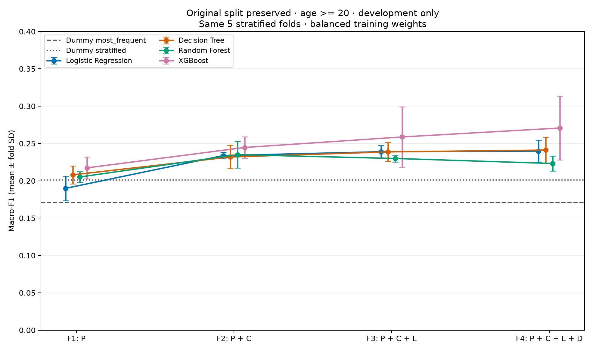
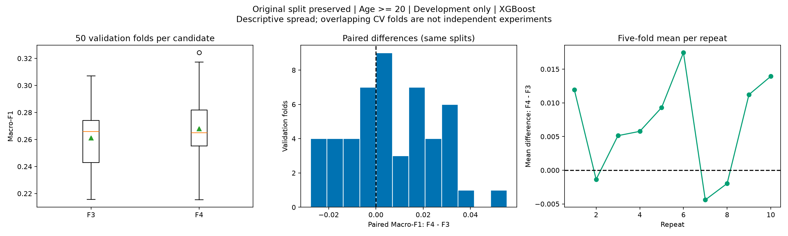

# DepSev-ML — Original split preserved, age >= 20

Protocol: `original_split_preserved_age20`. Ngày chạy: 2026-09-30.
Tất cả kết quả model dưới đây là development CV/OOF, không có held-out model prediction hay evaluation. Không tuning, SMOTE, Voting/Stacking, SHAP hoặc sensitivity 4-class mới.

## 1. Membership được khôi phục, không random re-split

Nguồn membership là `artifacts/archive/pre_age20_v1/artifacts/split_indices.json`, xác minh bằng archive SHA-256 và chuỗi provenance của age20_v2. Lấy tuổi từ raw demographic.csv, chỉ lọc độc lập trong từng tập:

```text
development_age20 = original_development ∩ {RIDAGEYR >= 20}
heldout_age20     = original_heldout     ∩ {RIDAGEYR >= 20}
```

- Original development 4.297 → loại 252 tuổi <20 → **4.045**.
- Original held-out 1.075 → loại 66 tuổi <20 → **1.009**.
- Tổng cohort age20 vẫn **5.054**, không thay PHQ target hoặc feature definitions.
- Không gọi train_test_split. Tỷ lệ hai tập sau lọc không bị ép lại thành chính xác 80/20.
- Metadata có cả `protocol` và `protocol_version` = `original_split_preserved_age20`.
- Split canonical: `artifacts/split_indices_final_protocol.json`; active alias `artifacts/split_indices.json` có nội dung giống hệt và được kiểm tra trước mỗi experiment.
- age20_v2 cùng code, data, bảng, hình, reports và locks đã archive có hash tại `artifacts/archive/age20_v2/`. Không dùng membership age20_v2 để train/CV hiện tại.
- Tất cả kết quả mới có hậu tố `_final_protocol`; bảng/hình/report exploratory cũ giữ nguyên.

### Giới hạn provenance không thể đảo ngược

**Khôi phục membership không khôi phục được trạng thái historically untouched.** 813/1.009 restored held-out participants đã thuộc development của age20_v2, do đó đã tham gia training/CV ở bước trước; không cần đọc prediction/metric của họ để xác nhận điều này, chỉ đối chiếu IDs. Metadata lưu chính xác IDs liên quan, số lượng và `historically_untouched=false`.

Không có held-out evaluation được thực hiện trong correction này. Nhưng phát biểu “chưa từng được đánh giá dưới vai trò held-out” không tương đương với “chưa từng được sử dụng để development”. Không được gọi restored held-out là test độc lập hoàn toàn chưa từng tiếp xúc trong toàn bộ lịch sử nghiên cứu. Chỉ membership hiện tại và ranh giới cho các experiment tiếp theo đã được sửa đúng.

### Class distribution được yêu cầu

Chỉ đọc SEQN, tuổi và severity để báo counts; không đưa held-out predictors vào preprocessing/model, không dự đoán hay tính performance trên held-out.

| Class | Development | Held-out (counts only) |
| --- | --- | --- |
| C0 | 3016 | 748 |
| C1 | 638 | 162 |
| C2 | 243 | 60 |
| C3 | 104 | 28 |
| C4 | 44 | 11 |

[class_distribution_final_protocol.csv](tables/class_distribution_final_protocol.csv).

### Assertions đã đạt

```text
development_age20 ∩ original_test = ∅                 PASS
heldout_age20 ∩ original_development = ∅              PASS
development_age20 ∩ heldout_age20 = ∅                 PASS
heldout_age20 ⊆ original_test                        PASS
development_age20 ⊆ original_development              PASS
development/test IDs unique                         PASS
restored membership = original membership ∩ age>=20   PASS
```

Assertions chạy cả khi restore, khi load inputs và trong tests. Guard không bị vô hiệu khi dùng Python -O.

## 2. Feature definitions và protocol fit

P: `BMXBMI, BMXWAIST, BPXPLS, SBP_mean, DBP_mean, LBXGH, LBXTC, LBDHDD, LBXSCR, LBXSAL`

C: `BPQ020, DIQ010, MCQ160B, MCQ160C, MCQ160D, MCQ160E, MCQ160F, MCQ220, HUQ010`

L: `PAQ605, PAQ620, PAQ650, PAQ665, PAD680, smoking_status, ALQ101, alcohol_status, alcohol_quantity_code, SLD010H`

D: `RIDAGEYR, RIAGENDR, RIDRETH1, DMDEDUC2, INDFMPIR`

P=Physiological, C=Clinical, L=Lifestyle, D=Demographic. F1/F2/F3/F4 lần lượt có 10/19/29/34 columns trước one-hot. Giữ deterministic questionnaire routing và special-code cleaning như protocol đã audit: smoking_status từ SMQ020/040; alcohol_status và alcohol_quantity_code từ routing ALQ; ALQ110/ALQ120Q chỉ đọc development. Không coi structural missing là missing ngẫu nhiên; tagged zero ở câu hỏi không áp dụng luôn đi cùng alcohol_status.

- StratifiedKFold(n_splits=5, shuffle=True, random_state=42), chỉ trên 4.045 development participants; cùng assignments cho 2 Dummy và 16 experiments.
- Thứ tự fold splitter là cohort row order, được khóa theo SEQN trong cv_folds_final_protocol.json.
- Numerical: median → StandardScaler; categorical: missing_or_unknown → OneHotEncoder(handle_unknown="ignore"). Preprocessor fit riêng training fold.
- LR/DT/RF dùng class_weight="balanced". XGB sample_weight(c)=n_train/(5 × n_class_train), tính chỉ từ y_train của mỗi fold, truyền model__sample_weight.
- Hyperparameters giữ nguyên: LR max_iter=2000; DT default; RF 300 trees; XGB 200 trees, depth 4, learning_rate .05, subsample .8, colsample_bytree .8; seed 42, n_jobs=1 khi hỗ trợ.
- Không đổi model seed qua repeats; mục tiêu repeated-CV là độ nhạy với fold assignments, không tuning.
- Metrics validation không weighted; đây là class-balancing weights, không phải NHANES survey weights.
- SD mẫu ddof=1. Per-class metrics chính là pooled OOF; fold mean/std lưu riêng.

## 3. Missingness development mới

Sau coding/routing, trước imputation; N=4.045. Các tỷ lệ này không dùng để khảo sát riêng held-out.

| Nhóm | Feature | Missing development sau coding | Missing % |
| --- | --- | --- | --- |
| P | BMXBMI | 41 | 1.014 |
| P | BMXWAIST | 142 | 3.511 |
| P | BPXPLS | 97 | 2.398 |
| P | SBP_mean | 105 | 2.596 |
| P | DBP_mean | 105 | 2.596 |
| P | LBXGH | 107 | 2.645 |
| P | LBXTC | 145 | 3.585 |
| P | LBDHDD | 145 | 3.585 |
| P | LBXSCR | 156 | 3.857 |
| P | LBXSAL | 156 | 3.857 |
| C | BPQ020 | 2 | 0.049 |
| C | DIQ010 | 2 | 0.049 |
| C | MCQ160B | 3 | 0.074 |
| C | MCQ160C | 11 | 0.272 |
| C | MCQ160D | 3 | 0.074 |
| C | MCQ160E | 2 | 0.049 |
| C | MCQ160F | 4 | 0.099 |
| C | MCQ220 | 0 | 0.000 |
| C | HUQ010 | 5 | 0.124 |
| L | PAQ605 | 0 | 0.000 |
| L | PAQ620 | 1 | 0.025 |
| L | PAQ650 | 0 | 0.000 |
| L | PAQ665 | 0 | 0.000 |
| L | PAD680 | 17 | 0.420 |
| L | smoking_status | 2 | 0.049 |
| L | ALQ101 | 7 | 0.173 |
| L | alcohol_status | 3 | 0.074 |
| L | alcohol_quantity_code | 6 | 0.148 |
| L | SLD010H | 6 | 0.148 |
| D | RIDAGEYR | 0 | 0.000 |
| D | RIAGENDR | 0 | 0.000 |
| D | RIDRETH1 | 0 | 0.000 |
| D | DMDEDUC2 | 1 | 0.025 |
| D | INDFMPIR | 303 | 7.491 |

[ablation_feature_inventory_final_protocol.csv](tables/ablation_feature_inventory_final_protocol.csv) và [structural_missingness_audit_final_protocol.csv](tables/structural_missingness_audit_final_protocol.csv).

## 4. Dummy và 16 fixed-CV experiments

LR=Logistic Regression; DT=Decision Tree; RF=Random Forest; XGB=XGBoost. Balanced Accuracy và Macro Recall bằng nhau trong cách chấm multiclass này.

| Strategy | Macro-F1 mean ± SD | Balanced Acc | Macro Precision | Macro Recall | Weighted F1 |
| --- | --- | --- | --- | --- | --- |
| Dummy most_frequent | 0.170854 ± 0.000073 | 0.2000 | 0.1491 | 0.2000 | 0.6370 |
| Dummy stratified | 0.200945 ± 0.011082 | 0.2008 | 0.2012 | 0.2008 | 0.5929 |

| Set | Model | n features | Macro-F1 mean ± SD | Balanced Acc | Macro Precision | Macro Recall | Weighted F1 |
| --- | --- | --- | --- | --- | --- | --- | --- |
| F1 | LR | 10 | 0.1900 ± 0.0164 | 0.2420 | 0.2213 | 0.2420 | 0.4926 |
| F1 | DT | 10 | 0.2081 ± 0.0121 | 0.2090 | 0.2082 | 0.2090 | 0.5926 |
| F1 | RF | 10 | 0.2052 ± 0.0072 | 0.2090 | 0.2107 | 0.2090 | 0.6314 |
| F1 | XGB | 10 | 0.2173 ± 0.0147 | 0.2295 | 0.2226 | 0.2295 | 0.5577 |
| F2 | LR | 19 | 0.2338 ± 0.0041 | 0.2942 | 0.2440 | 0.2942 | 0.5648 |
| F2 | DT | 19 | 0.2319 ± 0.0154 | 0.2357 | 0.2301 | 0.2357 | 0.6144 |
| F2 | RF | 19 | 0.2350 ± 0.0180 | 0.2353 | 0.2401 | 0.2353 | 0.6557 |
| F2 | XGB | 19 | 0.2447 ± 0.0143 | 0.2594 | 0.2465 | 0.2594 | 0.6002 |
| F3 | LR | 29 | 0.2390 ± 0.0084 | 0.3194 | 0.2505 | 0.3194 | 0.5637 |
| F3 | DT | 29 | 0.2388 ± 0.0127 | 0.2408 | 0.2376 | 0.2408 | 0.6195 |
| F3 | RF | 29 | 0.2299 ± 0.0045 | 0.2314 | 0.2493 | 0.2314 | 0.6671 |
| F3 | XGB | 29 | 0.2588 ± 0.0402 | 0.2713 | 0.2581 | 0.2713 | 0.6224 |
| F4 | LR | 34 | 0.2399 ± 0.0148 | 0.3216 | 0.2515 | 0.3216 | 0.5591 |
| F4 | DT | 34 | 0.2412 ± 0.0175 | 0.2450 | 0.2395 | 0.2450 | 0.6181 |
| F4 | RF | 34 | 0.2232 ± 0.0099 | 0.2253 | 0.2485 | 0.2253 | 0.6625 |
| F4 | XGB | 34 | 0.2707 ± 0.0428 | 0.2837 | 0.2692 | 0.2837 | 0.6344 |

XGB/F4 dẫn đầu về Macro-F1 mean trong 16 thí nghiệm; không phải kết quả test hoặc bằng chứng có thể dùng để chẩn đoán.

[feature_ablation_results_final_protocol.csv](tables/feature_ablation_results_final_protocol.csv), [dummy_cv_results_final_protocol.csv](tables/dummy_cv_results_final_protocol.csv), [ablation_fold_results_final_protocol.csv](tables/ablation_fold_results_final_protocol.csv).



### Incremental value

| Model | ΔF2−F1 | ΔF3−F2 | ΔF4−F3 |
| --- | --- | --- | --- |
| LR | +0.043888 | +0.005127 | +0.000905 |
| DT | +0.023866 | +0.006840 | +0.002424 |
| RF | +0.029841 | -0.005100 | -0.006711 |
| XGB | +0.027314 | +0.014110 | +0.011967 |

Không quy thay đổi score giữa protocol cũ/mới thành tác động thuần của features: membership và CV assignments đã thay đổi. Trong protocol này RF đạt mean cao nhất ở F2, không phải F4.

## 5. Per-class C0–C4 F1 / Recall

Support development: C0=3016, C1=638, C2=243, C3=104, C4=44.
Mỗi ô dưới đây là pooled OOF **F1 / Recall**; pooled macro không nhất thiết bằng mean Macro-F1 qua folds.

| Set | Model | C0 F1 / Recall | C1 F1 / Recall | C2 F1 / Recall | C3 F1 / Recall | C4 F1 / Recall |
| --- | --- | --- | --- | --- | --- | --- |
| Dummy | Dummy most_frequent | 0.854 / 1.000 | 0.000 / 0.000 | 0.000 / 0.000 | 0.000 / 0.000 | 0.000 / 0.000 |
| Dummy | Dummy stratified | 0.755 / 0.758 | 0.164 / 0.158 | 0.049 / 0.049 | 0.037 / 0.038 | 0.000 / 0.000 |
| F1 | LR | 0.619 / 0.502 | 0.156 / 0.143 | 0.063 / 0.078 | 0.084 / 0.260 | 0.025 / 0.227 |
| F1 | DT | 0.748 / 0.734 | 0.180 / 0.185 | 0.103 / 0.115 | 0.010 / 0.010 | 0.000 / 0.000 |
| F1 | RF | 0.808 / 0.859 | 0.163 / 0.149 | 0.054 / 0.037 | 0.000 / 0.000 | 0.000 / 0.000 |
| F1 | XGB | 0.691 / 0.613 | 0.218 / 0.260 | 0.102 / 0.152 | 0.056 / 0.096 | 0.015 / 0.023 |
| F2 | LR | 0.706 / 0.604 | 0.167 / 0.172 | 0.147 / 0.202 | 0.095 / 0.240 | 0.052 / 0.250 |
| F2 | DT | 0.774 / 0.764 | 0.185 / 0.190 | 0.108 / 0.107 | 0.084 / 0.096 | 0.019 / 0.023 |
| F2 | RF | 0.825 / 0.849 | 0.213 / 0.213 | 0.111 / 0.095 | 0.029 / 0.019 | 0.000 / 0.000 |
| F2 | XGB | 0.744 / 0.669 | 0.226 / 0.273 | 0.133 / 0.202 | 0.077 / 0.106 | 0.043 / 0.045 |
| F3 | LR | 0.702 / 0.592 | 0.177 / 0.177 | 0.146 / 0.210 | 0.112 / 0.298 | 0.059 / 0.318 |
| F3 | DT | 0.775 / 0.767 | 0.200 / 0.202 | 0.128 / 0.136 | 0.071 / 0.077 | 0.020 / 0.023 |
| F3 | RF | 0.843 / 0.889 | 0.211 / 0.201 | 0.079 / 0.058 | 0.017 / 0.010 | 0.000 / 0.000 |
| F3 | XGB | 0.769 / 0.708 | 0.240 / 0.285 | 0.139 / 0.198 | 0.083 / 0.096 | 0.068 / 0.068 |
| F4 | LR | 0.696 / 0.582 | 0.178 / 0.182 | 0.140 / 0.210 | 0.133 / 0.356 | 0.052 / 0.273 |
| F4 | DT | 0.780 / 0.771 | 0.162 / 0.160 | 0.139 / 0.156 | 0.111 / 0.115 | 0.021 / 0.023 |
| F4 | RF | 0.843 / 0.896 | 0.188 / 0.176 | 0.068 / 0.045 | 0.018 / 0.010 | 0.000 / 0.000 |
| F4 | XGB | 0.784 / 0.730 | 0.235 / 0.270 | 0.153 / 0.222 | 0.113 / 0.125 | 0.078 / 0.068 |

[per_class_cv_results_final_protocol.csv](tables/per_class_cv_results_final_protocol.csv) còn có precision, predicted_count, true_positive, support, recall_cv_mean/std và f1_cv_mean/std. [Confusion matrices](tables/ablation_confusion_matrices_final_protocol.csv) có hàng=true, cột=predicted.

### Severe classes

| Set | Model | C3 TP / 104 | C3 Precision | C3 Recall | C3 F1 | C4 TP / 44 | C4 Precision | C4 Recall | C4 F1 |
| --- | --- | --- | --- | --- | --- | --- | --- | --- | --- |
| F3 | XGB | 10 | 0.0730 | 0.0962 | 0.0830 | 3 | 0.0682 | 0.0682 | 0.0682 |
| F4 | XGB | 13 | 0.1032 | 0.1250 | 0.1130 | 3 | 0.0909 | 0.0682 | 0.0779 |
| F4 | RF | 1 | 0.1000 | 0.0096 | 0.0175 | 0 | 0.0000 | 0.0000 | 0.0000 |
| F4 | LR | 37 | 0.0817 | 0.3558 | 0.1329 | 12 | 0.0289 | 0.2727 | 0.0523 |

XGB/F4 chỉ nhận diện đúng C3 13/104, C4 3/44; severe prediction vẫn yếu dù Macro-F1 mean tốt nhất. Không đánh đồng recall cao hơn ở một model với F1/precision tốt. C4 validation mỗi fold chỉ 8–9 người nên một vài predictions làm metric biến động mạnh.

## 6. XGB/F3 vs F4 trên từng fixed fold

| Fold | F3 Macro-F1 | F4 Macro-F1 | ΔF4−F3 |
| --- | --- | --- | --- |
| 1 | 0.297355 | 0.324289 | +0.026934 |
| 2 | 0.233473 | 0.215299 | -0.018174 |
| 3 | 0.305564 | 0.296210 | -0.009354 |
| 4 | 0.215688 | 0.243703 | +0.028015 |
| 5 | 0.241781 | 0.274194 | +0.032413 |

Mean ΔF4−F3 = **+0,011967**, paired SD = **0,023783**. F4 thắng 3/5 folds, thua 2/5; không phải cải thiện đồng đều.

[xgb_fixed_F3_F4_comparison_final_protocol.csv](tables/xgb_fixed_F3_F4_comparison_final_protocol.csv).

## 7. Repeated-CV robustness chỉ trên development

RepeatedStratifiedKFold(n_splits=5, n_repeats=10, random_state=42), 50 validation folds cho mỗi candidate, paired splits F3/F4. Repeat 1 tái lập fixed experiment kể cả từng OOF prediction; 50 folds đã bao gồm 5 folds fixed, không phải 50 lần độc lập bổ sung.

| XGB | Folds | Mean | SD | Median | Min | Max |
| --- | --- | --- | --- | --- | --- | --- |
| F3 | 50 | 0.261177 | 0.023402 | 0.265869 | 0.215688 | 0.307130 |
| F4 | 50 | 0.267883 | 0.022873 | 0.265047 | 0.215299 | 0.324289 |

Phân phối paired difference:

| Phạm vi | Mean Δ | SD Δ | Median Δ | Min Δ | Max Δ | F4 thắng / thua |
| --- | --- | --- | --- | --- | --- | --- |
| 50_paired_validation_folds | 0.006707 | 0.019154 | 0.005929 | -0.027662 | 0.055507 | 32 / 18 |
| 10_paired_repeat_means | 0.006707 | 0.007376 | 0.007539 | -0.004399 | 0.017457 | 7 / 3 |

Khoảng phân vị thực nghiệm 2,5%–97,5% của 50 deltas là **−0,026812 đến +0,038752**; không phải confidence interval.

| Repeat | Mean F3 | Mean F4 | Mean Δ |
| --- | --- | --- | --- |
| 1 | 0.258772 | 0.270739 | +0.011967 |
| 2 | 0.258245 | 0.256886 | -0.001359 |
| 3 | 0.265597 | 0.270727 | +0.005131 |
| 4 | 0.257752 | 0.263523 | +0.005771 |
| 5 | 0.257367 | 0.266674 | +0.009307 |
| 6 | 0.265169 | 0.282626 | +0.017457 |
| 7 | 0.262890 | 0.258490 | -0.004399 |
| 8 | 0.266090 | 0.264122 | -0.001968 |
| 9 | 0.261232 | 0.272455 | +0.011223 |
| 10 | 0.258654 | 0.272590 | +0.013936 |

**Diễn giải:** F4 dẫn đầu theo mean fixed-CV và repeated-CV, nhưng lợi ích repeated chỉ +0,006707 Macro-F1; thắng 32/50 folds và 7/10 repeat means. Median Macro-F1 riêng F4 còn hơi thấp hơn F3. Có xu hướng nghiêng về F4, chưa xác nhận ưu thế nhất quán hoặc ý nghĩa thống kê. Nếu ghi nhận candidate theo primary mean thì F4 là candidate dẫn đầu, F3 vẫn là đối chứng cần giữ; không khẳng định F4 chắc chắn tốt hơn.

CV folds/repeats chồng lấp participants và training sets. SD, percentiles và win counts chỉ là mô tả; không dùng t-test IID hoặc SD/√50 để tuyên bố significance. Không xem test để giải quyết việc lựa chọn giữa F3 và F4.

[repeated_cv_summary_final_protocol.csv](tables/repeated_cv_summary_final_protocol.csv), [50 paired differences](tables/repeated_cv_paired_differences_final_protocol.csv), [10 repeat means](tables/repeated_cv_repeat_means_final_protocol.csv), [per-class theo repeat](tables/repeated_cv_per_class_final_protocol.csv).



## 8. Kiểm chứng và tái lập

15 tests đạt: original membership/age filter và assertions; chống cross-boundary IDs; class counts; archive và exploratory file hashes; pipeline imputation/scaling; fold balancing; fixed/repeated assignment; coverage OOF; độc lập tính lại metrics; repeat 1 khớp fixed; chặn legacy random-split/unweighted/EDA runners; restore idempotent không gọi random split.

```bash
# Restore đã hoàn thành; gọi lại chỉ xác minh/tái sử dụng cùng membership.
python src/02_restore_original_split.py
python src/05_feature_ablation.py --audit-only
python src/05_feature_ablation.py
python src/05_robustness.py
python -m unittest discover -s tests -v
```

Bước 02_build_cohort.py random re-split đã bị chặn ở final protocol. Legacy 03/04 cũng bị chặn để tránh ghi đè exploratory outputs hoặc chạy baseline sai weighting. Các kết quả sensitivity 4-class cũ vẫn là exploratory age20_v2, không được tái gắn nhãn final_protocol và không chạy lại trong yêu cầu này.

Không train final model, không model prediction/metric trên held-out, không tuning/SMOTE/ensemble/SHAP. Suffix final_protocol chỉ định phiên bản protocol được yêu cầu, **không chứng nhận held-out historically untouched**.

