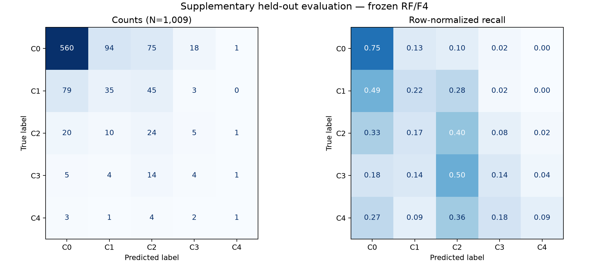

# DepSev-ML — RF/F4 final model

Final RF/F4 đã được freeze, refit trên toàn development_age20 N=4.045, lưu artifact
và khóa hash trước khi thực hiện **supplementary held-out evaluation** trên N=1.009.
Chỉ có một lượt `predict_proba` trên tập này; `y_pred` lấy từ argmax cùng probabilities.
Sau khi lưu evaluation mới chạy permutation importance và SHAP trên development.
Không thay đổi final model, threshold, features hoặc split sau evaluation/explainability.

Metadata: `historically_untouched=false`. Primary model-performance evidence vẫn
là development CV / nested-CV. Kết quả supplementary held-out evaluation không được
dùng để chọn model hoặc điều chỉnh bất kỳ specification nào.

## 1. Final specification

Protocol `original_split_preserved_age20`, cohort N=5.054, age ≥20, đủ cả 9 PHQ-9
items hợp lệ. Development N=4.045, held-out N=1.009, membership giữ nguyên.
Final candidate được người dùng xác nhận trước supplementary held-out evaluation.

```python
RandomForestClassifier(
    n_estimators=150,
    max_depth=8,
    min_samples_split=10,
    min_samples_leaf=8,
    max_features=0.5,
    class_weight="balanced_subsample",
    random_state=42,
    n_jobs=1,
)
```

Toàn bộ defaults còn lại giữ đúng tuned/ensemble configuration, gồm bootstrap=True,
criterion=gini. Không tuning thêm, không SMOTE, không calibration hoặc sửa threshold.

Exact F4 input order, 34 features trước preprocessing học từ dữ liệu:

```text
P (10): BMXBMI, BMXWAIST, BPXPLS, SBP_mean, DBP_mean,
        LBXGH, LBXTC, LBDHDD, LBXSCR, LBXSAL
C (9):  BPQ020, DIQ010, MCQ160B, MCQ160C, MCQ160D,
        MCQ160E, MCQ160F, MCQ220, HUQ010
L (10): PAQ605, PAQ620, PAQ650, PAQ665, PAD680, smoking_status,
        ALQ101, alcohol_status, alcohol_quantity_code, SLD010H
D (5):  RIDAGEYR, RIAGENDR, RIDRETH1, DMDEDUC2, INDFMPIR
```

Các deterministic coding/routing rules vẫn là `src/ablation_features.py` đã audit:
smoking status từ SMQ020/SMQ040; alcohol status/quantity từ questionnaire routing;
nonresponse codes giữ cách xử lý cũ. Những bước này không học statistics và không
sử dụng target. Pipeline artifact nhận 34 columns sau deterministic coding này,
trước imputation/scaling/encoding; không nhận trực tiếp sáu CSV raw chưa xử lý.

Preprocessing được fit cùng RF trong **một Pipeline.fit(X_development, y_development)**:

- 15 numerical features: median imputation → StandardScaler.
- 19 categorical features: constant `missing_or_unknown` → OneHotEncoder,
  handle_unknown=ignore, sparse_output=False, drop=None.
- Kết quả có 79 transformed columns. Không fit preprocessor trên held-out.

Target: tổng DPQ010, DPQ020, DPQ030, DPQ040, DPQ050, DPQ060, DPQ070, DPQ080,
DPQ090; mỗi item 0–3 và không thiếu. Target mapping giữ nguyên:

| Class | PHQ-9 total | Label |
|---|---:|---|
| C0 | 0–4 | Minimal |
| C1 | 5–9 | Mild |
| C2 | 10–14 | Moderate |
| C3 | 15–19 | Moderately severe |
| C4 | 20–27 | Severe |

Specification, schema và mapping đã lưu trước fit:
[final_model_spec.json](../artifacts/final_model_spec.json),
[final_feature_schema.json](../artifacts/final_feature_schema.json),
[class_mapping.json](../artifacts/class_mapping.json).
Các fields `selected_before_heldout=true`, `heldout_used_for_selection=false` nói về
việc lựa chọn trước **supplementary held-out evaluation hiện tại**; không xóa lịch sử
exposure của age20_v2.

## 2. Development evidence và selection rule

| Evidence trên development | RF/F4 Macro-F1 |
|---|---:|
| Nested CV 5 outer × 3 inner, chọn tham số riêng mỗi outer fold | 0.2755 ± 0.0270 |
| Fixed final configuration, cùng 5 outer folds trong ensemble experiment | 0.2630 ± 0.0222 |

SD giữa 5 folds dùng ddof=1. Hai dòng đánh giá hai quy trình khác nhau. Nested-CV
chọn max_features=sqrt ở folds 1–3, 0.5 ở folds 4–5; final configuration giữ 0.5
ở mọi fold. Cấu hình cuối không được thay đổi sau khi nhìn thấy khác biệt này.

Conservative selection rule đã chốt trước ensemble: ensemble phải tăng mean
Macro-F1 ≥0.01 so với RF, thắng ≥4/5 folds, đồng thời SD ≤ RF. Voting 1:2:1 đạt
0.2781 ± 0.0377, tăng 0.0151, thắng 4/5 folds nhưng SD cao hơn RF 0.0222 nên không
đạt. Giữ RF/F4 theo rule và xác nhận của người dùng. Đây là quyết định development,
không dựa trên supplementary held-out evaluation.

## 3. Supplementary held-out evaluation

N=1.009; `historically_untouched=false`.

| Metric | Value |
|---|---:|
| Macro-F1 | 0.300632 |
| Balanced Accuracy | 0.319696 |
| Macro Precision | 0.321157 |
| Macro Recall | 0.319696 |
| Weighted F1 | 0.641515 |
| Accuracy | 0.618434 |

Per-class results của supplementary held-out evaluation:

| Class | Precision | Recall | F1 | Support | True positives | Predicted count |
|---|---:|---:|---:|---:|---:|---:|
| C0 | 0.839580 | 0.748663 | 0.791519 | 748 | 560 | 667 |
| C1 | 0.243056 | 0.216049 | 0.228758 | 162 | 35 | 144 |
| C2 | 0.148148 | 0.400000 | 0.216216 | 60 | 24 | 162 |
| C3 | 0.125000 | 0.142857 | 0.133333 | 28 | 4 | 32 |
| C4 | 0.250000 | 0.090909 | 0.133333 | 11 | 1 | 4 |

Confusion matrix của supplementary held-out evaluation. Hàng là true class,
cột là predicted class:

| True \ Predicted | C0 | C1 | C2 | C3 | C4 |
|---|---:|---:|---:|---:|---:|
| C0 | 560 | 94 | 75 | 18 | 1 |
| C1 | 79 | 35 | 45 | 3 | 0 |
| C2 | 20 | 10 | 24 | 5 | 1 |
| C3 | 5 | 4 | 14 | 4 | 1 |
| C4 | 3 | 1 | 4 | 2 | 1 |



Model chỉ nhận diện đúng 4/28 C3 và 1/11 C4. Một nửa trường hợp C3 bị dự đoán là C2.
Accuracy 0.6184 cũng thấp hơn tỷ lệ C0=748/1009≈0.7413; vì vậy không dùng accuracy
làm bằng chứng cho khả năng nhận diện tốt các mức triệu chứng. Không fit/chạy thêm
Dummy trên held-out để có phép so sánh này, chỉ dùng counts của evaluation đã lưu.

Predictions và 5 probabilities mỗi participant ở
[final_heldout_predictions.csv](tables/final_heldout_predictions.csv).
Metrics ở [final_heldout_metrics.csv](tables/final_heldout_metrics.csv), per-class ở
[final_heldout_per_class_results.csv](tables/final_heldout_per_class_results.csv).

## 4. Permutation importance trên development

Dùng final fitted pipeline, 4.045 development participants, n_repeats=10,
random_state=42. Hoán vị từng feature F4 trước preprocessing. Lưu giảm Macro-F1,
Balanced Accuracy, F1_C0–C4 và Recall_C0–C4. Mean/SD là qua 10 permutations, SD ddof=1.
Đây là **development in-sample importance**, không phải đánh giá CV.

Top features theo giảm Macro-F1 khi hoán vị:

| Feature | Mean decrease | SD qua repeats |
|---|---:|---:|
| HUQ010 | 0.147350 | 0.007167 |
| INDFMPIR | 0.042452 | 0.006314 |
| BPXPLS | 0.039706 | 0.003745 |
| LBXTC | 0.025644 | 0.005372 |
| BMXWAIST | 0.025244 | 0.004896 |
| smoking_status | 0.023332 | 0.003752 |
| PAQ665 | 0.023176 | 0.004336 |
| RIDAGEYR | 0.019485 | 0.003436 |
| SBP_mean | 0.018462 | 0.002972 |
| LBXSAL | 0.017093 | 0.003489 |

Baseline score dùng nội bộ cho permutation là training Macro-F1≈0.7052, cao hơn
fixed-config development CV 0.2630. Nó phản ánh đánh giá lại training data và không
được đưa vào primary performance evidence. Một số mean importance nhỏ âm
(MCQ160B/C/E/F) không chứng minh các biến đó có hại và không được dùng để bỏ feature.

[permutation_importance.csv](tables/permutation_importance.csv) lưu 408 dòng:
34 features × 12 metrics, có trường class để tách global và C0–C4.
Theo [tài liệu scikit-learn](https://scikit-learn.org/stable/modules/permutation_importance.html),
importance mô tả sự phụ thuộc của model cụ thể vào feature; dữ liệu đánh giá và
các features tương quan ảnh hưởng đến cách diễn giải.

## 5. SHAP global và từng output class

SHAP 0.52.0, TreeExplainer, feature_perturbation=tree_path_dependent,
model_output=raw, approximate=False. Background là training path counts lưu trong
RF có class weighting. Chạy trên toàn bộ 4.045 development participants.

API thực tế trả ndarray shape **(4045, 79, 5)**. Code phát hiện thứ tự dimensions
từ sample/feature/class counts thực tế, đối chiếu classes_=[0,1,2,3,4], và hỗ trợ
cả dạng list của các phiên bản trước. Theo
[tài liệu TreeExplainer](https://shap.readthedocs.io/en/latest/generated/shap.TreeExplainer.html),
output có thể khác theo model/version và phải kiểm tra output space. Với RF này,
đã kiểm tra expected_value + tổng SHAP khớp predict_proba trên cùng development rows;
max absolute error **2.4425e-15**.

Các dummy columns được cộng **signed SHAP trước khi lấy absolute value** để trở về
34 source features và giữ additivity. Global importance là mean absolute grouped
SHAP qua mọi participant, rồi trung bình đều 5 class outputs. Per-class importance
là mean absolute grouped SHAP cho output class tương ứng qua tất cả participant,
không chỉ những người có true label bằng class đó.

Top global theo mean absolute grouped SHAP:

| Feature | Mean absolute SHAP |
|---|---:|
| HUQ010 | 0.046013 |
| INDFMPIR | 0.015804 |
| BPXPLS | 0.011016 |
| PAQ665 | 0.010381 |
| smoking_status | 0.008752 |
| RIAGENDR | 0.008626 |
| BPQ020 | 0.006800 |
| LBXTC | 0.006238 |
| BMXWAIST | 0.006066 |
| SLD010H | 0.005749 |

HUQ010 là tình trạng sức khỏe tự báo cáo, INDFMPIR là tỷ lệ thu nhập/ngưỡng nghèo,
BPXPLS là nhịp mạch, PAQ665 là hoạt động giải trí cường độ vừa. Ranking mô tả final
RF; không suy ra chiều tác động từ mean absolute SHAP hoặc diễn giải thành causal effect.

Top 5 từng output class, thứ tự giảm dần (mean absolute SHAP):

| Output | 1 | 2 | 3 | 4 | 5 |
|---|---|---|---|---|---|
| C0 | HUQ010 (0.091097) | INDFMPIR (0.027772) | RIAGENDR (0.016907) | PAQ665 (0.016013) | smoking_status (0.012668) |
| C1 | HUQ010 (0.023753) | PAQ665 (0.008193) | INDFMPIR (0.007268) | BPXPLS (0.006170) | LBXTC (0.006037) |
| C2 | HUQ010 (0.035575) | INDFMPIR (0.013456) | PAQ665 (0.007628) | BPXPLS (0.006535) | LBXSAL (0.005515) |
| C3 | HUQ010 (0.047244) | INDFMPIR (0.022349) | BPQ020 (0.012612) | BPXPLS (0.012459) | BMXBMI (0.008890) |
| C4 | HUQ010 (0.032396) | BPXPLS (0.018439) | RIAGENDR (0.016958) | PAQ665 (0.016791) | smoking_status (0.013239) |

CSV: [global](tables/shap_global_importance.csv),
[C0–C4](tables/shap_per_class_importance.csv), và từng file `shap_importance_C0.csv` … `C4.csv`.
Figures: [global](figures/shap_summary_global.png), [C0](figures/shap_summary_C0.png),
[C1](figures/shap_summary_C1.png), [C2](figures/shap_summary_C2.png),
[C3](figures/shap_summary_C3.png), [C4](figures/shap_summary_C4.png).
Các plots thể hiện top 15; CSV giữ đủ 34 features. Attribution arrays và mapping
79→34 được lưu để tái kiểm tra.

## 6. Artifact và kiểm tra

Fitted Pipeline: [artifacts/final_model.pkl](../artifacts/final_model.pkl), định dạng
joblib, dùng `joblib.load` với artifact tin cậy của project và các dependency versions
ghi trong specification. Pipeline chứa fitted imputer, scaler, encoder và RF.

SHA-256 của final model:

```text
aad8b283647d89446a0e07a7ff5d74296a2087f35979e6e6b12cfbd06f6c978f
```

Hash này giữ nguyên từ trước supplementary held-out evaluation đến sau SHAP.
Specification lưu SHA-256 của cohort, development IDs, held-out IDs, feature schema,
RF config và thứ tự development rows, cùng hashes các input/source artifacts.
Membership hashes dùng sorted IDs; row-order hash riêng bảo vệ thứ tự.

Đã chạy tuần tự:

```bash
.venv/bin/python src/07_final_test.py --stage freeze
.venv/bin/python src/07_final_test.py --stage refit
.venv/bin/python src/07_final_test.py --stage evaluate
.venv/bin/python src/08_explain.py
.venv/bin/python -m unittest discover -s tests -v
```

**40 tests pass**, gồm 7 tests mới: specification/hashes, development-only preprocessing,
thứ tự freeze/fit/evaluation/explainability, saved metrics/confusion matrix, chống
refit/re-prediction, permutation repeat statistics, SHAP dimensions/grouping/additivity.
Tests supplementary held-out evaluation chỉ dùng predictions đã lưu, không predict lại.
Confusion matrix và cả 6 SHAP figures đã được kiểm tra trực quan.

Chạy lại stages đã hoàn tất chỉ verify và dùng lại artifact. Nếu một lần fit/evaluation
bị gián đoạn thì script dừng để audit thay vì tự refit hoặc predict lại.
Các snapshots của giai đoạn trước được giữ nguyên; ledger mới
`artifacts/supplementary_heldout_evaluation.json` ghi trạng thái evaluation hiện tại.

## 7. Limitations

- 813/1.009 restored held-out participants đã tham gia development trong age20_v2.
  Vì vậy mọi kết quả của tập này được gọi là **supplementary held-out evaluation**.
  `historically_untouched=false` được bảo tồn; model đã được chốt trước evaluation hiện tại.
- Primary evidence là development CV / nested-CV, nhưng lịch sử dùng cùng development
  để chọn feature/configuration/model vẫn tạo selection bias. Không dùng SD giữa folds
  như confidence interval hay bằng chứng statistical significance.
- Severe classes ít mẫu: development C3=104, C4=44; supplementary held-out evaluation
  C3=28, C4=11. C4 recall 1/11 rất nhạy với một trường hợp; performance severe còn yếu.
- Permutation trên training data có optimism, nhất là so với CV. Hoán vị từng feature
  riêng có thể tạo tổ hợp không tự nhiên giữa các predictors tương quan hoặc các biến
  alcohol status/quantity có routing liên quan. Chưa thực hiện conditional/grouped permutation.
- SHAP trên development giải thích hành vi model đã fit. Background tree paths phản ánh
  class balancing. Gộp signed dummy attributions bảo toàn additivity nhưng không phải
  tính lại group-level Shapley values dưới một trò chơi coalition mới.
- SHAP/permutation không là causal effects. Feature quan trọng với C4 không chứng minh
  model dự đoán C4 tốt. Mean absolute SHAP không cho biết tăng feature làm tăng hay giảm risk.
- RF probabilities chưa calibration và dùng class balancing, không diễn giải thành nguy cơ
  trầm cảm của dân số. Class weights không phải NHANES survey weights; chưa mô hình hóa
  complex survey design để suy luận đại diện dân số.
- Dữ liệu cắt ngang, complete PHQ-9 và age≥20 giới hạn khả năng khái quát. Target là
  mức độ triệu chứng từ PHQ-9, không phải chẩn đoán lâm sàng. Chưa có external validation.

Final specification và model artifact giữ nguyên sau toàn bộ evaluation/explainability.
