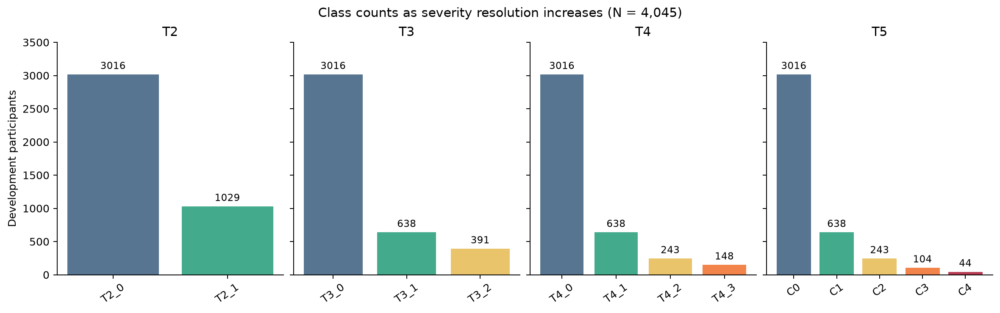
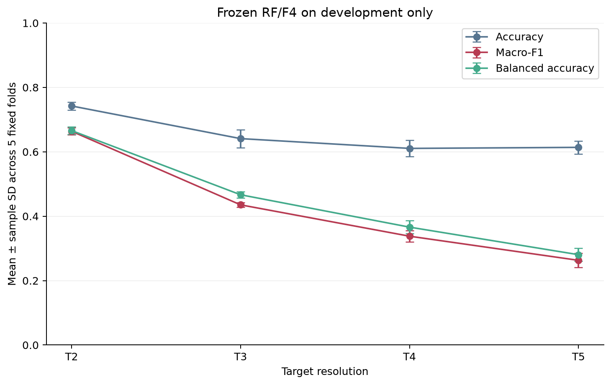
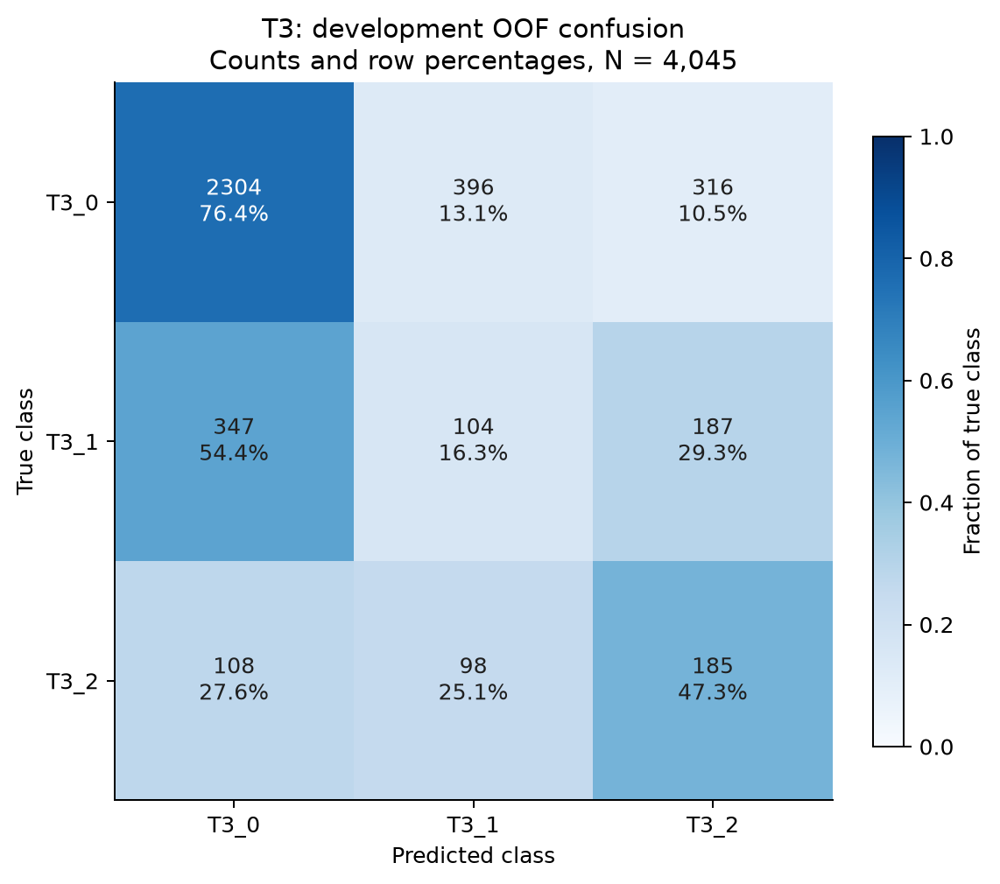
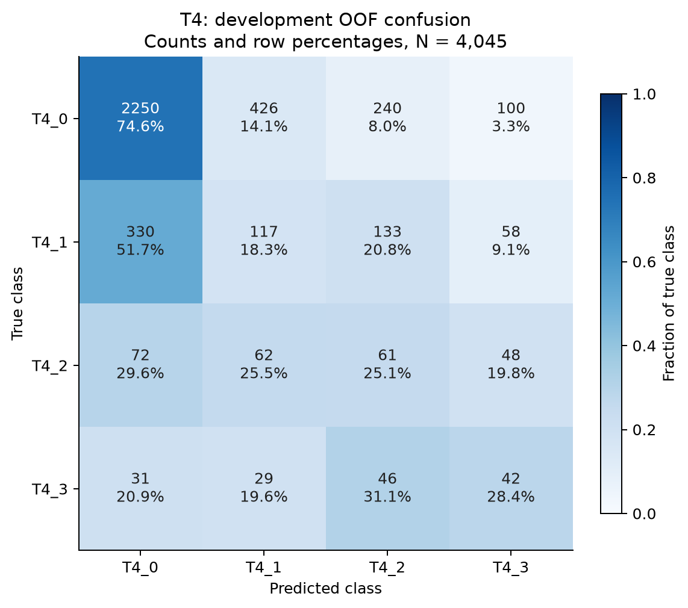
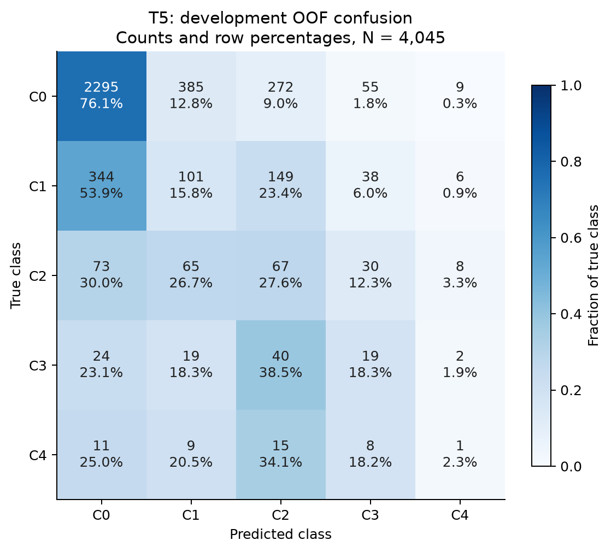
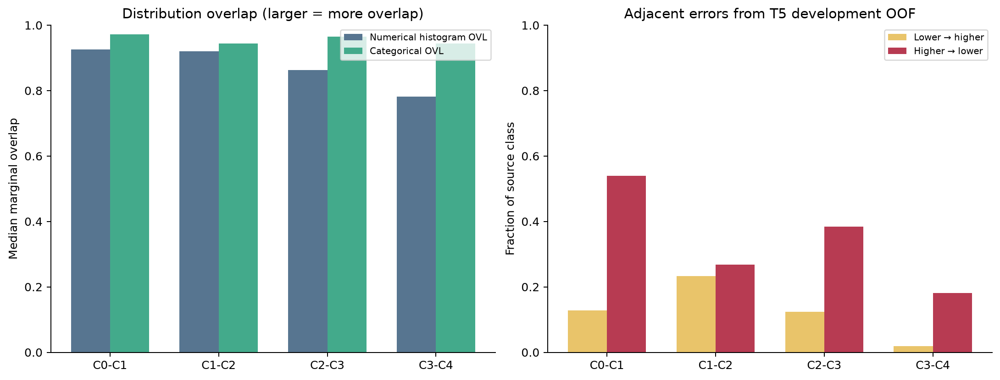
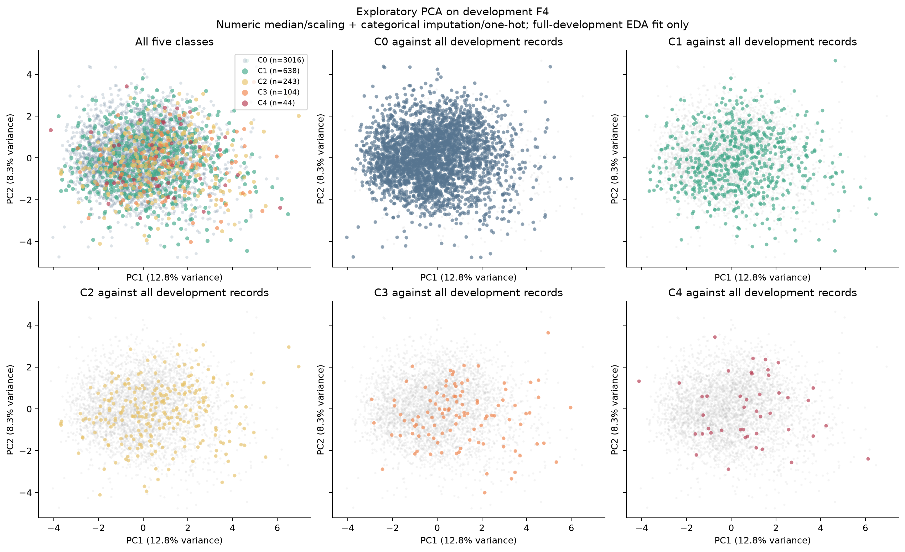
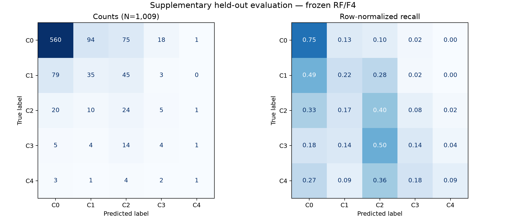

# DepSev-ML — Target granularity trong dự đoán mức độ triệu chứng trầm cảm

Bản tích hợp cập nhật ngày 01/10/2026, dựa trên các kết quả đã lưu. Phần chính
trình bày granularity experiment; toàn bộ nội dung báo cáo RF/F4 trước đây được
giữ ở Phụ lục A. Các báo cáo protocol correction, ablation, nested tuning và
ensemble vẫn được bảo tồn và liên kết trong mục 6.

## 1. Câu hỏi nghiên cứu

> Hiệu năng của cùng một framework thay đổi như thế nào khi mức độ chi tiết của
> bài toán dự đoán depression severity tăng từ 2 lên 5 lớp?

Granularity experiment khảo sát khả năng của RF/F4 đã cố định khi target được
phân chia chi tiết hơn. Bốn tasks được định nghĩa trước bằng cách gộp các mức
PHQ-9 liền kề, giữ nguyên các ngưỡng severity gốc. Đối tượng dự đoán là mức độ
triệu chứng PHQ-9; các nhãn không thay thế chẩn đoán lâm sàng.

Kết quả chính cho thấy Macro-F1 và Balanced Accuracy giảm liên tục từ T2 đến T5.
Bước giảm lớn nhất xuất hiện khi tách mild khỏi nhóm symptomatic để tạo T3.
Các kết quả được diễn giải trong phạm vi framework, cohort và development CV
hiện tại, cùng với per-class performance và phân tích overlap đã lưu.

## 2. Experimental setting và quy ước tổng hợp

| Thành phần | Thiết lập giữ nguyên |
|---|---|
| Dataset | NHANES 2013–2014 |
| Cohort | RIDAGEYR ≥20, đủ 9 PHQ-9 items hợp lệ |
| Participants dùng trong granularity experiment | Development_age20, N=4045 |
| Features | F4: 34 features thuộc P+C+L+D, giữ nguyên definitions và thứ tự |
| Model | Frozen Random Forest/F4 |
| Evaluation | Cùng 5 validation-fold assignments đã lưu; mỗi fold có 809 người |
| Nguồn assignments | `artifacts/cv_folds_final_protocol.json`, từ StratifiedKFold(5, shuffle=True, random_state=42) |
| Numerical preprocessing | Median imputation → StandardScaler |
| Categorical preprocessing | Constant `missing_or_unknown` → OneHotEncoder(handle_unknown="ignore") |
| Fit scope | Preprocessing và RF được fit chung trong pipeline, chỉ trên training partition của mỗi fold |

Các tham số cố định là n_estimators=150, max_depth=8, min_samples_split=10,
min_samples_leaf=8, max_features=0.5, class_weight="balanced_subsample",
random_state=42 và n_jobs=1. Toàn bộ defaults còn lại, questionnaire routing,
cách xử lý structural missingness và danh sách 34 features giữ nguyên theo
[final specification](../artifacts/final_model_spec.json) và
[feature schema](../artifacts/final_feature_schema.json).

Yếu tố thiết kế được thay đổi là cách gộp target, từ hai đến năm lớp. Không tạo
split hoặc fold assignments mới, không tuning theo từng task và không điều chỉnh
threshold. Chính sách `balanced_subsample` được giữ nguyên; trọng số thực tế
trong từng bootstrap sample được tính theo các lớp của task tương ứng, vì vậy
không đồng nhất về giá trị số sau khi gộp target.

Tất cả headline metrics được báo dưới dạng mean ± sample SD qua cùng 5 folds
(ddof=1). SD mô tả biến thiên giữa folds, không phải confidence interval. Các
chênh lệch giữa tasks được ghép theo cùng fold. Confusion counts và các tỷ lệ
đi kèm được tính từ pooled development OOF: mỗi participant có đúng một
validation prediction cho mỗi task. Pooled F1/Recall có thể khác trung bình
F1/Recall của các folds, đặc biệt với lớp C4 nhỏ.

Supplementary held-out không được dùng trong granularity experiment. Kết quả
của tập đó chỉ được giữ ở Phụ lục A để bảo tồn lịch sử nghiên cứu và không đóng
góp vào kết luận so sánh T2–T5. T5 tái lập đúng predictions và probabilities OOF
của RF/F4 trong ensemble experiment trước đó; đây là kiểm tra tính nhất quán,
không phải một nguồn xác nhận độc lập mới.

## 3. Results

### A. Target granularity

**Bảng G1. Định nghĩa target và phân bố lớp trên development.** Các counts và
percentages trong mỗi hàng được liệt kê theo thứ tự các khoảng PHQ-9.

| Task | PHQ-9 total theo thứ tự lớp | N theo thứ tự lớp | Percentage theo thứ tự lớp |
|---|---|---|---|
| T2 | 0–4 / 5–27 | 3016 / 1029 | 74.56% / 25.44% |
| T3 | 0–4 / 5–9 / 10–27 | 3016 / 638 / 391 | 74.56% / 15.77% / 9.67% |
| T4 | 0–4 / 5–9 / 10–14 / 15–27 | 3016 / 638 / 243 / 148 | 74.56% / 15.77% / 6.01% / 3.66% |
| T5 | 0–4 / 5–9 / 10–14 / 15–19 / 20–27 | 3016 / 638 / 243 / 104 / 44 | 74.56% / 15.77% / 6.01% / 2.57% / 1.09% |

T2 được gọi là **minimal symptoms vs symptomatic**. T3 và T4 lần lượt giữ riêng
mild và moderate, trong khi T5 giữ đủ C0–C4. Những nhóm này mô tả mức độ triệu
chứng, không phải tình trạng có hoặc không có bệnh. Khi tăng số lớp, nhóm nhỏ
nhất giảm từ 1029 người ở T2 xuống 44 người ở T5.

Nguồn: [granularity_class_distribution.csv](tables/granularity_class_distribution.csv).



### B. Performance chính

**Bảng G2. Performance RF/F4 trên cùng fixed 5-fold CV, mean ± SD.**

| Task | Accuracy | Macro-F1 | Balanced Accuracy |
|---|---:|---:|---:|
| T2 | 0.7424 ± 0.0126 | 0.6639 ± 0.0113 | 0.6659 ± 0.0122 |
| T3 | 0.6410 ± 0.0279 | 0.4354 ± 0.0075 | 0.4667 ± 0.0101 |
| T4 | 0.6106 ± 0.0258 | 0.3380 ± 0.0177 | 0.3661 ± 0.0202 |
| T5 | 0.6138 ± 0.0203 | 0.2630 ± 0.0222 | 0.2805 ± 0.0199 |

Macro-F1 giảm theo chuỗi **0.6639 → 0.4354 → 0.3380 → 0.2630**. Balanced
Accuracy cũng giảm liên tục: **0.6659 → 0.4667 → 0.3661 → 0.2805**. Hai chuỗi
này là bằng chứng rõ nhất trong thí nghiệm hiện tại về sự suy giảm performance
khi yêu cầu dự đoán severity chi tiết hơn. Accuracy không giảm đơn điệu: T5
có Accuracy cao hơn T4 một lượng nhỏ, trong khi hai metrics macro/balanced vẫn giảm.

**Bảng G3. Các metrics bổ sung, mean ± SD qua 5 folds.**

| Task | Macro Precision | Macro Recall | Weighted F1 |
|---|---:|---:|---:|
| T2 | 0.6632 ± 0.0125 | 0.6659 ± 0.0122 | 0.7436 ± 0.0100 |
| T3 | 0.4263 ± 0.0070 | 0.4667 ± 0.0101 | 0.6538 ± 0.0156 |
| T4 | 0.3299 ± 0.0140 | 0.3661 ± 0.0202 | 0.6351 ± 0.0169 |
| T5 | 0.2630 ± 0.0280 | 0.2805 ± 0.0199 | 0.6339 ± 0.0116 |

Balanced Accuracy bằng Macro Recall trong cách chấm các tasks này. Weighted F1
chịu ảnh hưởng lớn của lớp minimal chiếm 74.56% development; giá trị này cần được
đọc cùng Macro-F1 và per-class metrics.

Nguồn: [granularity_results.csv](tables/granularity_results.csv),
[granularity_fold_results.csv](tables/granularity_fold_results.csv).



### C. Điểm suy giảm chính: T2 → T3

**Bảng G4. Chênh lệch ghép theo cùng fold, task sau trừ task trước, mean ± SD.**

| Chuyển task | Δ Accuracy | Δ Macro-F1 | Δ Balanced Accuracy |
|---|---:|---:|---:|
| T3 − T2 | −0.1014 ± 0.0217 | −0.2285 ± 0.0159 | −0.1992 ± 0.0182 |
| T4 − T3 | −0.0304 ± 0.0113 | −0.0974 ± 0.0195 | −0.1005 ± 0.0239 |
| T5 − T4 | +0.0032 ± 0.0063 | −0.0750 ± 0.0220 | −0.0856 ± 0.0250 |

T2 → T3 có mức giảm Macro-F1 lớn nhất, **Δ Macro-F1 = −0.2285**. Macro-F1 và
Balanced Accuracy giảm ở cả 5 folds tại mỗi bước tăng granularity. Riêng Accuracy
T5−T4 tăng ở hai folds, giảm ở hai folds và bằng nhau ở một fold. Tính nhất quán
về dấu của các chênh lệch không được xem là một kiểm định ý nghĩa thống kê.

Cụ thể, nhóm symptomatic 5–27 của T2 được tách thành mild 5–9 và nhóm 10–27 ở
T3; nhóm minimal 0–4 giữ nguyên. Model vì vậy phải phân biệt một lớp mild riêng
với minimal và với nhóm severity cao hơn.

Trong T3, **347/638 người thuộc mild (54.4%) bị dự đoán thành minimal**; chỉ
104/638 người được nhận diện đúng mild. Bảng G5 cho thấy recall mild trung bình
0.1629 ± 0.0464 và F1 0.1659 ± 0.0217. Quan sát này gợi ý khó khăn trong việc
tách mild khỏi minimal bằng không gian feature hiện tại: *suggests difficulty
separating mild from minimal using the current feature space*. Đây là diễn giải
từ lỗi OOF quan sát được, không xác định một cơ chế nhân quả tạo ra mức giảm.

Nguồn: [granularity_paired_deltas.csv](tables/granularity_paired_deltas.csv),
[granularity_paired_fold_deltas.csv](tables/granularity_paired_fold_deltas.csv),
[granularity_confusion_matrices.csv](tables/granularity_confusion_matrices.csv).
Confusion matrix T2 được lưu ở [Hình G3a](figures/granularity_T2_confusion.png).



### D. Fine-grained severity và per-class performance

Ở T4, nhóm PHQ-9 **15–27 được nhận diện đúng 42/148 người (28.4%)**;
46/148 người (31.1%) bị dự đoán xuống nhóm 10–14. Gộp C3+C4 vẫn để lại một nhóm
có khả năng nhận diện hạn chế dưới cấu hình hiện tại.

Ở T5, **C3 → C2 = 40/104 = 38.5%**, lớn hơn số trường hợp C3 được nhận diện
đúng (19/104). C4 chỉ có **1/44 người được dự đoán đúng (2.3%)**. Trong 43 lỗi
C4, model dự đoán 15 người thành C2, 11 thành C0, 9 thành C1 và 8 thành C3.
Vì vậy, lỗi ở lớp severe không chỉ là nhầm giữa hai lớp nặng liền kề.

**Bảng G5. Precision, Recall và F1 từng lớp, mean ± SD qua 5 folds.** Support
là tổng số participant của lớp trên development. T2–T4 đánh số lớp từ 0 theo
thứ tự khoảng PHQ-9 trong Bảng G1; T5 dùng C0–C4 gốc.

| Lớp | Support | Precision | Recall | F1 |
|---|---:|---:|---:|---:|
| T2_0 | 3016 | 0.8312 ± 0.0081 | 0.8216 ± 0.0249 | 0.8261 ± 0.0111 |
| T2_1 | 1029 | 0.4952 ± 0.0236 | 0.5102 ± 0.0380 | 0.5016 ± 0.0184 |
| T3_0 | 3016 | 0.8354 ± 0.0073 | 0.7639 ± 0.0460 | 0.7973 ± 0.0241 |
| T3_1 | 638 | 0.1748 ± 0.0114 | 0.1629 ± 0.0464 | 0.1659 ± 0.0217 |
| T3_2 | 391 | 0.2689 ± 0.0092 | 0.4732 ± 0.0241 | 0.3428 ± 0.0133 |
| T4_0 | 3016 | 0.8386 ± 0.0042 | 0.7460 ± 0.0394 | 0.7892 ± 0.0228 |
| T4_1 | 638 | 0.1846 ± 0.0149 | 0.1834 ± 0.0413 | 0.1823 ± 0.0249 |
| T4_2 | 243 | 0.1280 ± 0.0242 | 0.2508 ± 0.0426 | 0.1691 ± 0.0295 |
| T4_3 | 148 | 0.1685 ± 0.0331 | 0.2844 ± 0.0728 | 0.2113 ± 0.0458 |
| T5/C0 | 3016 | 0.8359 ± 0.0112 | 0.7609 ± 0.0337 | 0.7962 ± 0.0158 |
| T5/C1 | 638 | 0.1739 ± 0.0205 | 0.1583 ± 0.0450 | 0.1638 ± 0.0288 |
| T5/C2 | 243 | 0.1232 ± 0.0236 | 0.2761 ± 0.0617 | 0.1703 ± 0.0339 |
| T5/C3 | 104 | 0.1318 ± 0.0609 | 0.1824 ± 0.0611 | 0.1515 ± 0.0591 |
| T5/C4 | 44 | 0.0500 ± 0.1118 | 0.0250 ± 0.0559 | 0.0333 ± 0.0745 |

C4 pooled OOF recall là 1/44=0.0227, trong khi mean recall qua folds là 0.0250.
Hai giá trị khác nhau do cách tổng hợp và support mỗi fold không hoàn toàn bằng
nhau; không thay thế một giá trị cho giá trị còn lại. Tương tự, tỷ lệ đúng của
nhóm 15–27 ở T4 là 42/148=0.2838 trong pooled OOF.

Nguồn: [granularity_per_class_results.csv](tables/granularity_per_class_results.csv),
[granularity_per_class_fold_results.csv](tables/granularity_per_class_fold_results.csv),
[granularity_confusion_matrices.csv](tables/granularity_confusion_matrices.csv).





### E. Ordinal behaviour

**Bảng G6. Ordinal metrics, mean ± SD qua cùng 5 folds.**

| Task | Mean Absolute Class Error | Within-one-class accuracy |
|---|---:|---:|
| T3 | 0.4638 ± 0.0251 | 0.8952 ± 0.0031 |
| T4 | 0.5528 ± 0.0327 | 0.8690 ± 0.0150 |
| T5 | 0.5525 ± 0.0178 | 0.8667 ± 0.0077 |

Mean Absolute Class Error là mean(abs(y_true−y_pred)); within-one-class accuracy
là tỷ lệ abs(y_true−y_pred)≤1. Chỉ số lớp được sắp theo severity tăng dần. Hai
metrics được báo cho T3–T5; T2 không được dùng cho comparison ordinal này.

Mặc dù exact-class performance thấp hơn ở các tasks chi tiết, phần lớn predictions
trên toàn development vẫn nằm trong phạm vi một bậc so với true severity class:
89.52% ở T3, 86.90% ở T4 và 86.67% ở T5. Kết quả mô tả sự gần nhau theo mã lớp,
không bảo đảm các lớp severe được nhận diện tốt hoặc lỗi có ý nghĩa lâm sàng nhỏ.
Các tỷ lệ tổng thể này cũng chịu ảnh hưởng của lớp C0 chiếm đa số.

Khoảng cách một bậc không tương đương một số điểm PHQ-9 cố định, và các bậc gộp
của T3/T4 khác các bậc của T5. Vì vậy không so sánh các ordinal metrics như thể
chúng có cùng đơn vị tuyệt đối giữa tasks. Mean Absolute Class Error gần như
không đổi từ T4 sang T5 cũng không phủ nhận suy giảm Macro-F1 ở Bảng G2.

Nguồn: [granularity_results.csv](tables/granularity_results.csv).

## 4. Discussion

### 4.1. Coarse-grained task dễ hơn fine-grained task đối với framework hiện tại

Cùng dataset, cùng 4045 participants, cùng 34 predictors, cùng cấu hình RF và
cùng fold assignments, Macro-F1 giảm liên tục khi số lớp tăng từ hai lên năm.
Balanced Accuracy có cùng xu hướng và cả hai metrics đều giảm ở từng fold tại
mỗi bước. Đây là bằng chứng thực nghiệm rằng yêu cầu phân loại severity chi tiết
hơn làm bài toán khó hơn đối với framework hiện tại. Sự suy giảm lớn nhất xảy ra
tại T2 → T3, phù hợp với quan sát mild thường bị dự đoán thành minimal.

Trong bốn tasks đã khảo sát, T2 cho khả năng phân biệt tương đối tốt nhất, nhưng
recall nhóm symptomatic chỉ 0.5102 ± 0.0380 và F1 là 0.5016 ± 0.0184. T3 giữ
được một phần khả năng nhận diện nhóm 10–27, trong khi lớp mild có F1 thấp.
T4/T5 tiếp tục bộc lộ hạn chế khi phân biệt các mức triệu chứng chi tiết.

Kết luận này có phạm vi là một framework đã cố định và một cách gộp target được
định trước. Nó không phải giới hạn tối ưu của mọi phương pháp hoặc mọi cách biểu
diễn dữ liệu. Không thể từ điểm T5 thấp suy rộng rằng NHANES không phù hợp cho
nghiên cứu depression severity. Dữ liệu vẫn cho phép mô tả rõ mức độ phân giải mà
framework hiện tại xử lý tương đối tốt hơn và nơi hiệu năng bắt đầu suy giảm.

Việc thay số lớp cũng làm thay đổi bài toán và cách tổng hợp metric. Các mức
tham chiếu của metrics phụ thuộc vào số lớp; các chênh lệch không biểu diễn một
đại lượng lâm sàng có đơn vị chung. RF đã được chọn trong quá trình phát triển
5-class trước đây, không được tối ưu riêng cho từng task trong thí nghiệm này.
Do đó, so sánh có giá trị cho câu hỏi giữ nguyên framework, nhưng không thay thế
đánh giá độc lập về khả năng khái quát.

### 4.2. Accuracy không đủ để đánh giá

T2 đạt **Accuracy = 74.24%**, trong khi tỷ lệ majority minimal là
**3016/4045 = 74.56%**. Quy tắc luôn dự đoán minimal sẽ có Accuracy bằng tỷ lệ
majority này; đây là phép đối chiếu trực tiếp từ class counts, không phải một
experiment mới. Vì vậy, Accuracy T2 không đủ để tuyên bố model mạnh.

Macro-F1, Balanced Accuracy và per-class Recall/F1 cần được ưu tiên khi diễn
giải khả năng phân biệt các mức triệu chứng. T2 Balanced Accuracy 0.6659 ± 0.0122
và recall symptomatic khoảng 51% cho thấy model có nhận diện cả hai nhóm, nhưng
vẫn bỏ sót gần một nửa nhóm symptomatic trong pooled OOF. Precision symptomatic
trung bình 0.4952 ± 0.0236 cũng cho thấy nhiều false positives.

Accuracy T5 cao hơn T4 một lượng nhỏ không phản ánh cải thiện trên các lớp severity
khó: Macro-F1 và Balanced Accuracy đều giảm, còn C4 chỉ có một true positive.
Tương tự, within-one-class accuracy cao trên toàn mẫu không loại bỏ hạn chế
nhận diện severe hoặc sự chi phối của lớp majority.

### 4.3. Feature overlap là một limitation quan trọng

Các thống kê mô tả trên development cho thấy nhiều predictors có phân phối
chồng lấp giữa các severity groups. Numerical summaries dùng giá trị quan sát
được, không dùng median-imputed values; missingness và số quan sát được báo
riêng theo feature/class. Categorical distributions giữ mức missing/unknown
rõ ràng và biểu diễn percentage trong từng severity class.

**Bảng G7. Overlap phân phối biên và effect size giữa các lớp liền kề.** Mỗi
giá trị là median qua các features thuộc loại tương ứng, không phải overlap
của toàn bộ không gian đa biến.

| Cặp lớp | Numerical histogram overlap | Categorical overlap | Absolute Cliff's δ |
|---|---:|---:|---:|
| C0–C1 | 0.926 | 0.971 | 0.043 |
| C1–C2 | 0.921 | 0.944 | 0.049 |
| C2–C3 | 0.863 | 0.965 | 0.018 |
| C3–C4 | 0.782 | 0.944 | 0.056 |

Numerical overlap là tổng phần xác suất histogram chung, dùng cùng biên decile
từ development cho từng feature; các biên trùng nhau được gộp. Categorical
overlap là tổng phần xác suất chung của các category. Giá trị gần 1 biểu thị
chồng lấp nhiều hơn theo cách mô tả này. Cliff's δ so sánh thứ hạng hai nhóm;
giá trị gần 0 không đồng nghĩa mọi khía cạnh của hai phân phối đều giống nhau.

**C0–C1 numerical overlap = 0.926 và categorical overlap = 0.971** cho thấy
phân phối biên của nhiều features gần nhau. **C2–C3 median absolute Cliff's δ
= 0.018** cho thấy chênh lệch thứ hạng nhìn chung rất nhỏ. Các quan sát này phù
hợp với lỗi mild/minimal và C3/C2 trong OOF, nhưng không xác định overlap là
nguyên nhân duy nhất của lỗi phân loại.

Nguồn: [adjacent_class_overlap.csv](tables/adjacent_class_overlap.csv),
[overlap_numerical_adjacent_effects.csv](tables/overlap_numerical_adjacent_effects.csv),
[overlap_categorical_adjacent_overlap.csv](tables/overlap_categorical_adjacent_overlap.csv).



**Bảng G8. Một số associations đơn biến nổi bật trên development.** Spearman
ρ liên hệ numerical feature với PHQ9_total; Cramér's V liên hệ categorical
feature với C0–C4. Hai statistics không có cùng ý nghĩa và không được xếp hạng
trực tiếp trên một thang đo chung.

| Feature | Statistic | Giá trị |
|---|---|---:|
| LBXSAL | Spearman ρ | −0.164 |
| INDFMPIR | Spearman ρ | −0.159 |
| SLD010H | Spearman ρ | −0.139 |
| BMXBMI | Spearman ρ | +0.114 |
| HUQ010 | Cramér's V | 0.195 |

Các tương quan numerical còn nhỏ, trong khi HUQ010 có association tương đối
lớn hơn các categorical features khác trong phân tích đã lưu. Kết quả phù hợp
với tín hiệu đơn biến yếu đến trung bình và overlap đáng kể, chưa cho thấy sự
phân tách rõ giữa mọi lớp. Chẳng hạn LBXSAL có median lần lượt 4.3, 4.2, 4.1,
4.1, 4.1 ở C0–C4; Q1–Q3 ở C2 và C3 đều là 3.9–4.4 (IQR=0.5). Sự thay đổi trung tâm phân
phối tồn tại đồng thời với chồng lấp trong từng nhóm.

Cramér's V là estimator mô tả không hiệu chỉnh; bảng nguồn báo cả tỷ lệ cells
có expected count nhỏ hơn 5. Spearman p-values trong nguồn là exploratory và
chưa hiệu chỉnh multiple comparisons; phần thảo luận dựa vào magnitude của
association, không dùng p-values để chọn lại feature. Numerical summaries,
cross-tabs và associations có tại
[overlap_numerical_summary.csv](tables/overlap_numerical_summary.csv),
[overlap_categorical_crosstabs.csv](tables/overlap_categorical_crosstabs.csv),
[overlap_spearman_correlations.csv](tables/overlap_spearman_correlations.csv) và
[overlap_categorical_associations.csv](tables/overlap_categorical_associations.csv).

[Hình G5: numerical boxplots](figures/overlap_numerical_boxplots.png) và
[Hình G6: categorical associations](figures/overlap_categorical_association.png)
cung cấp bối cảnh phân phối cho các statistics trên. PCA exploratory cho thấy
các lớp trộn lẫn trong không gian hai chiều. PC1 giải thích 12.78% và PC2
giải thích 8.30%, tổng cộng **21.08% phương sai**. Preprocessor cho PCA được fit
riêng trên development để EDA, không được sử dụng trong các fits đánh giá CV.
Vì phép chiếu chỉ giữ một phần phương sai, hình này không đủ để kết luận các
lớp không thể phân tách trong toàn bộ không gian feature.



Nguồn PCA: [overlap_pca_variance.csv](tables/overlap_pca_variance.csv),
[overlap_pca_coordinates.csv](tables/overlap_pca_coordinates.csv).

Các correlations, Cramér's V, Cliff's δ và overlap là associations/thống kê
mô tả, không phải causal effects. SHAP và permutation importance của RF 5-class
được giữ ở Phụ lục A để mô tả hành vi model đã fit; chúng cũng không xác lập
nhân quả và không được dùng để suy ra rằng một feature gây ra triệu chứng.
Một feature có attribution lớn không đồng nghĩa lớp tương ứng được dự đoán tốt.

### 4.4. Class imbalance là yếu tố đóng góp hợp lý, cùng với overlap

T5 có **C0=3016** và **C4=44**, trong khi C3 chỉ có 104 người. Trong mỗi validation
fold, C4 chỉ có 8–9 người, nên một dự đoán đúng có thể làm per-class recall thay
đổi đáng kể. C4 recall trung bình 0.0250 ± 0.0559 và F1 0.0333 ± 0.0745 phản
ánh khả năng nhận diện thấp và độ nhạy lớn với số true positives rất nhỏ.

Chính sách class weighting giúp điều chỉnh đóng góp của các lớp trong training,
nhưng không làm tăng số participant severe được quan sát. Khi gộp classes,
support và trọng số thực tế của `balanced_subsample` thay đổi cùng target,
dù model configuration và chính sách weighting vẫn cố định. Thí nghiệm hiện
tại không tách riêng tác động của scarcity, feature overlap và việc phân chia
target; vì vậy không xác định yếu tố nào chiếm phần lớn mức suy giảm.

Diễn giải được hỗ trợ là: **class imbalance và feature overlap đều là những yếu
tố đóng góp hợp lý — both are plausible contributing factors**. Overlap thấp
hơn ở C3–C4 trong Bảng G7 không cho thấy cặp này dễ phân biệt hơn: ước lượng
histogram nhạy với sample size và cách chia bins, trong khi nhiều lỗi C4 đi
về C0–C2. Phân phối biên chồng lấp hoặc effect size nhỏ cũng không loại trừ
thông tin từ các tương tác đa biến.

Ngoài ra, đây là development comparison sau các bước chọn feature/model trước
đó, nên còn giới hạn về selection bias và khả năng khái quát. Dữ liệu cắt ngang,
điều kiện đủ PHQ-9 và missingness từng feature có thể ảnh hưởng thành phần mẫu.
Các phân tích hiện tại không sử dụng NHANES survey weights/PSUs/strata để suy
luận đại diện dân số; class weights của RF không phải survey weights. Những
giới hạn này không được giải quyết bằng kết quả supplementary held-out ở Phụ lục A.

## 5. Kết luận của granularity subsection

RF/F4 thể hiện khả năng phân biệt tốt hơn rõ rệt ở mức severity thô so với
bài toán năm lớp chi tiết trong development protocol hiện tại. Bước suy giảm
lớn nhất xuất hiện khi mild trở thành một lớp riêng trong T3, cần phân biệt
với minimal. Các kết quả OOF và phân tích mô tả cùng cho thấy khó khăn ở các mức PHQ-9
liền kề, overlap feature đáng kể và số mẫu severe ít. Imbalance và overlap
đều là các yếu tố đóng góp hợp lý, nhưng nghiên cứu hiện tại chưa xác định
được contribution riêng của từng yếu tố.

> RF/F4 demonstrated substantially stronger discrimination in coarse-grained
> severity prediction than in fine-grained five-class prediction within the
> current development protocol. The largest degradation occurred when mild
> symptoms became a distinct class that had to be separated from the minimal
> group. Increasing target granularity
> revealed difficulty distinguishing adjacent PHQ-9 severity levels alongside
> substantial feature-distribution overlap and severe class sparsity. Both are
> plausible contributing factors to limited fine-grained classification, but
> this experiment does not isolate their relative contributions.

## 6. Tích hợp với lịch sử nghiên cứu và nguồn bằng chứng

Các thí nghiệm trước vẫn là bằng chứng cho quá trình xây dựng DepSev-ML.
Granularity bổ sung một câu hỏi nghiên cứu trên framework đã chọn, không
thay thế các kết quả model development đã ghi nhận.

| Giai đoạn được bảo tồn | Báo cáo nguồn | Vai trò trong bản tích hợp |
|---|---|---|
| Age eligibility correction và exploratory runs | [protocol_correction_report.md](protocol_correction_report.md), [ablation_report.md](ablation_report.md) | Lưu lịch sử trước khi khôi phục membership cuối; không trộn scores của split cũ vào T2–T5 |
| Original split preserved, feature ablation và robustness | [ablation_report_final_protocol.md](ablation_report_final_protocol.md) | Bằng chứng về cohort/membership, feature definitions và baselines trên protocol cuối |
| Nested tuning | [nested_cv_tuning_report.md](nested_cv_tuning_report.md) | Bằng chứng cho quá trình chọn family/configuration; RF/F4 nested CV 0.2755 ± 0.0270 đánh giá quy trình tuning |
| Ensemble comparison | [ensemble_report.md](ensemble_report.md) | Conservative selection rule giữ RF/F4; fixed RF CV 0.2630 ± 0.0222 được T5 tái lập |
| Final refit, supplementary held-out evaluation và explainability | [final_report.md](final_report.md), toàn bộ nội dung ở Phụ lục A | Giữ nguyên kết quả và provenance; không dùng supplementary evaluation làm evidence cho granularity |
| Target granularity và feature overlap | Results/Discussion ở mục 3–5 của bản này | So sánh cùng frozen RF/F4 theo T2–T5, chỉ dùng development |

Nested-CV RF 0.2755 và fixed-config RF/T5 0.2630 thuộc hai quy trình đánh giá
khác nhau; không dùng thay thế cho nhau. Các statements về trạng thái ở báo cáo
lịch sử được hiểu tại thời điểm chạy experiment tương ứng.

Các bảng G1–G8 sử dụng trực tiếp CSV đã lưu, có nguồn cạnh từng bảng. Hình G1/G2
là class distribution/performance; G3a–G3d là bốn confusion matrices; G4 là
adjacent overlap; G5/G6 là numerical boxplots/categorical associations; G7 là PCA.
Không tính lại kết quả, vẽ lại hình hoặc chạy model trong lần cập nhật tài liệu này.

Protocol và run records của thí nghiệm:
[granularity_protocol.json](../artifacts/granularity_protocol.json),
[granularity_run.json](../artifacts/granularity_run.json),
[overlap_run.json](../artifacts/overlap_run.json).
Các records này ghi nhận 20 fits RF, kiểm tra T5 tái lập OOF và bảo tồn files cũ
tại thời điểm hoàn tất thí nghiệm. Không thay đổi các records hoặc khóa hash.

## Phụ lục A. Báo cáo RF/F4 trước granularity, bảo tồn toàn bộ nội dung

Phần dưới sao lại toàn bộ [final_report.md](final_report.md); chỉ hạ cấp heading
để phù hợp cấu trúc tài liệu. Các con số, links, model specification và cảnh báo
provenance giữ nguyên. Kết quả supplementary held-out chỉ nằm trong phần lịch
sử này, không được sử dụng để giải thích hoặc lựa chọn thiết kế granularity.

### DepSev-ML — RF/F4 final model

Final RF/F4 đã được freeze, refit trên toàn development_age20 N=4.045, lưu artifact
và khóa hash trước khi thực hiện **supplementary held-out evaluation** trên N=1.009.
Chỉ có một lượt `predict_proba` trên tập này; `y_pred` lấy từ argmax cùng probabilities.
Sau khi lưu evaluation mới chạy permutation importance và SHAP trên development.
Không thay đổi final model, threshold, features hoặc split sau evaluation/explainability.

Metadata: `historically_untouched=false`. Primary model-performance evidence vẫn
là development CV / nested-CV. Kết quả supplementary held-out evaluation không được
dùng để chọn model hoặc điều chỉnh bất kỳ specification nào.

#### 1. Final specification

Protocol `original_split_preserved_age20`, cohort N=5.054, age ≥20, đủ cả 9 PHQ-9
items hợp lệ. Development N=4.045, held-out N=1.009, membership giữ nguyên.
Final candidate được người dùng xác nhận trước supplementary held-out evaluation.

```python
RandomForestClassifier(
    n_estimators=150,
    max_depth=8,
    min_samples_split=10,
    min_samples_leaf=8,
    max_features=0.5,
    class_weight="balanced_subsample",
    random_state=42,
    n_jobs=1,
)
```

Toàn bộ defaults còn lại giữ đúng tuned/ensemble configuration, gồm bootstrap=True,
criterion=gini. Không tuning thêm, không SMOTE, không calibration hoặc sửa threshold.

Exact F4 input order, 34 features trước preprocessing học từ dữ liệu:

```text
P (10): BMXBMI, BMXWAIST, BPXPLS, SBP_mean, DBP_mean,
        LBXGH, LBXTC, LBDHDD, LBXSCR, LBXSAL
C (9):  BPQ020, DIQ010, MCQ160B, MCQ160C, MCQ160D,
        MCQ160E, MCQ160F, MCQ220, HUQ010
L (10): PAQ605, PAQ620, PAQ650, PAQ665, PAD680, smoking_status,
        ALQ101, alcohol_status, alcohol_quantity_code, SLD010H
D (5):  RIDAGEYR, RIAGENDR, RIDRETH1, DMDEDUC2, INDFMPIR
```

Các deterministic coding/routing rules vẫn là `src/ablation_features.py` đã audit:
smoking status từ SMQ020/SMQ040; alcohol status/quantity từ questionnaire routing;
nonresponse codes giữ cách xử lý cũ. Những bước này không học statistics và không
sử dụng target. Pipeline artifact nhận 34 columns sau deterministic coding này,
trước imputation/scaling/encoding; không nhận trực tiếp sáu CSV raw chưa xử lý.

Preprocessing được fit cùng RF trong **một Pipeline.fit(X_development, y_development)**:

- 15 numerical features: median imputation → StandardScaler.
- 19 categorical features: constant `missing_or_unknown` → OneHotEncoder,
  handle_unknown=ignore, sparse_output=False, drop=None.
- Kết quả có 79 transformed columns. Không fit preprocessor trên held-out.

Target: tổng DPQ010, DPQ020, DPQ030, DPQ040, DPQ050, DPQ060, DPQ070, DPQ080,
DPQ090; mỗi item 0–3 và không thiếu. Target mapping giữ nguyên:

| Class | PHQ-9 total | Label |
|---|---:|---|
| C0 | 0–4 | Minimal |
| C1 | 5–9 | Mild |
| C2 | 10–14 | Moderate |
| C3 | 15–19 | Moderately severe |
| C4 | 20–27 | Severe |

Specification, schema và mapping đã lưu trước fit:
[final_model_spec.json](../artifacts/final_model_spec.json),
[final_feature_schema.json](../artifacts/final_feature_schema.json),
[class_mapping.json](../artifacts/class_mapping.json).
Các fields `selected_before_heldout=true`, `heldout_used_for_selection=false` nói về
việc lựa chọn trước **supplementary held-out evaluation hiện tại**; không xóa lịch sử
exposure của age20_v2.

#### 2. Development evidence và selection rule

| Evidence trên development | RF/F4 Macro-F1 |
|---|---:|
| Nested CV 5 outer × 3 inner, chọn tham số riêng mỗi outer fold | 0.2755 ± 0.0270 |
| Fixed final configuration, cùng 5 outer folds trong ensemble experiment | 0.2630 ± 0.0222 |

SD giữa 5 folds dùng ddof=1. Hai dòng đánh giá hai quy trình khác nhau. Nested-CV
chọn max_features=sqrt ở folds 1–3, 0.5 ở folds 4–5; final configuration giữ 0.5
ở mọi fold. Cấu hình cuối không được thay đổi sau khi nhìn thấy khác biệt này.

Conservative selection rule đã chốt trước ensemble: ensemble phải tăng mean
Macro-F1 ≥0.01 so với RF, thắng ≥4/5 folds, đồng thời SD ≤ RF. Voting 1:2:1 đạt
0.2781 ± 0.0377, tăng 0.0151, thắng 4/5 folds nhưng SD cao hơn RF 0.0222 nên không
đạt. Giữ RF/F4 theo rule và xác nhận của người dùng. Đây là quyết định development,
không dựa trên supplementary held-out evaluation.

#### 3. Supplementary held-out evaluation

N=1.009; `historically_untouched=false`.

| Metric | Value |
|---|---:|
| Macro-F1 | 0.300632 |
| Balanced Accuracy | 0.319696 |
| Macro Precision | 0.321157 |
| Macro Recall | 0.319696 |
| Weighted F1 | 0.641515 |
| Accuracy | 0.618434 |

Per-class results của supplementary held-out evaluation:

| Class | Precision | Recall | F1 | Support | True positives | Predicted count |
|---|---:|---:|---:|---:|---:|---:|
| C0 | 0.839580 | 0.748663 | 0.791519 | 748 | 560 | 667 |
| C1 | 0.243056 | 0.216049 | 0.228758 | 162 | 35 | 144 |
| C2 | 0.148148 | 0.400000 | 0.216216 | 60 | 24 | 162 |
| C3 | 0.125000 | 0.142857 | 0.133333 | 28 | 4 | 32 |
| C4 | 0.250000 | 0.090909 | 0.133333 | 11 | 1 | 4 |

Confusion matrix của supplementary held-out evaluation. Hàng là true class,
cột là predicted class:

| True \ Predicted | C0 | C1 | C2 | C3 | C4 |
|---|---:|---:|---:|---:|---:|
| C0 | 560 | 94 | 75 | 18 | 1 |
| C1 | 79 | 35 | 45 | 3 | 0 |
| C2 | 20 | 10 | 24 | 5 | 1 |
| C3 | 5 | 4 | 14 | 4 | 1 |
| C4 | 3 | 1 | 4 | 2 | 1 |



Model chỉ nhận diện đúng 4/28 C3 và 1/11 C4. Một nửa trường hợp C3 bị dự đoán là C2.
Accuracy 0.6184 cũng thấp hơn tỷ lệ C0=748/1009≈0.7413; vì vậy không dùng accuracy
làm bằng chứng cho khả năng nhận diện tốt các mức triệu chứng. Không fit/chạy thêm
Dummy trên held-out để có phép so sánh này, chỉ dùng counts của evaluation đã lưu.

Predictions và 5 probabilities mỗi participant ở
[final_heldout_predictions.csv](tables/final_heldout_predictions.csv).
Metrics ở [final_heldout_metrics.csv](tables/final_heldout_metrics.csv), per-class ở
[final_heldout_per_class_results.csv](tables/final_heldout_per_class_results.csv).

#### 4. Permutation importance trên development

Dùng final fitted pipeline, 4.045 development participants, n_repeats=10,
random_state=42. Hoán vị từng feature F4 trước preprocessing. Lưu giảm Macro-F1,
Balanced Accuracy, F1_C0–C4 và Recall_C0–C4. Mean/SD là qua 10 permutations, SD ddof=1.
Đây là **development in-sample importance**, không phải đánh giá CV.

Top features theo giảm Macro-F1 khi hoán vị:

| Feature | Mean decrease | SD qua repeats |
|---|---:|---:|
| HUQ010 | 0.147350 | 0.007167 |
| INDFMPIR | 0.042452 | 0.006314 |
| BPXPLS | 0.039706 | 0.003745 |
| LBXTC | 0.025644 | 0.005372 |
| BMXWAIST | 0.025244 | 0.004896 |
| smoking_status | 0.023332 | 0.003752 |
| PAQ665 | 0.023176 | 0.004336 |
| RIDAGEYR | 0.019485 | 0.003436 |
| SBP_mean | 0.018462 | 0.002972 |
| LBXSAL | 0.017093 | 0.003489 |

Baseline score dùng nội bộ cho permutation là training Macro-F1≈0.7052, cao hơn
fixed-config development CV 0.2630. Nó phản ánh đánh giá lại training data và không
được đưa vào primary performance evidence. Một số mean importance nhỏ âm
(MCQ160B/C/E/F) không chứng minh các biến đó có hại và không được dùng để bỏ feature.

[permutation_importance.csv](tables/permutation_importance.csv) lưu 408 dòng:
34 features × 12 metrics, có trường class để tách global và C0–C4.
Theo [tài liệu scikit-learn](https://scikit-learn.org/stable/modules/permutation_importance.html),
importance mô tả sự phụ thuộc của model cụ thể vào feature; dữ liệu đánh giá và
các features tương quan ảnh hưởng đến cách diễn giải.

#### 5. SHAP global và từng output class

SHAP 0.52.0, TreeExplainer, feature_perturbation=tree_path_dependent,
model_output=raw, approximate=False. Background là training path counts lưu trong
RF có class weighting. Chạy trên toàn bộ 4.045 development participants.

API thực tế trả ndarray shape **(4045, 79, 5)**. Code phát hiện thứ tự dimensions
từ sample/feature/class counts thực tế, đối chiếu classes_=[0,1,2,3,4], và hỗ trợ
cả dạng list của các phiên bản trước. Theo
[tài liệu TreeExplainer](https://shap.readthedocs.io/en/latest/generated/shap.TreeExplainer.html),
output có thể khác theo model/version và phải kiểm tra output space. Với RF này,
đã kiểm tra expected_value + tổng SHAP khớp predict_proba trên cùng development rows;
max absolute error **2.4425e-15**.

Các dummy columns được cộng **signed SHAP trước khi lấy absolute value** để trở về
34 source features và giữ additivity. Global importance là mean absolute grouped
SHAP qua mọi participant, rồi trung bình đều 5 class outputs. Per-class importance
là mean absolute grouped SHAP cho output class tương ứng qua tất cả participant,
không chỉ những người có true label bằng class đó.

Top global theo mean absolute grouped SHAP:

| Feature | Mean absolute SHAP |
|---|---:|
| HUQ010 | 0.046013 |
| INDFMPIR | 0.015804 |
| BPXPLS | 0.011016 |
| PAQ665 | 0.010381 |
| smoking_status | 0.008752 |
| RIAGENDR | 0.008626 |
| BPQ020 | 0.006800 |
| LBXTC | 0.006238 |
| BMXWAIST | 0.006066 |
| SLD010H | 0.005749 |

HUQ010 là tình trạng sức khỏe tự báo cáo, INDFMPIR là tỷ lệ thu nhập/ngưỡng nghèo,
BPXPLS là nhịp mạch, PAQ665 là hoạt động giải trí cường độ vừa. Ranking mô tả final
RF; không suy ra chiều tác động từ mean absolute SHAP hoặc diễn giải thành causal effect.

Top 5 từng output class, thứ tự giảm dần (mean absolute SHAP):

| Output | 1 | 2 | 3 | 4 | 5 |
|---|---|---|---|---|---|
| C0 | HUQ010 (0.091097) | INDFMPIR (0.027772) | RIAGENDR (0.016907) | PAQ665 (0.016013) | smoking_status (0.012668) |
| C1 | HUQ010 (0.023753) | PAQ665 (0.008193) | INDFMPIR (0.007268) | BPXPLS (0.006170) | LBXTC (0.006037) |
| C2 | HUQ010 (0.035575) | INDFMPIR (0.013456) | PAQ665 (0.007628) | BPXPLS (0.006535) | LBXSAL (0.005515) |
| C3 | HUQ010 (0.047244) | INDFMPIR (0.022349) | BPQ020 (0.012612) | BPXPLS (0.012459) | BMXBMI (0.008890) |
| C4 | HUQ010 (0.032396) | BPXPLS (0.018439) | RIAGENDR (0.016958) | PAQ665 (0.016791) | smoking_status (0.013239) |

CSV: [global](tables/shap_global_importance.csv),
[C0–C4](tables/shap_per_class_importance.csv), và từng file `shap_importance_C0.csv` … `C4.csv`.
Figures: [global](figures/shap_summary_global.png), [C0](figures/shap_summary_C0.png),
[C1](figures/shap_summary_C1.png), [C2](figures/shap_summary_C2.png),
[C3](figures/shap_summary_C3.png), [C4](figures/shap_summary_C4.png).
Các plots thể hiện top 15; CSV giữ đủ 34 features. Attribution arrays và mapping
79→34 được lưu để tái kiểm tra.

#### 6. Artifact và kiểm tra

Fitted Pipeline: [artifacts/final_model.pkl](../artifacts/final_model.pkl), định dạng
joblib, dùng `joblib.load` với artifact tin cậy của project và các dependency versions
ghi trong specification. Pipeline chứa fitted imputer, scaler, encoder và RF.

SHA-256 của final model:

```text
aad8b283647d89446a0e07a7ff5d74296a2087f35979e6e6b12cfbd06f6c978f
```

Hash này giữ nguyên từ trước supplementary held-out evaluation đến sau SHAP.
Specification lưu SHA-256 của cohort, development IDs, held-out IDs, feature schema,
RF config và thứ tự development rows, cùng hashes các input/source artifacts.
Membership hashes dùng sorted IDs; row-order hash riêng bảo vệ thứ tự.

Đã chạy tuần tự:

```bash
.venv/bin/python src/07_final_test.py --stage freeze
.venv/bin/python src/07_final_test.py --stage refit
.venv/bin/python src/07_final_test.py --stage evaluate
.venv/bin/python src/08_explain.py
.venv/bin/python -m unittest discover -s tests -v
```

**40 tests pass**, gồm 7 tests mới: specification/hashes, development-only preprocessing,
thứ tự freeze/fit/evaluation/explainability, saved metrics/confusion matrix, chống
refit/re-prediction, permutation repeat statistics, SHAP dimensions/grouping/additivity.
Tests supplementary held-out evaluation chỉ dùng predictions đã lưu, không predict lại.
Confusion matrix và cả 6 SHAP figures đã được kiểm tra trực quan.

Chạy lại stages đã hoàn tất chỉ verify và dùng lại artifact. Nếu một lần fit/evaluation
bị gián đoạn thì script dừng để audit thay vì tự refit hoặc predict lại.
Các snapshots của giai đoạn trước được giữ nguyên; ledger mới
`artifacts/supplementary_heldout_evaluation.json` ghi trạng thái evaluation hiện tại.

#### 7. Limitations

- 813/1.009 restored held-out participants đã tham gia development trong age20_v2.
  Vì vậy mọi kết quả của tập này được gọi là **supplementary held-out evaluation**.
  `historically_untouched=false` được bảo tồn; model đã được chốt trước evaluation hiện tại.
- Primary evidence là development CV / nested-CV, nhưng lịch sử dùng cùng development
  để chọn feature/configuration/model vẫn tạo selection bias. Không dùng SD giữa folds
  như confidence interval hay bằng chứng statistical significance.
- Severe classes ít mẫu: development C3=104, C4=44; supplementary held-out evaluation
  C3=28, C4=11. C4 recall 1/11 rất nhạy với một trường hợp; performance severe còn yếu.
- Permutation trên training data có optimism, nhất là so với CV. Hoán vị từng feature
  riêng có thể tạo tổ hợp không tự nhiên giữa các predictors tương quan hoặc các biến
  alcohol status/quantity có routing liên quan. Chưa thực hiện conditional/grouped permutation.
- SHAP trên development giải thích hành vi model đã fit. Background tree paths phản ánh
  class balancing. Gộp signed dummy attributions bảo toàn additivity nhưng không phải
  tính lại group-level Shapley values dưới một trò chơi coalition mới.
- SHAP/permutation không là causal effects. Feature quan trọng với C4 không chứng minh
  model dự đoán C4 tốt. Mean absolute SHAP không cho biết tăng feature làm tăng hay giảm risk.
- RF probabilities chưa calibration và dùng class balancing, không diễn giải thành nguy cơ
  trầm cảm của dân số. Class weights không phải NHANES survey weights; chưa mô hình hóa
  complex survey design để suy luận đại diện dân số.
- Dữ liệu cắt ngang, complete PHQ-9 và age≥20 giới hạn khả năng khái quát. Target là
  mức độ triệu chứng từ PHQ-9, không phải chẩn đoán lâm sàng. Chưa có external validation.

Final specification và model artifact giữ nguyên sau toàn bộ evaluation/explainability.

## Phụ lục B. Rà soát cách diễn giải trong bản tích hợp

| Nội dung cần kiểm soát | Cách trình bày đã áp dụng | Vị trí phần mới |
|---|---|---|
| Accuracy dưới class imbalance | Đối chiếu 74.24% với majority 74.56%; ưu tiên Macro-F1, Balanced Accuracy và per-class Recall/F1 | 3.B, 4.2 |
| Ý nghĩa của T2 | Minimal symptoms vs symptomatic, dựa trên PHQ-9 symptom severity | 1, 3.A |
| Thay đổi target T2 → T3 | Tách nhóm symptomatic 5–27 thành 5–9 và 10–27; minimal 0–4 giữ nguyên | 3.C |
| Giải thích điểm suy giảm | OOF gợi ý khó phân biệt mild/minimal; không xác định cơ chế nhân quả | 3.C, 4.1 |
| Overlap, correlation và SHAP | Dùng như mô tả associations hoặc hành vi model; không suy ra causal effects | 4.3 |
| Đánh giá tính phù hợp của dataset | Giới hạn kết luận ở framework, features và cohort hiện tại; không suy rộng từ điểm T5 ra toàn bộ NHANES | 4.1 |
| Severe scarcity và feature overlap | Cả hai là các yếu tố đóng góp hợp lý; không định lượng riêng contribution của từng yếu tố | 4.4, 5 |
| Pooled OOF và fold mean | Phân biệt 1/44=0.0227 với mean recall C4=0.0250; SD chỉ mô tả 5 folds | 2, 3.D |
| Ordinal metrics | Đơn vị là bậc lớp, phụ thuộc grouping; tỷ lệ tổng thể không xác nhận nhận diện severe tốt | 3.E |
| Nested CV, fixed CV và supplementary evaluation | Giữ riêng vai trò từng evidence; supplementary evaluation chỉ được bảo tồn trong lịch sử | 2, 6, Phụ lục A |

Bản cập nhật này chỉ tích hợp và diễn giải các kết quả hiện có. README, các
báo cáo nguồn, dữ liệu, bảng/hình kết quả, code thực nghiệm, model artifacts và
protocol locks được giữ nguyên. Không có experiment mới trong lần cập nhật này.
