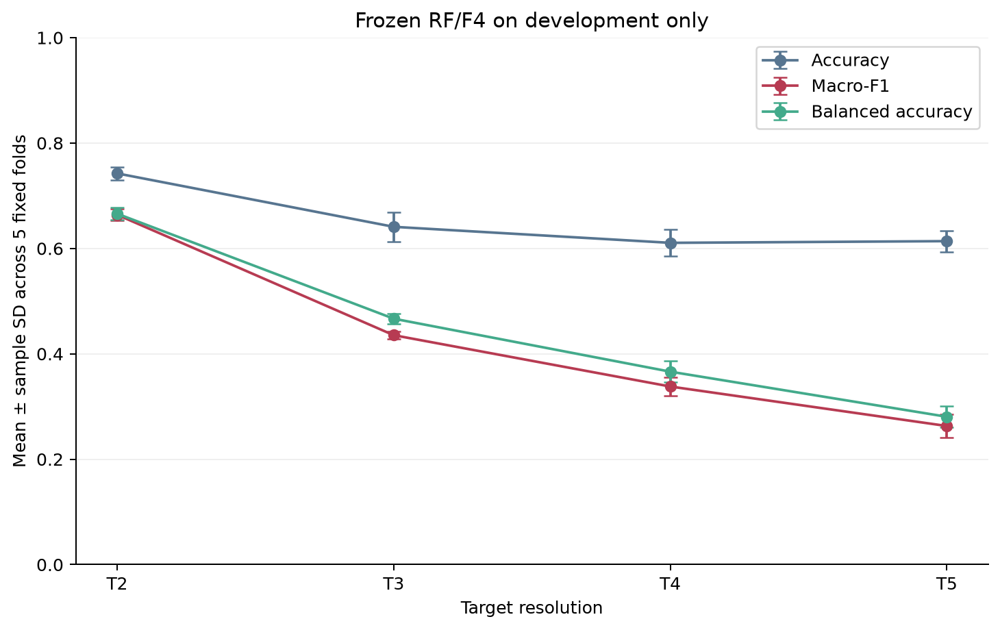
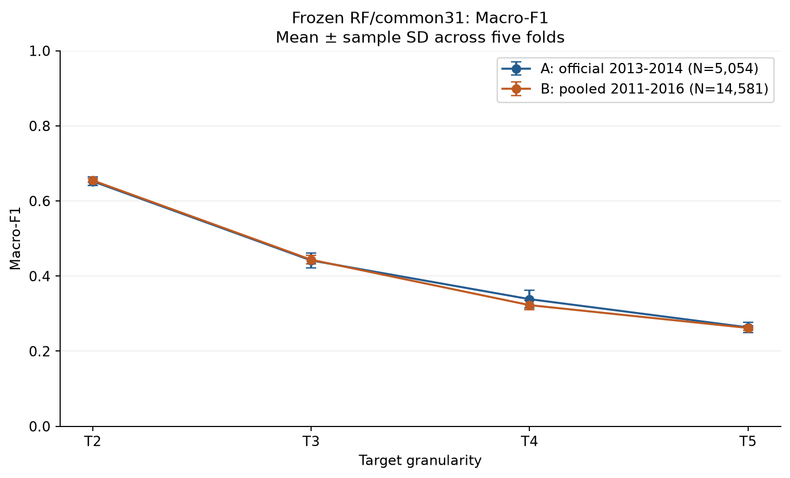
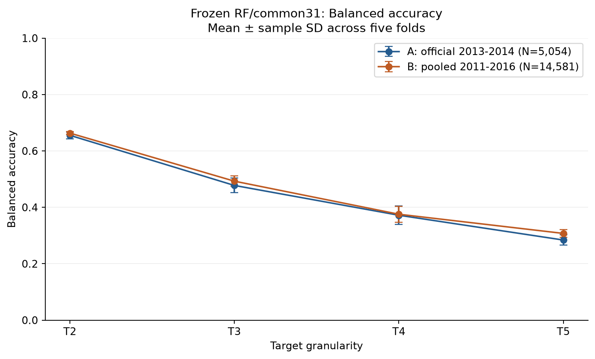
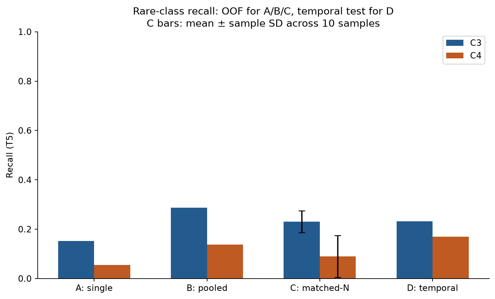

# DepSev-ML: Target granularity và mở rộng dữ liệu NHANES đa chu kỳ

Báo cáo nghiên cứu tích hợp — 02/10/2026.

## Tóm tắt

Nghiên cứu khảo sát khả năng dự đoán mức độ triệu chứng trầm cảm từ các biến physiological, clinical, lifestyle và demographic trong NHANES. Trọng tâm là mức độ chi tiết của target và khả năng giảm suy giảm hiệu năng bằng mở rộng dữ liệu, không phải tìm model có Accuracy cao nhất.

Hai nhánh được phân biệt xuyên suốt: **legacy NHANES 2013–2014 Kaggle CDC, RF/F4 với 34 features** và **official NHANES 2011–2016, RF/F4_common31 với 31 features đã harmonize**. Trong legacy development N=4045, Macro-F1 giảm từ 0.6639 ở T2 xuống 0.2630 ở T5; bước giảm lớn nhất xảy ra khi mild trở thành lớp riêng ở T3. Trong official comparison, pooled N=14581 không cải thiện Macro-F1 nhất quán so với single-cycle N=5054. T5 Macro-F1 là 0.2634 ở single-cycle và 0.2619 ở pooled, trong khi Balanced Accuracy tăng từ 0.2841 lên 0.3076. Recall C3/C4 tăng nhưng precision còn thấp và C3 F1 gần như không đổi. Mẫu hình khó khăn ở target chi tiết tiếp tục xuất hiện trong matched-N, temporal evaluation và phân tích theo cycle.

Kết quả hỗ trợ một kết luận có giới hạn: framework RF cố định xử lý symptom grouping thô tốt hơn phân loại severity chi tiết; tăng số cycle chưa giải quyết được hạn chế đó theo Macro-F1. Các phân tích overlap, class scarcity và XAI bổ sung bối cảnh mô tả, không xác định cơ chế nhân quả. Nguồn số liệu của các kết luận nằm cạnh từng bảng ở phần Results.

Đây là bản synthesis từ kết quả đã lưu. Các báo cáo lịch sử được bảo tồn; không có model fit, tuning, CV, SHAP hoặc experiment mới trong lần tích hợp này.

## 1. Research framing

### 1.1. Câu hỏi trung tâm

**English**

> How does predictive performance change as depression symptom severity is represented with increasingly finer target granularity, and to what extent can expanding NHANES data across multiple cycles mitigate the observed degradation?

**Tiếng Việt**

> Hiệu năng dự đoán thay đổi như thế nào khi mức độ triệu chứng trầm cảm được biểu diễn bằng các lớp ngày càng chi tiết, và việc mở rộng dữ liệu NHANES qua nhiều chu kỳ có thể giảm bớt sự suy giảm đó đến mức nào?

Đối tượng dự đoán là **PHQ-9 symptom severity** trong cohort nghiên cứu. T2 được gọi là **minimal symptoms vs symptomatic**, không phải phân biệt người khỏe mạnh với người có bệnh. Các experiments không đánh giá khả năng chẩn đoán hoặc hiệu quả ứng dụng lâm sàng.

### 1.2. Bộ research questions cuối cùng

| RQ | Câu hỏi nghiên cứu | Evidence trả lời |
| --- | --- | --- |
| RQ1 | Hiệu năng thay đổi như thế nào khi target severity tăng từ 2 lên 5 lớp? | Controlled T2–T5 trong legacy và official A/B/C/D |
| RQ2 | Bước tăng granularity nào và những lớp/confusions nào gắn với suy giảm lớn nhất? | Granularity deltas, per-class metrics, confusion matrices |
| RQ3 | Mở rộng từ một lên ba cycle có cải thiện hiệu năng khi giữ cùng common31 và frozen RF framework không? | Official A single, B pooled, C matched-N |
| RQ4 | Khi số mẫu C3/C4 tăng trong pooled cohort, khả năng nhận diện các lớp này thay đổi ra sao, và có chuyển thành cải thiện Macro-F1 không? | Class counts, recall, precision, F1 và dự đoán C3/C4 của A/B/C |
| RQ5 | Mẫu hình hiệu năng quan sát được có tiếp tục xuất hiện khi đánh giá theo thời gian trên NHANES 2015–2016 không? | D temporal và B pooled OOF theo source cycle |

RQ2 hỏi vị trí/mẫu hình suy giảm, không định lượng đóng góp nhân quả của từng yếu tố. RQ4 là đối chiếu mô tả khi mở rộng dữ liệu; thiết kế không cô lập hoàn toàn sample size khỏi thành phần cycle.

### 1.3. Research expectations và thời điểm hình thành

Hai expectations dùng để tổ chức discussion:

- **E1:** Macro-F1 và Balanced Accuracy có xu hướng giảm khi target granularity tăng.
- **E2:** Mở rộng multi-cycle có thể giúp recall của các lớp severe ít mẫu nhưng chưa chắc loại bỏ khó khăn fine-grained classification.

Chúng được phát biểu trong giai đoạn tổng hợp sau khi đã có kết quả, **không phải hypotheses preregistered hay kỳ vọng được ghi nhận trước phân tích**. Ngược lại, conservative selection rule của ensemble và frozen multi-cycle configuration có artifacts riêng được chốt trước các runs tương ứng. Không đồng nhất hai loại thời điểm này.

## 2. Hai nhánh bằng chứng và tiến trình nghiên cứu

| Nhánh | Nguồn / feature space | Phạm vi thực nghiệm | Vai trò |
| --- | --- | --- | --- |
| Legacy / original | Kaggle CDC NHANES 2013–2014; F4=34 | Dummy; LR/DT/RF/XGB; F1–F4 ablation; robustness; nested tuning; ensemble; RF selection/refit; supplementary held-out; XAI; granularity và overlap | Xây dựng framework và xác định khó khăn khi tăng target granularity |
| Official multi-cycle extension | Official NHANES 2011–2012, 2013–2014, 2015–2016; F4_common31 | A single-cycle; B pooled; C matched-N; D temporal; T2–T5; per-cycle OOF | Kiểm tra mở rộng dữ liệu trong cùng feature space và frozen RF |

**Không lấy chênh lệch legacy F4-34 so với common31 làm ước lượng tác động sample size.** Hai nhánh khác nguồn dữ liệu, feature policy và số participants được dùng trong CV. Đối chứng single-cycle hợp lệ cho B trong nghiên cứu này là **A official common31**, không phải legacy development.

Lịch sử không bị viết lại:

1. Baseline và ablation tạo bằng chứng lựa chọn feature/model; correction age ≥20 xuất phát từ survey eligibility, không từ score.
2. Age20_v2 từng re-split. Membership original được khôi phục và lọc tuổi riêng theo từng partition trong final protocol. Lịch sử exposure vẫn tồn tại.
3. Nested tuning xác định RF/F4 là candidate dẫn đầu trong budget đã khảo sát; ensemble rule giữ RF thay vì chọn mean cao nhất bằng mọi giá.
4. Final refit và supplementary held-out evaluation đã hoàn tất trong legacy; sau đó mới có XAI và controlled granularity.
5. Audit/harmonization tạo common31 official; A/B/C/D kế thừa RF configuration để kiểm tra một framework cố định, không chọn lại model.

Nguồn lịch sử được giữ nguyên: [protocol correction](protocol_correction_report.md), [ablation ban đầu](ablation_report.md), [ablation final protocol](ablation_report_final_protocol.md), [nested tuning](nested_cv_tuning_report.md), [ensemble](ensemble_report.md), [final RF report](final_report.md), [granularity report](final_report_granularity.md) và [multi-cycle technical summary](multicycle/multicycle_experiment_summary.md).

## 3. Dữ liệu, target và feature policy

### 3.1. Legacy cohort

Cohort Kaggle CDC 2013–2014 yêu cầu age ≥20 và đủ chín PHQ-9 items hợp lệ, tổng N=5054. Final-protocol development N=4045; supplementary held-out N=1009.

**Bảng 1. Legacy cohort và membership cuối.**

| Legacy partition | N | C0 | C1 | C2 | C3 | C4 |
| --- | --- | --- | --- | --- | --- | --- |
| Development | 4045 | 3016 | 638 | 243 | 104 | 44 |
| Supplementary held-out | 1009 | 748 | 162 | 60 | 28 | 11 |
| Full cohort | 5054 | 3764 | 800 | 303 | 132 | 55 |

Nguồn: [class_distribution_final_protocol.csv](tables/class_distribution_final_protocol.csv), [final_model_spec.json](../artifacts/final_model_spec.json).

Protocol là original_split_preserved_age20. Khôi phục membership không xóa exposure: 813/1009 người trong restored held-out đã tham gia development của age20_v2. Vì vậy historically_untouched=false được giữ nguyên. Kết quả trên 1009 người chỉ là **supplementary held-out evaluation**, không dùng làm bằng chứng chính cho granularity hoặc làm đối chứng multi-cycle. Primary legacy evidence vẫn là development CV/nested-CV, với giới hạn prior selection nêu ở mục 8.

### 3.2. Official multi-cycle cohorts

Mỗi cycle được xây riêng từ official modules ghép bằng SEQN, age ≥20, đủ DPQ010–DPQ090 trong tập 0–3, rồi mới concat sau schema/coding audit. Mỗi participant một row; duplicate SEQN bằng 0 theo audit. Cycle là provenance, không phải predictor.

**Bảng 2. Class distribution của official common31 cohorts.** Percentage dùng N của cohort cuối từng dòng, không phải dân số NHANES có survey weighting.

| Official cohort | N | C0, n (%) | C1, n (%) | C2, n (%) | C3, n (%) | C4, n (%) |
| --- | --- | --- | --- | --- | --- | --- |
| 2011–2012 | 4639 | 3531 (76.12%) | 686 (14.79%) | 242 (5.22%) | 121 (2.61%) | 59 (1.27%) |
| 2013–2014 | 5054 | 3764 (74.48%) | 800 (15.83%) | 303 (6.00%) | 132 (2.61%) | 55 (1.09%) |
| 2015–2016 | 4888 | 3649 (74.65%) | 841 (17.21%) | 246 (5.03%) | 99 (2.03%) | 53 (1.08%) |
| pooled–2011–2016 | 14581 | 10944 (75.06%) | 2327 (15.96%) | 791 (5.42%) | 352 (2.41%) | 167 (1.15%) |

Nguồn: [multicycle_class_distribution.csv](tables/multicycle_class_distribution.csv).

So với official 2013–2014, pooled C3 tăng **132 → 352, thêm 220 người**, C4 tăng **55 → 167, thêm 112 người**. Tăng số tuyệt đối không đồng nghĩa giảm imbalance: C3 proportion thay đổi 2.61% → 2.41%, C4 1.09% → 1.15%, còn C0 chiếm khoảng 75.06% pooled cohort.

Các denominators khác nhau trong bảng audit cần được phân biệt: total N là toàn DEMO; valid PHQ N là đủ chín items trước filter tuổi; age≥20 N là đủ tuổi trước yêu cầu PHQ; cohort N là giao hai điều kiện. Không cộng hoặc diễn giải các cột đó như các bước loại mẫu nối tiếp có cùng mẫu số.

### 3.3. Target granularity

**Bảng 3. Bốn target definitions dùng chung.**

| Target | PHQ-9 total groups theo thứ tự tăng | Ý nghĩa |
| --- | --- | --- |
| T2 | 0–4; 5–27 | Minimal symptoms vs symptomatic |
| T3 | 0–4; 5–9; 10–27 | Minimal; mild; moderate or higher |
| T4 | 0–4; 5–9; 10–14; 15–27 | Minimal; mild; moderate; moderately severe or severe |
| T5 | 0–4; 5–9; 10–14; 15–19; 20–27 | C0 minimal; C1 mild; C2 moderate; C3 moderately severe; C4 severe |

T2 → T3 **tách nhóm 5–27 thành 5–9 và 10–27**; nhóm minimal 0–4 giữ nguyên. Không viết rằng mild vốn thuộc minimal trong T2. Tổng điểm, PHQ items và severity label không nằm trong predictors.

Nguồn: [granularity_protocol.json](../artifacts/granularity_protocol.json), [experiment_config.json](../artifacts/multicycle/experiment_config.json).

### 3.4. Từ F4-34 đến F4_common31

Legacy F4 bao gồm P=10 physiological, C=9 clinical, L=10 lifestyle và D=5 demographic features. Common31 giữ P/C/D, còn L=7 sau khi loại:

| Feature loại khỏi common31 | Lý do đã audit |
| --- | --- |
| SLD010H | Không có measurement tương đương ở 2015–2016; không tự thay bằng SLD012 |
| PAQ605 | Questionnaire definition thay đổi |
| PAD680 | Prompt/probe wording thay đổi |

Đây là **cross-cycle measurement compatibility decision**, không phải feature selection theo performance. Alcohol quantity được đổi thành biểu diễn chung, không thêm predictor thứ 32.

Exact common31 list theo thứ tự trong policy:

| Group | Features |
| --- | --- |
| P (10) | BMXBMI, BMXWAIST, BPXPLS, SBP_mean, DBP_mean, LBXGH, LBXTC, LBDHDD, LBXSCR, LBXSAL |
| C (9) | BPQ020, DIQ010, MCQ160B, MCQ160C, MCQ160D, MCQ160E, MCQ160F, MCQ220, HUQ010 |
| L (7) | PAQ620, PAQ650, PAQ665, smoking_status, ALQ101, alcohol_status, alcohol_quantity_code_common |
| D (5) | RIDAGEYR, RIAGENDR, RIDRETH1, DMDEDUC2, INDFMPIR |

Harmonization rules đã thực hiện:

- SBP_mean/DBP_mean là mean các readings 1–4 sẵn có, kể cả reading đầu; DBP=0 hợp lệ được giữ, toàn bộ thiếu thì mean thiếu.
- Smoking giữ semantic từ SMQ020/SMQ040: under_100_lifetime, current_daily, current_some_days, former; dưới 100 cigarettes lifetime không được đổi tên thành “never smoker”.
- Alcohol status giữ routing ALQ110/ALQ120Q/ALQ130 đã audit. ALQ120Q chỉ dùng zero/positive cho routing, không bị diễn giải mặc định thành số ngày/năm.
- ALQ130 hợp lệ 1–95 ở 2011/2013 và 1–15 ở 2015. Mọi giá trị hợp lệ ≥15 được top-code về 15 trong cả ba cycle. 777/999 là nonresponse, không phải lượng uống.
- Routed not-applicable dùng tagged zero đi cùng alcohol_status; unknown và explicit nonresponse giữ NaN cho quantity, được phân biệt bằng metadata state/reason. Metadata không đưa vào common31. Vì vậy sự phân biệt này được bảo tồn trong audit, không phải thêm một predictor để model nhận diện riêng mọi loại missing.
- Các categorical codes 7/9 được xử lý theo từng biến; DIQ010=3 vẫn là borderline hợp lệ. Không mode-impute các routing questions. Imputation học từ dữ liệu chỉ diễn ra trong training pipeline sau deterministic coding.

Nguồn: [common31_harmonization_policy.json](../artifacts/common31_harmonization_policy.json), [common31_features.py](../src/common31_features.py), [routing audit](tables/multicycle_common31_routing_audit.csv). Ghi chú comparability cũ trong policy có một điểm không đồng bộ về top-code; mục Phụ lục C truy nguyên rõ, không sửa artifact.

### 3.5. Reader, parity và residual shifts

Loader chỉ normalize về 0 khi **source numeric bytes đều zero và pandas decoded value đúng 2⁻²⁶⁰**, trong scope đã reader-audit/hash-verify; không làm tròn mọi số rất nhỏ. Tổng corrections là **111802 cells**: 36061, 38791, 36950 theo thứ tự ba cycle. Scope là các raw dependencies cần thiết, không phải 111802 participants. Raw XPT giữ nguyên.

Official-vs-Kaggle 2013–2014 raw dependency mismatches giảm từ **38792 xuống 1**; PHQ/cohort membership sau correction khớp. Common31+PHQ cohort vẫn giữ source difference **PAQ665, SEQN 73756: Kaggle=1, official=2**. Official data không bị sửa để ép khớp.

Missingness audit không vượt ngưỡng review 5 percentage points; gap lớn nhất khoảng 2.90 pp ở LBXSCR/LBXSAL. INDFMPIR thiếu 7.78%, 7.20%, 9.70% theo ba cycle. Distribution audit không vượt ngưỡng đã đặt, nhưng RIDRETH1 category 3 có gap 9.98 pp, gần ngưỡng 10 pp; SBP_mean median shift lớn nhất khoảng 0.152 reference IQR. **Không có flag không đồng nghĩa measurement invariance hoặc missing completely at random.** Lab platform/site transitions và questionnaire context vẫn là limitations.

Nguồn: [zero normalization audit](tables/xpt_zero_normalization_audit.csv), [raw parity](tables/common31_2013_raw_parity.csv), [cohort parity](tables/common31_2013_kaggle_parity.csv), [source differences](tables/common31_2013_source_differences.csv), [missingness](tables/multicycle_common31_missingness.csv), [feature shift audit](tables/multicycle_feature_shift_audit.csv), [build audit](../artifacts/common31_build_audit.json).

## 4. Experimental design và cách tổng hợp metrics

### 4.1. Frozen RF và preprocessing

Cấu hình được kế thừa nguyên trạng từ legacy final RF: 150 trees; max_depth=8; min_samples_split=10; min_samples_leaf=8; max_features=0.5; class_weight=balanced_subsample; random_state=42; n_jobs=1; bootstrap=True; criterion=gini. Các defaults khác theo artifacts, không có tuning theo T2–T5 hoặc theo kết quả A/B/C/D.

Raw predictors sau deterministic coding đi qua pipeline:

- Numerical: median imputation → StandardScaler.
- Categorical: constant missing_or_unknown → OneHotEncoder(handle_unknown=ignore, sparse_output=False, drop=None).
- Fit toàn bộ pipeline riêng trên training partition của từng lần đánh giá; không pre-fit imputer/scaler/encoder trên toàn cohort trước CV.
- Quyết định class bằng argmax probabilities; không chỉnh threshold, không SMOTE hoặc over/undersampling trong training folds.

Legacy có 15 numerical/19 categorical inputs; common31 có 13 numerical/18 categorical. Weighting **policy** cố định, nhưng actual bootstrap class weights thay đổi theo target và class frequencies. Do đó “chỉ đổi target” không có nghĩa mọi sample weight số học đều giữ nguyên.

Nguồn: [final_model_spec.json](../artifacts/final_model_spec.json), [tuned_model_configs.json](../artifacts/tuned_model_configs.json), [multi-cycle config](../artifacts/multicycle/experiment_config.json).

### 4.2. Các đánh giá được giữ riêng

Legacy granularity dùng development N=4045, same fixed five folds đã có; mỗi validation fold N=809. Official experiment tạo T5-stratified StratifiedKFold(n_splits=5, shuffle=True, random_state=42) một lần cho từng dataset/sample và dùng lại assignments cho T2–T5 **bên trong dataset/sample đó**. Không gọi A và B là cùng participant folds.

**Bảng 4. Official experiment design.**

| Setting | Dữ liệu | Evaluation | Mục đích |
| --- | --- | --- | --- |
| A single | Official 2013–2014, N=5054 | 5-fold CV | Đối chứng common31 single-cycle |
| B pooled | Official ba cycle, N=14581 | 5-fold CV | Mở rộng số mẫu và cycle |
| C matched-N | Mỗi sample N=5054 từ 2011–2012 và 2015–2016; không lấy 2013–2014 | 10 samples, mỗi sample 5-fold CV | Kiểm tra độ nhạy composition/cycle khi giữ N và T5 counts như A |
| D temporal | Train 2011–2012 + 2013–2014, N=9693; evaluate 2015–2016, N=4888 | Một temporal evaluation cho mỗi target | Kiểm tra chuyển tiếp sang cycle sau |

C dùng seeds 101–110, sampling không replacement trong từng sample, exact T5 counts 3764/800/303/132/55; cycle quotas tỷ lệ với số khả dụng trong từng class, làm tròn largest remainder. Các samples có thể trùng participant với nhau. C là cohort-level matched control, không phải resampling để cân bằng training folds.

Trong D, không fit preprocessing/model trên 2015–2016 và không thay specification sau khi xem kết quả. Tuy nhiên 2015–2016 đã xuất hiện trong B/C và quá trình audit, nên tên phù hợp là **temporal evaluation**, không phải untouched external validation.

### 4.3. Metrics, SD và đơn vị phân tích

Primary metric là Macro-F1. Secondary gồm Balanced Accuracy, Macro Precision, Macro Recall, Weighted F1 và Accuracy; thêm per-class Precision/Recall/F1, support và confusion counts. Trong cách chấm multiclass này Balanced Accuracy bằng Macro Recall, nên không xem chúng là hai bằng chứng độc lập.

| Kết quả | Ý nghĩa mean/SD hoặc aggregation |
| --- | --- |
| Legacy granularity, official A/B | Mean ± sample SD (ddof=1) qua 5 validation folds |
| C matched-N main metrics | Mean ± sample SD qua **10 sample-level CV means**, không phải 50 independent folds |
| D temporal | Một score trên cycle sau; không có CV SD |
| Official A/B per-class | Metrics từ pooled OOF predictions |
| C per-class | Mean/SD qua 10 sample-level pooled OOF metrics |
| Legacy per-class | Nguồn có cả fold mean/SD và pooled OOF; báo rõ loại đang dùng |
| B per-cycle | Metrics trên subsets của pooled-trained OOF theo cycle, không phải model train riêng từng cycle |

SD không phải confidence interval và không dùng làm kiểm định statistical significance. A nằm trong B; C samples overlap; D evaluation rows cũng hiện diện trong B/C. Vì vậy không có paired A-vs-B significance test hoặc suy luận các settings là independent replications. Matched-N kiểm soát N và class counts, không kiểm soát toàn bộ demographics/covariates/measurement conditions.

Mean Absolute Class Error = mean(abs(class_true − class_pred)); within-one-class accuracy = proportion(abs(class_true − class_pred) ≤1). Đơn vị là bậc lớp theo từng task, không phải điểm PHQ-9, nên không so sánh khoảng cách tuyệt đối giữa T3/T4/T5 như cùng đơn vị.

## 5. Results

### 5.1. Legacy model development: cơ sở lựa chọn framework

Trong final protocol, Dummy most_frequent đạt Macro-F1 0.1709 và Balanced Accuracy 0.2000; Dummy stratified đạt 0.2009 và 0.2008. Ablation so sánh LR, DT, RF, XGB với F1=P, F2=P+C, F3=P+C+L, F4=P+C+L+D (10/19/29/34 features).

XGB/F4 baseline có Macro-F1 0.2707 ± 0.0428. RF baseline đạt mean cao nhất của chính family tại F2 (0.2350 ± 0.0180), không phải F4 (0.2232 ± 0.0099). DT/F4 đạt 0.2412 ± 0.0175. Do đó ablation không hỗ trợ mệnh đề “thêm mọi feature luôn tốt hơn”. Repeated-CV XGB/F3–F4 sau đó được giữ như robustness evidence, không thay thế fixed-fold hoặc nested results.

**Bảng 5. Nested tuning của legacy development.** Outer 5 folds, inner 3 folds; 12 sampled configurations cho mỗi candidate trong từng inner search. Baseline là final-protocol ablation trên cùng development/outer assignments.

| Model/configuration | Macro-F1 baseline | Macro-F1 nested CV | Δ nested − baseline |
| --- | --- | --- | --- |
| Logistic Regression/F4 | 0.2399 | 0.2407 ± 0.0173 | +0.0009 |
| Random Forest/F4 | 0.2232 | 0.2755 ± 0.0270 | +0.0523 |
| XGBoost/F3 | 0.2588 | 0.2516 ± 0.0267 | -0.0071 |
| XGBoost/F4 | 0.2707 | 0.2621 ± 0.0353 | -0.0087 |

Nguồn: [Dummy CSV](tables/dummy_cv_results_final_protocol.csv), [16 ablation results](tables/feature_ablation_results_final_protocol.csv), [repeated CV](tables/repeated_cv_summary_final_protocol.csv), [nested_cv_summary.csv](tables/nested_cv_summary.csv).

RF/F4 dẫn đầu trong nested-CV candidates đã chạy với **0.2755 ± 0.0270**, không phải chứng nhận tối ưu toàn cục. Nested CV đánh giá quy trình chọn hyperparameters riêng từng outer fold. Điểm 0.2630 ± 0.0222 ở ensemble/T5 sau đó đánh giá **một final configuration cố định**; hai giá trị không mâu thuẫn.

Ensemble giữ LR consensus C=0.3, XGB baseline F4 và RF tuned fixed. LR C=0.3 là consensus từ outer-fold best-C, không phải globally optimal parameter. Soft Voting 1:2:1 có mean 0.2781 ± 0.0377, cao hơn fixed RF 0.2630 ± 0.0222, nhưng không đạt điều kiện SD ≤ RF. Rule yêu cầu đồng thời gain ≥0.01, thắng ≥4/5 folds và SD không cao hơn RF. RF được giữ theo rule bảo thủ; **không kết luận RF luôn có raw mean cao nhất hoặc có khác biệt thống kê vượt mọi model**. Bảng ensemble đầy đủ ở Phụ lục A.

### 5.2. Legacy controlled granularity: cùng 4045 người, frozen RF/F4

**Bảng 6. Legacy T2–T5 performance, mean ± SD qua cùng 5 folds.**

| Target | Accuracy mean ± SD | Macro-F1 mean ± SD | Balanced Accuracy mean ± SD |
| --- | --- | --- | --- |
| T2 | 0.7424 ± 0.0126 | 0.6639 ± 0.0113 | 0.6659 ± 0.0122 |
| T3 | 0.6410 ± 0.0279 | 0.4354 ± 0.0075 | 0.4667 ± 0.0101 |
| T4 | 0.6106 ± 0.0258 | 0.3380 ± 0.0177 | 0.3661 ± 0.0202 |
| T5 | 0.6138 ± 0.0203 | 0.2630 ± 0.0222 | 0.2805 ± 0.0199 |

Nguồn: [granularity_results.csv](tables/granularity_results.csv).

Macro-F1 giảm liên tục **0.6639 → 0.4354 → 0.3380 → 0.2630**; Balanced Accuracy giảm **0.6659 → 0.4667 → 0.3661 → 0.2805**. Mỗi bước đều giảm ở cả năm folds đối với hai metrics này theo [paired deltas](tables/granularity_paired_deltas.csv).

T2 → T3 là bước giảm lớn nhất: **Δ Macro-F1 = −0.2285**. Trong T3, **347/638 mild (54.4%)** bị dự đoán minimal. Kết quả gợi ý khó tách mild khỏi minimal trong feature space hiện tại; đây là mô tả liên hệ giữa error pattern và suy giảm metric, không phải causal explanation.

Fine-grained prediction tiếp tục khó: ở T4, nhóm 15–27 chỉ có **42/148** dự đoán đúng. Ở T5, **40/104 C3 (38.5%)** bị dự đoán C2, và chỉ **1/44 C4** được nhận diện đúng. Recall C4 pooled OOF là 0.0227, khác fold-mean 0.0250 vì denominator mỗi fold không bằng nhau. T5 ở đây tái lập fixed RF ensemble OOF, không phải validation độc lập bổ sung.

Accuracy T2 **74.24%** thấp hơn tỷ lệ majority **3016/4045 = 74.56%**. Đây là đối chiếu counts, không phải một Dummy experiment mới. Balanced Accuracy 0.6659 và symptomatic recall pooled OOF 0.5102 cho thấy model có phân biệt cả hai nhóm, nhưng bỏ sót gần một nửa nhóm symptomatic. Không dùng Accuracy để tuyên bố framework mạnh.

**Bảng 7. Legacy ordinal behaviour, mean ± SD.**

| Target | Mean Absolute Class Error | Within-one-class accuracy |
| --- | --- | --- |
| T3 | 0.4638 ± 0.0251 | 0.8952 ± 0.0031 |
| T4 | 0.5528 ± 0.0327 | 0.8690 ± 0.0150 |
| T5 | 0.5525 ± 0.0178 | 0.8667 ± 0.0077 |

Phần lớn predictions toàn cohort nằm trong một bậc severity, nhưng các metrics tổng thể chịu ảnh hưởng lớp C0 chiếm đa số. Chúng không xác nhận severe recognition tốt hoặc sai lệch có ý nghĩa lâm sàng nhỏ. Mean Absolute Class Error T4/T5 gần nhau không phủ nhận Macro-F1 tiếp tục giảm.

Nguồn errors/per-class: [granularity_confusion_matrices.csv](tables/granularity_confusion_matrices.csv), [granularity_per_class_results.csv](tables/granularity_per_class_results.csv). Confusion figures được giữ trong danh mục Phụ lục B.

### 5.3. Official common31: single, matched-N, pooled và temporal

**Bảng 8. Macro-F1 của official A/C/B/D.**

| Target | A single | C matched-N | B pooled | D temporal | Δ B − A |
| --- | --- | --- | --- | --- | --- |
| T2 | 0.6524 ± 0.0117 | 0.6503 ± 0.0055 | 0.6548 ± 0.0042 | 0.6500 | +0.0024 |
| T3 | 0.4417 ± 0.0198 | 0.4440 ± 0.0056 | 0.4436 ± 0.0113 | 0.4345 | +0.0019 |
| T4 | 0.3386 ± 0.0234 | 0.3401 ± 0.0112 | 0.3227 ± 0.0129 | 0.3250 | -0.0159 |
| T5 | 0.2634 ± 0.0141 | 0.2700 ± 0.0121 | 0.2619 ± 0.0063 | 0.2676 | -0.0015 |

**Bảng 9. Balanced Accuracy của official A/C/B/D.**

| Target | A single | C matched-N | B pooled | D temporal | Δ B − A |
| --- | --- | --- | --- | --- | --- |
| T2 | 0.6555 ± 0.0121 | 0.6537 ± 0.0054 | 0.6633 ± 0.0049 | 0.6555 | +0.0078 |
| T3 | 0.4778 ± 0.0256 | 0.4752 ± 0.0054 | 0.4929 ± 0.0185 | 0.4908 | +0.0151 |
| T4 | 0.3720 ± 0.0326 | 0.3742 ± 0.0108 | 0.3756 ± 0.0278 | 0.3848 | +0.0036 |
| T5 | 0.2841 ± 0.0181 | 0.3006 ± 0.0164 | 0.3076 ± 0.0136 | 0.3135 | +0.0235 |

Nguồn hai bảng: [comparison_summary.csv](multicycle/tables/comparison_summary.csv). A/B SD qua 5 folds; C SD qua 10 sample-level CV means; D không có SD. Các ô được đọc trực tiếp từ CSV rồi định dạng bốn chữ số thập phân. Deltas được lấy từ full-precision source, không trừ các số đã làm tròn.

Pooling **không cải thiện Macro-F1 nhất quán**: Δ B−A là +0.0024, +0.0019, −0.0159, −0.0015 cho T2–T5. Trong khi đó Balanced Accuracy tăng ở cả bốn tasks; T5 tăng +0.0235. Không chỉ chọn metric có lợi để kết luận pooling tốt hơn.

C matched-N nhìn chung gần A. T5 C đạt 0.2700 ± 0.0121, so với A 0.2634 ± 0.0141 và B 0.2619 ± 0.0063. Các khoảng SD có đơn vị aggregation khác nhau, không dùng overlap của chúng như hypothesis test. Kết quả **không cung cấp bằng chứng rằng tăng số mẫu đơn thuần đủ giải quyết bài toán**, nhưng cũng không xác định sample size hoàn toàn không có tác dụng. C đồng thời thay cycle composition; đây không phải thí nghiệm ngẫu nhiên hóa riêng N.

B có fold SD Macro-F1 nhỏ hơn A, nhưng mức mean ở T4/T5 không tăng. SD thấp hơn chỉ mô tả các folds đã quan sát và validation support lớn hơn, không tự động xác lập độ ổn định ngoài dữ liệu nghiên cứu.

### 5.4. Rare classes: recall tăng nhưng F1 còn thấp

**Bảng 10. T5 severe-class metrics.** A/B là pooled OOF; D là temporal evaluation. Không gán fold SD cho các pooled counts.

| Setting / class | Precision | Recall | F1 | TP / support |
| --- | --- | --- | --- | --- |
| A/C3 | 0.0922 | 0.1515 | 0.1146 | 20/132 |
| B/C3 | 0.0721 | 0.2869 | 0.1152 | 101/352 |
| D/C3 | 0.0703 | 0.2323 | 0.1080 | 23/99 |
| A/C4 | 0.0667 | 0.0545 | 0.0600 | 3/55 |
| B/C4 | 0.0740 | 0.1377 | 0.0962 | 23/167 |
| D/C4 | 0.1200 | 0.1698 | 0.1406 | 9/53 |

Nguồn: [rare_class_comparison.csv](multicycle/tables/rare_class_comparison.csv).

Từ A sang B, C3 recall tăng **0.1515 → 0.2869**, nhưng precision giảm **0.0922 → 0.0721** và F1 gần như không đổi **0.1146 → 0.1152**. Pooled model đưa ra 1401 predictions C3 nhưng chỉ 101 đúng. C4 recall tăng **0.0545 → 0.1377** và F1 tăng **0.0600 → 0.0962**, vẫn thấp. Recall cao hơn không tự động tạo F1 cao hơn khi precision còn thấp.

Đồng thời T5 C1 F1 giảm **0.1762 → 0.1544**, C2 F1 giảm **0.1789 → 0.1423**, còn C0 tăng **0.7911 → 0.8006**. Đó là lý do cần đọc toàn bộ per-class profile thay vì chỉ chọn C3/C4 recall. So sánh này mô tả cấu thành metrics, không quy thay đổi cho một cơ chế duy nhất. Bảng T5 C0–C4 đầy đủ ở Phụ lục A; nguồn [per_class_metrics.csv](multicycle/tables/per_class_metrics.csv).

C matched-N có C4 recall **0.0891 ± 0.0850** và F1 **0.0713 ± 0.0508**, cho thấy độ nhạy lớn với thành phần severe participants được lấy mẫu. Đây là biến thiên trong pool cụ thể, không phải independent-sample CI.

### 5.5. Confusion patterns và điểm suy giảm lớn nhất

**Bảng 11. Official T5 confusion patterns chủ chốt.**

| Setting, T5 | C1 → C0 | C3 → C2 | C4 đúng |
| --- | --- | --- | --- |
| A | 435/800 (54.4%) | 51/132 (38.6%) | 3/55 (5.5%) |
| B | 1210/2327 (52.0%) | 108/352 (30.7%) | 23/167 (13.8%) |
| D | 445/841 (52.9%) | 42/99 (42.4%) | 9/53 (17.0%) |

Nguồn: [T5_confusion_patterns.csv](multicycle/tables/T5_confusion_patterns.csv).

Mild → minimal vẫn chiếm khoảng **52–54%** trong A/B/D; C3 → C2 còn đáng kể. Các lỗi này phù hợp với khó khăn ở mức severity liền kề. Tuy nhiên không phải tất cả errors đều ordinal-adjacent: trong B, C4 có 32 dự đoán thành C0, 14 thành C1, 52 thành C2, 46 thành C3 và chỉ 23 đúng C4. Do đó không nói mọi sai số đều “chỉ lệch một lớp”.

Đếm trực tiếp các ô ngoài đường chéo trong [confusion_matrices.csv](multicycle/tables/confusion_matrices.csv), lỗi T5 lệch đúng một lớp chiếm **1224/1972 = 62.1%** errors ở A, **2797/5642 = 49.6%** ở B và **1046/1940 = 53.9%** ở D. Như vậy chỉ có thể nói adjacent confusions là một nhóm lỗi quan trọng; không khái quát “đa số lỗi đều liền kề” cho mọi setting. Within-one-class accuracy bao gồm cả dự đoán đúng, nên B có 80.49% predictions trong một bậc không đồng nghĩa 80.49% errors là liền kề. Đây là phép tổng hợp counts đã lưu, không phải experiment mới.

**Bảng 12. Δ Macro-F1 khi tăng granularity, từng setting riêng.**

| Setting | T2 → T3 Δ Macro-F1 | T3 → T4 | T4 → T5 |
| --- | --- | --- | --- |
| Legacy | -0.2285 | -0.0974 | -0.0750 |
| A | -0.2107 | -0.1031 | -0.0752 |
| B | -0.2112 | -0.1209 | -0.0608 |
| D | -0.2155 | -0.1095 | -0.0574 |

Nguồn: [legacy paired deltas](tables/granularity_paired_deltas.csv), [official granularity_deltas.csv](multicycle/tables/granularity_deltas.csv). Bảng trình bày biến thiên **trong** từng setting, không dùng mức chênh giữa legacy và common31 để ước lượng sample-size effect.

T2 → T3 luôn là bước giảm lớn nhất trong các settings này. Đối với C, các mean trong Bảng 8 cũng giảm theo T2–T5. Target càng chi tiết, framework càng phải tách các nhóm symptom gần nhau với support ít hơn; các quan sát này chưa xác định contribution riêng của overlap, imbalance và ranh giới target.

Ordinal metrics cũng không tăng đồng loạt khi pooling: T5 A có Mean Absolute Class Error 0.5772 và within-one-class accuracy 0.8520; B tương ứng 0.6624 và 0.8049. Như vậy rare-class recall tăng đi kèm các trade-offs khác, không phải mọi loại lỗi đều giảm. Nguồn: [comparison_summary.csv](multicycle/tables/comparison_summary.csv).

### 5.6. Temporal evaluation và per-cycle robustness

D train N=9693 từ 2011–2012 + 2013–2014, evaluate N=4888 từ 2015–2016. Macro-F1 theo T2–T5 là **0.6500, 0.4345, 0.3250, 0.2676**. T5 Balanced Accuracy **0.3135**. Số đúng severe vẫn ít: **23/99 C3**, **9/53 C4**.

D không cho thấy suy giảm aggregate rất lớn so với các scores CV official trong một temporal comparison này; đồng thời fine-grained performance vẫn thấp. Không suy ra model ổn định qua mọi thời kỳ hoặc có external validity. D không được dùng để điều chỉnh features, RF parameters hoặc thresholds.

**Bảng 13. B pooled-trained OOF, tách theo source cycle, T5.**

| Source cycle trong B OOF | N | T5 Macro-F1 | Balanced Accuracy | C3 recall | C4 recall |
| --- | --- | --- | --- | --- | --- |
| 2011_2012 | 4639 | 0.2617 | 0.2945 | 0.2149 | 0.1356 |
| 2013_2014 | 5054 | 0.2641 | 0.3078 | 0.3030 | 0.1273 |
| 2015_2016 | 4888 | 0.2593 | 0.3236 | 0.3535 | 0.1509 |

Nguồn: [pooled_per_cycle_metrics.csv](multicycle/tables/pooled_per_cycle_metrics.csv).

Không cycle riêng lẻ nào có collapse lớn về overall Macro-F1: ba giá trị gần nhau. Tuy vậy C3 recall khác nhau rõ về mặt mô tả, từ 0.2149 tới 0.3535. Aggregate similarity không đồng nghĩa measurement invariance, class-specific equivalence hoặc kiểm chứng độc lập qua ba cohorts.

### 5.7. Feature overlap: bằng chứng bổ trợ từ legacy development

**Bảng 14. Overlap giữa các lớp liền kề, legacy F4-34.** Các giá trị là median qua features cùng loại, không phải overlap của joint multivariate distribution.

| Adjacent classes | Median numerical overlap | Median categorical overlap | Median absolute Cliff’s δ |
| --- | --- | --- | --- |
| C0-C1 | 0.926 | 0.971 | 0.043 |
| C1-C2 | 0.921 | 0.944 | 0.049 |
| C2-C3 | 0.863 | 0.965 | 0.018 |
| C3-C4 | 0.782 | 0.944 | 0.056 |

Nguồn: [adjacent_class_overlap.csv](tables/adjacent_class_overlap.csv).

Numerical histogram overlap sử dụng cùng decile-bin boundaries của development cho mỗi feature; categorical overlap là phần xác suất chung giữa category distributions. Numerical descriptive summaries dùng observed values và báo missing riêng. Median absolute Cliff’s δ gần zero mô tả chênh lệch thứ hạng nhỏ, không đồng nghĩa mọi khía cạnh phân phối giống nhau.

Các associations đơn biến còn nhỏ: Spearman ρ với PHQ9_total của LBXSAL = −0.164, INDFMPIR = −0.159, SLD010H = −0.139, BMXBMI = +0.114; HUQ010 có Cramér’s V = 0.195 với C0–C4. Spearman và Cramér’s V không cùng thang ý nghĩa. SLD010H chỉ thuộc evidence legacy, không được đưa lại vào common31 vì association này.

PCA cho thấy các lớp trộn lẫn trong projection hai chiều; PC1/PC2 chỉ giải thích tổng **21.08%** variance. Vì còn phần lớn phương sai ngoài projection, PCA không xác nhận không thể phân tách trong feature space đầy đủ.

Các kết quả **consistent with limited discriminative separation in the current structured feature space**. Không khẳng định “overlap gây ra poor performance”, không xem nó là nguyên nhân duy nhất, và không lấy overlap legacy như một phép đo đã thực hiện trên pooled common31. Feature interactions có thể chứa thông tin không thể hiện ở marginal overlap.

Nguồn: [numerical overlap/effect sizes](tables/overlap_numerical_adjacent_effects.csv), [categorical overlap](tables/overlap_categorical_adjacent_overlap.csv), [Spearman](tables/overlap_spearman_correlations.csv), [categorical associations](tables/overlap_categorical_associations.csv), [PCA variance](tables/overlap_pca_variance.csv). [Hình overlap](figures/overlap_adjacent_classes.png) và [PCA](figures/overlap_pca_C0_C4.png) được giữ làm hình bổ trợ.

### 5.8. Explainability: chỉ thuộc legacy final RF/F4

**Bảng 15. Các features nổi bật của legacy final RF.** Global SHAP và permutation có ý nghĩa/đơn vị khác nhau; không so sánh trực tiếp độ lớn giữa hai cột.

| Feature | Global mean absolute grouped SHAP | Permutation Δ Macro-F1 mean ± SD |
| --- | --- | --- |
| HUQ010 | 0.046013 | 0.147350 ± 0.007167 |
| INDFMPIR | 0.015804 | 0.042452 ± 0.006314 |
| BPXPLS | 0.011016 | 0.039706 ± 0.003745 |
| PAQ665 | 0.010381 | 0.023176 ± 0.004336 |
| smoking_status | 0.008752 | 0.023332 ± 0.003752 |
| LBXTC | 0.006238 | 0.025644 ± 0.005372 |
| BMXWAIST | 0.006066 | 0.025244 ± 0.004896 |

Nguồn: [shap_global_importance.csv](tables/shap_global_importance.csv), [permutation_importance.csv](tables/permutation_importance.csv).

HUQ010, INDFMPIR, BPXPLS, PAQ665 và smoking_status đứng đầu global SHAP. Permutation cũng cho thấy model phụ thuộc vào các features này, cùng LBXTC/BMXWAIST. SHAP theo từng class được giữ trong Phụ lục A.

Phạm vi phải được đọc đúng: **đây không phải SHAP/permutation của pooled common31**. SHAP được tính trên 4045 development participants của final RF/F4; permutation là **development in-sample importance**, 10 repeats. Training Macro-F1 nội bộ của permutation khoảng 0.7052 không phải performance evidence ngoài training, và không được thay cho CV 0.2630.

SHAP output thực tế (4045,79,5) được audit theo axes; one-hot attributions được cộng signed theo source feature trước khi lấy absolute value. Global importance trung bình đều qua 5 output classes; per-class importance xét output đó trên toàn development, không chỉ người có true class tương ứng. Đây là supporting interpretation về hành vi model. Mean absolute SHAP không cho chiều tác động, không xác lập causal effect, và attribution lớn cho C4 không chứng minh nhận diện C4 tốt. Permutation từng biến riêng còn bị ảnh hưởng bởi correlated/routed predictors.

## 6. Discussion: năm findings và trả lời RQs

### F1. Target càng chi tiết, hiệu năng càng giảm trong framework đã cố định

Legacy và official A/B/C/D đều cho thấy Macro-F1, Balanced Accuracy giảm theo T2–T5. Điều này trả lời RQ1: coarse grouping dễ phân biệt hơn đối với RF/features/cohorts đã khảo sát. Trong từng setting, participants, predictors và fold assignments được giữ chung giữa targets, giúp mô tả granularity effect trong một framework cố định.

Tuy nhiên số lớp, class supports và metric averaging cũng thay đổi cùng target. Chance reference và độ khó không có một đơn vị lâm sàng chung. RF kế thừa quá trình phát triển 5-class, không tối ưu riêng từng task. Kết quả không là giới hạn tốt nhất có thể đạt của NHANES hoặc của mọi model.

### F2. Điểm suy giảm lớn nhất là bước hình thành lớp mild riêng

T2 → T3 tách symptomatic thành mild và moderate-or-higher; minimal không thay ranh giới. Δ Macro-F1 khoảng −0.21 đến −0.23 trong các settings được đối chiếu, cùng tỷ lệ mild → minimal cao, xác định vùng khó nổi bật cho RQ2. Đây là error-based interpretation, không định lượng tỷ phần suy giảm “do” mild và không xác định một cơ chế sinh học.

Ở severity cao hơn, C3 → C2 và C4 thường không được nhận diện đúng. Ordinal summaries cho thấy nhiều predictions gần severity thực tế trên toàn cohort nhưng không che được các lỗi nhiều bậc hoặc severe-class failure.

### F3. Mở rộng multi-cycle cải thiện rare-class recall có chọn lọc, không cải thiện Macro-F1 nhất quán

RQ3/RQ4 cần cả metric tổng thể và per-class profile. B tăng Balanced Accuracy và C3/C4 recall so với A, nhưng T4/T5 Macro-F1 không tăng. C3 F1 gần như giữ nguyên vì precision thấp; C1/C2 F1 giảm. Vì vậy không thể kết luận pooled model tốt hơn toàn diện, cũng không thể kết luận pooling hoàn toàn vô ích.

Balanced Accuracy phản ánh trung bình recall; Macro-F1 còn phản ánh precision ở mỗi class. Hai chiều đánh giá khác nhau giải thích vì sao kết quả này không mâu thuẫn về số học. Không đổi primary metric sau khi xem kết quả.

### F4. Tăng absolute severe support chưa đủ khắc phục fine-grained classification trong framework này

Pooled tăng C3 thêm 220 và C4 thêm 112 so với A, nhưng T5 Macro-F1 vẫn khoảng 0.262 và severe F1 còn thấp. Matched-N gần A, kèm độ biến động C4 lớn giữa samples, bổ sung robustness evidence. Nghiên cứu **không cung cấp bằng chứng rằng sample size lớn hơn tự nó đủ giải quyết khó khăn**, nhưng không chứng minh size không có ảnh hưởng.

Imbalance/scarcity và substantial feature overlap là **both plausible contributing factors**. Đây là supported hypothesis về các yếu tố đóng góp, không phải causal decomposition. Cohort expansion đồng thời thay cycle mix và distributions; marginal overlap không đại diện đầy đủ thông tin đa biến. Dù severe counts tăng, severe proportions vẫn nhỏ.

### F5. Mẫu hình tổng thể tiếp tục xuất hiện trong temporal và per-cycle analyses

D vẫn giảm mạnh từ T2 tới T5, trong khi B per-cycle T5 Macro-F1 gần nhau. Điều này trả lời RQ5 trong phạm vi quan sát: khó khăn fine-grained không chỉ xuất hiện ở một aggregate cycle cụ thể. Tuy nhiên D chỉ là một later-cycle evaluation; các analyses có participant overlap và chịu prior model selection. Không chuyển kết luận thành bảo đảm generalization hoặc measurement invariance.

## 7. Đóng góp của nghiên cứu

Nghiên cứu không đề xuất thuật toán mới. Đóng góp nằm ở thiết kế đánh giá và cách diễn giải:

1. **Controlled target-granularity evaluation:** theo dõi cùng frozen framework khi PHQ-9 symptom target tăng từ 2 tới 5 lớp, với cùng participants/features/folds trong từng setting.
2. **Harmonized multi-cycle NHANES framework:** common31 có policy về measurement compatibility, routing, reader normalization và source provenance; bảo đảm so sánh official single/multi trong cùng feature space.
3. **Matched-N robustness analysis:** đối chứng exact N/T5 counts với nhiều samples để khảo sát composition sensitivity, không coi repeated samples là độc lập.
4. **Temporal evaluation:** train hai cycle trước, evaluate cycle sau, giữ nguyên specification và báo rõ giới hạn independence.
5. **Error/overlap/rare-class analysis:** nối aggregate metrics với mild/minimal confusion, severe precision–recall trade-offs và legacy distribution overlap. Legacy XAI là supporting interpretation, không phải novel XAI method hay lời giải thích nhân quả.

Đóng góp thực nghiệm là xác định **framework hoạt động tương đối tốt hơn ở độ phân giải nào và còn hạn chế ở đâu**, không là tuyên bố hiệu quả triển khai lâm sàng.

## 8. Limitations

- **Imbalance và low C3/C4 support:** cả pooled cohort vẫn có ít severe participants; per-class estimates nhạy với vài true positives. Tăng absolute N không làm các class cân bằng.
- **Structured variables only:** feature space chủ yếu là measurements/questionnaires một thời điểm; không có diễn biến triệu chứng hoặc dữ liệu sinh lý giàu động học. Không kết luận không tồn tại tín hiệu mạnh hơn trong nguồn khác.
- **Target scope:** PHQ-9 symptom severity không đồng nhất clinical diagnosis. T2 threshold 5 chỉ biểu diễn symptom grouping đã quy định, không phân định disease/no disease.
- **Observational/cross-sectional data:** association, overlap, SHAP và permutation không xác định cause; không tách contribution riêng của imbalance, overlap và measurement noise.
- **Complete-PHQ adult selection:** kết quả giới hạn ở người age≥20 có đủ items hợp lệ; không tự động áp dụng cho người bị loại vì thiếu PHQ hoặc nhóm tuổi khác.
- **Residual harmonization uncertainty:** common31 giảm khác biệt rõ, nhưng lab platform/site transitions, questionnaire context và demographic/missingness shifts vẫn tồn tại. Không flag không chứng nhận invariance. Loại sleep/work/sedentary variables còn giới hạn nội dung common feature space.
- **Inherited RF selection:** hyperparameters đến từ legacy 2013–2014 model development. Nested CV bảo vệ inner tuning của giai đoạn đó, không làm toàn bộ lịch sử feature/model selection trở thành unbiased evaluation. Frozen follow-up CV là controlled comparison có prior-selection limitations.
- **A contained within B:** không phải hai cohorts độc lập. Các A/B fold comparisons không có paired participant-level inferential design để định lượng riêng sample-size effect.
- **Matched samples overlap:** C SD mô tả sampling sensitivity có điều kiện trong pool, không phải 50 independent validation sets. N/class-count matching không đồng nghĩa covariate matching.
- **Temporal evaluation không phải untouched external cohort:** 2015–2016 cũng nằm trong B/C analyses. D không fit lên future rows nhưng không khôi phục một lịch sử chưa từng quan sát dữ liệu.
- **Legacy held-out provenance:** historically_untouched=false; supplementary held-out evidence không được gọi fully independent external test hoặc unbiased final generalization estimate.
- **Không survey weighting cho population inference:** class_weight của RF khác NHANES survey weights. Không báo các class percentages như prevalence đại diện dân số.
- **Không household/PSU-aware validation:** random participant CV chưa mô hình hóa clustering/strata, nên không chứng nhận independence theo complex survey design.
- **Metric uncertainty:** không có confidence intervals hay significance tests cho A-vs-B; folds dùng training data chồng lấp. SD giữa folds/samples không phải sai số chuẩn của population performance.
- **XAI và probabilities:** importance là legacy/in-sample, không kiểm chứng pooled mechanism; correlated features/routing có thể ảnh hưởng permutation. Class-balanced probabilities chưa calibrated, không diễn giải thành individual/population risk.
- **Chỉ một framework và một temporal boundary:** không tối ưu lại theo task hoặc thử mọi ordinal approach. Fine-grained score thấp không cho phép kết luận dataset không phù hợp với nghiên cứu depression severity nói chung.

## 9. Future work gắn với findings

| Hạn chế/bằng chứng hiện tại | Hướng kiểm tra tiếp theo |
| --- | --- |
| Mild/minimal và các mức liền kề còn overlap trong structured variables | Khảo sát representations dựa trên richer physiological signals và thông tin longitudinal có sẵn/được thu thập phù hợp; đánh giá giá trị bổ sung trên protocol độc lập |
| Target có thứ tự nhưng RF hiện tại dùng nominal multiclass | So sánh ordinal models/losses, đánh giá cả exact-class và ordinal errors với ranh giới target cố định |
| C3/C4 recall–precision trade-off và support ít | Kiểm tra cost-sensitive/imbalance-aware approaches với budget và nested validation định trước, báo đầy đủ precision/recall thay vì chỉ accuracy |
| Probabilities class-balanced chưa calibration | Đánh giá probability calibration và reliability trên partitions dành riêng; không hiệu chỉnh lại dựa vào temporal scores đã xem |
| Random CV và unweighted analysis chưa phản ánh survey structure | Household/PSU/group-aware validation và survey-aware analysis, tách mục tiêu predictive cohort performance khỏi population inference |
| Prior selection, A⊂B và temporal cohort đã được quan sát trong analyses khác | Freeze protocol trước khi đánh giá trên independent cohorts/cycles chưa tham gia development; không tái gọi các dữ liệu hiện có là untouched |

Đây là đề xuất nghiên cứu tương lai, **chưa được chạy trong project ở bước tổng hợp này**. Không suy đoán rằng phương pháp khác chắc chắn giải quyết được vấn đề.

## 10. Kết luận

**Điều framework làm tương đối tốt hơn:** coarse symptom grouping, đặc biệt T2 minimal symptoms vs symptomatic, cho discrimination mạnh hơn các targets chi tiết theo Macro-F1 và Balanced Accuracy.

**Nơi framework còn hạn chế:** phân biệt mild với minimal và phân loại fine-grained severe/adjacent levels. Largest degradation xuất hiện ở T2 → T3; T5 severe precision/F1 vẫn thấp.

**Thêm các cycle có giải quyết được không?** Không theo primary Macro-F1 trong frozen RF/common31 comparison đã thực hiện. T5 pooled không vượt single-cycle control; matched-N và temporal results không đảo ngược mẫu hình đó.

**Điều có cải thiện:** sensitivity/recall của một số rare severe classes tăng khi pooling, cùng Balanced Accuracy, nhưng không chuyển thành cải thiện Macro-F1 nhất quán vì precision và các class khác còn hạn chế.

> Within the evaluated frozen RF framework, coarse symptom grouping was more tractable than fine-grained severity classification. The largest degradation occurred when mild symptoms became a separate class. Multi-cycle expansion increased rare-class recall but did not consistently improve Macro-F1 or remove fine-grained classification difficulty. Legacy overlap analyses are consistent with limited discriminative separation, while severe-class sparsity remains a plausible contributing factor; the experiments do not isolate their causal contributions.

## Phụ lục A. Kết quả hỗ trợ và lịch sử được bảo tồn

### A.1. Legacy ensemble, cùng fixed development folds

| Frozen learner / ensemble, F4 | Macro-F1 mean ± SD | Balanced Accuracy mean ± SD |
| --- | --- | --- |
| LR | 0.2411 ± 0.0165 | 0.3239 ± 0.0548 |
| RF | 0.2630 ± 0.0222 | 0.2805 ± 0.0199 |
| XGB | 0.2707 ± 0.0428 | 0.2837 ± 0.0485 |
| SoftVoting | 0.2691 ± 0.0295 | 0.3092 ± 0.0562 |
| SoftVoting_RF2 | 0.2781 ± 0.0377 | 0.3117 ± 0.0594 |
| Stacking | 0.2159 ± 0.0093 | 0.2979 ± 0.0361 |

SoftVoting = 1:1:1; SoftVoting_RF2 = 1:2:1. Stacking dùng inner OOF trong từng outer training fold, không tạo meta-features bằng in-sample predictions. Rule giữ RF là một lựa chọn thực hành, không phải significance test.

Nguồn: [ensemble_results.csv](tables/ensemble_results.csv), [fold comparison](tables/ensemble_fold_comparison.csv), [ensemble_report.md](ensemble_report.md).

### A.2. Legacy supplementary held-out evaluation

Đây là kết quả lịch sử đã lưu sau final refit, không chạy lại trong báo cáo này: N=1009; Macro-F1=0.300632; Balanced Accuracy=0.319696; Macro Precision=0.321157; Macro Recall=0.319696; Weighted F1=0.641515; Accuracy=0.618434. historically_untouched=false. Primary performance evidence vẫn là development CV/nested-CV, có prior-selection limitations.

Nguồn: [final_heldout_metrics.csv](tables/final_heldout_metrics.csv), [per-class](tables/final_heldout_per_class_results.csv), [confusion matrix](figures/final_confusion_matrix.png), [full legacy report](final_report.md). Không dùng score này để chứng minh hiệu năng granularity/multi-cycle.

### A.3. Official T5 per-class metrics đầy đủ

| Setting / T5 class | Precision | Recall | F1 | Support |
| --- | --- | --- | --- | --- |
| A/C0 | 0.8318 | 0.7543 | 0.7911 | 3764 |
| A/C1 | 0.1923 | 0.1625 | 0.1762 | 800 |
| A/C2 | 0.1280 | 0.2970 | 0.1789 | 303 |
| A/C3 | 0.0922 | 0.1515 | 0.1146 | 132 |
| A/C4 | 0.0667 | 0.0545 | 0.0600 | 55 |
| B/C0 | 0.8405 | 0.7643 | 0.8006 | 10944 |
| B/C1 | 0.2415 | 0.1135 | 0.1544 | 2327 |
| B/C2 | 0.1020 | 0.2351 | 0.1423 | 791 |
| B/C3 | 0.0721 | 0.2869 | 0.1152 | 352 |
| B/C4 | 0.0740 | 0.1377 | 0.0962 | 167 |
| D/C0 | 0.8318 | 0.7523 | 0.7900 | 3649 |
| D/C1 | 0.2414 | 0.1165 | 0.1572 | 841 |
| D/C2 | 0.0936 | 0.2967 | 0.1423 | 246 |
| D/C3 | 0.0703 | 0.2323 | 0.1080 | 99 |
| D/C4 | 0.1200 | 0.1698 | 0.1406 | 53 |

A/B pooled OOF; D temporal. Không lấy mean năm pooled class F1 thay cho mean-of-fold Macro-F1 trong Bảng 8.

Nguồn: [per_class_metrics.csv](multicycle/tables/per_class_metrics.csv).

### A.4. C matched-N severe metrics

| Class | Precision mean ± SD | Recall mean ± SD | F1 mean ± SD |
| --- | --- | --- | --- |
| C3 | 0.1023 ± 0.0174 | 0.2303 ± 0.0442 | 0.1405 ± 0.0215 |
| C4 | 0.0632 ± 0.0376 | 0.0891 ± 0.0850 | 0.0713 ± 0.0508 |

Mỗi ô tổng hợp qua 10 sample-level OOF metrics; không coi repeated participant occurrences là những người mới. Confusion counts của C trong [T5_confusion_patterns.csv](multicycle/tables/T5_confusion_patterns.csv) là prediction occurrences qua samples overlap. Ví dụ support C4 tổng hợp 550 không phải 550 unique participants.

### A.5. Legacy SHAP theo output class

| Legacy output class | Top 5 grouped SHAP features (giảm dần) |
| --- | --- |
| C0 | HUQ010 (0.0911), INDFMPIR (0.0278), RIAGENDR (0.0169), PAQ665 (0.0160), smoking_status (0.0127) |
| C1 | HUQ010 (0.0238), PAQ665 (0.0082), INDFMPIR (0.0073), BPXPLS (0.0062), LBXTC (0.0060) |
| C2 | HUQ010 (0.0356), INDFMPIR (0.0135), PAQ665 (0.0076), BPXPLS (0.0065), LBXSAL (0.0055) |
| C3 | HUQ010 (0.0472), INDFMPIR (0.0223), BPQ020 (0.0126), BPXPLS (0.0125), BMXBMI (0.0089) |
| C4 | HUQ010 (0.0324), BPXPLS (0.0184), RIAGENDR (0.0170), PAQ665 (0.0168), smoking_status (0.0132) |

Nguồn: [shap_per_class_importance.csv](tables/shap_per_class_importance.csv). Mỗi output được giải thích trên toàn legacy development N=4045. Không phải SHAP của multi-cycle hoặc chỉ riêng true-class subgroup.

## Phụ lục B. Danh mục bảng/hình và nguồn kết quả

### B.1. Core tables cho phần trình bày chính

- **Bảng 2–4:** official class distribution, target definitions, A/B/C/D design.
- **Bảng 6:** legacy granularity Accuracy/Macro-F1/BA mean ± SD.
- **Bảng 8–9:** official A/C/B/D Macro-F1 và BA, gồm ΔB−A.
- **Bảng 10–12:** rare-class precision/recall/F1, confusion counts và granularity deltas.
- **Bảng 13:** pooled OOF theo cycle.

Bảng 1/5/7/14/15 là supporting context trong bản đầy đủ; khi rút gọn thành bài báo có thể chuyển sang appendix mà không mất nguồn evidence. Các bảng trong bản này chỉ chọn/định dạng lại số đã lưu, không tạo kết quả thực nghiệm mới.

### B.2. Core figures đã chọn, chỉ dùng file hiện có

| Figure | File | Vai trò |
| --- | --- | --- |
| Hình 1 | [granularity_performance.png](figures/granularity_performance.png) | Legacy target-granularity degradation |
| Hình 2 | [macro_f1_A_vs_B.png](multicycle/figures/macro_f1_A_vs_B.png) | Primary metric official single-vs-pooled |
| Hình 3 | [balanced_accuracy_A_vs_B.png](multicycle/figures/balanced_accuracy_A_vs_B.png) | Đọc BA cùng Macro-F1, không cherry-pick |
| Hình 4 | [rare_class_recall.png](multicycle/figures/rare_class_recall.png) | C3/C4 recall; luôn đọc cùng precision/F1 Bảng 10 |

### B.3. Appendix figures được khuyến nghị

- Error patterns: legacy [T3](figures/granularity_T3_confusion.png), [T4](figures/granularity_T4_confusion.png), [T5](figures/granularity_T5_confusion.png); official [A T5](multicycle/figures/A_T5_confusion.png), [B T5](multicycle/figures/B_T5_confusion.png), [D T5](multicycle/figures/D_T5_confusion.png).
- Supporting overlap: [adjacent overlap](figures/overlap_adjacent_classes.png), [numerical boxplots](figures/overlap_numerical_boxplots.png), [categorical association](figures/overlap_categorical_association.png), [PCA](figures/overlap_pca_C0_C4.png). Ghi rõ legacy F4-34.
- Legacy XAI: [global SHAP](figures/shap_summary_global.png), [C0](figures/shap_summary_C0.png), [C1](figures/shap_summary_C1.png), [C2](figures/shap_summary_C2.png), [C3](figures/shap_summary_C3.png), [C4](figures/shap_summary_C4.png).
- Model-development history: [ablation](figures/feature_group_comparison_final_protocol.png), [ensemble](figures/ensemble_comparison.png); giữ supplementary confusion trong Phụ lục A, không trộn vào temporal figures.

Không tạo figure mới hoặc chạy lại plotting/experiments. Confusion matrices và overlap figures được dẫn ở appendix để phần chính không quá tải.

### B.4. Appendix tables và records để truy nguyên

| Nhóm | Nguồn đã lưu |
| --- | --- |
| Legacy ablation/robustness | [feature_ablation_results_final_protocol.csv](tables/feature_ablation_results_final_protocol.csv), [per_class_cv_results_final_protocol.csv](tables/per_class_cv_results_final_protocol.csv), [repeated_cv_summary_final_protocol.csv](tables/repeated_cv_summary_final_protocol.csv) |
| Nested tuning / selection | [nested_cv_tuning_results.csv](tables/nested_cv_tuning_results.csv), [best_params_by_fold.csv](tables/best_params_by_fold.csv), [tuned_model_configs.json](../artifacts/tuned_model_configs.json), [ensemble_protocol.json](../artifacts/ensemble_protocol.json) |
| Legacy granularity | [fold results](tables/granularity_fold_results.csv), [per-class](tables/granularity_per_class_results.csv), [class distribution](tables/granularity_class_distribution.csv), [paired fold deltas](tables/granularity_paired_fold_deltas.csv) |
| Legacy overlap/XAI | [numerical summary](tables/overlap_numerical_summary.csv), [categorical cross-tabs](tables/overlap_categorical_crosstabs.csv), [SHAP per-class](tables/shap_per_class_importance.csv), [permutation importance](tables/permutation_importance.csv) |
| Official per-class / ordinal / secondary metrics | [comparison summary](multicycle/tables/comparison_summary.csv), [per-class](multicycle/tables/per_class_metrics.csv), [per-cycle per-class](multicycle/tables/pooled_per_cycle_per_class_metrics.csv), [confusion matrices](multicycle/tables/confusion_matrices.csv) |
| Official sample / fold provenance | [matched sampling manifest](multicycle/tables/matched_n_sampling_manifest.csv), [CV assignments](multicycle/tables/cv_fold_assignments.csv), [fold metrics](multicycle/tables/cv_fold_metrics.csv) |
| Frozen official specification | [experiment_config.json](../artifacts/multicycle/experiment_config.json), [harmonization policy](../artifacts/common31_harmonization_policy.json), [preprocessing fit audit](../artifacts/multicycle/preprocessing_fit_audit.json) |

Full-precision CSV là nguồn số. Số trong prose/tables được làm tròn để trình bày; không thay đổi CSV. Các records historical “chưa train/chưa refit” phản ánh thời điểm kết thúc stage, không phải trạng thái cuối toàn project.

## Phụ lục C. Đối chiếu số liệu và xung đột nguồn

### C.1. Kết quả headline và các khác biệt không phải mâu thuẫn

Không phát hiện xung đột số headline giữa legacy granularity report và granularity CSV, hoặc giữa multi-cycle technical summary và comparison_summary.csv ở precision trình bày. Đối chiếu read-only thêm 24 cặp mean/SD của A/B/C × T2–T5 × Macro-F1/BA với cv_fold_metrics.csv khớp trong tolerance 1e-12. Đây là kiểm tra tổng hợp bảng đã lưu, không rerun CV.

| Điểm dễ bị hiểu thành mâu thuẫn | Truy nguyên / cách dùng đúng |
| --- | --- |
| RF 0.2755 so với 0.2630 | Nested tuning workflow so với final fixed configuration; best max_features thay đổi giữa outer folds ở nested CV |
| RF được chọn dù Voting 1:2:1 mean 0.2781 cao hơn | Voting không đạt điều kiện SD ≤ RF; selection rule không đơn thuần tối đa mean |
| Legacy T5 0.2630 so với official A 0.2634 | Khác nguồn/feature space/evaluation N; không coi là replication cùng protocol hoặc sample-size effect |
| Legacy C4 recall 0.0250 so với 1/44=0.0227 | Fold mean so với pooled OOF; không hoán đổi hai aggregations |
| Legacy mild→minimal 347/638 so với 344/638 | 347 thuộc T3 confusion; 344 thuộc T5/adjacent overlap; khác target nên không sửa một số theo số kia |
| C3 recall tăng nhưng Macro-F1 không tăng | Precision thấp, C3 F1 gần như không đổi và C1/C2 F1 giảm; khác metric không phải lỗi số liệu |
| Within-one-class accuracy cao bị diễn giải thành “đa số errors liền kề” | Metric tính cả dự đoán đúng. Trong B/T5 chỉ 2797/5642 errors (49.6%) lệch đúng một lớp; không đủ cho khái quát này |
| Các report cũ ghi chưa refit/chưa SHAP/chưa đánh giá | Stage-specific snapshots; các stages sau đã hoàn tất, được lưu riêng, không sửa lịch sử |

Nguồn tương ứng: [nested summary](tables/nested_cv_summary.csv), [best params by fold](tables/best_params_by_fold.csv), [ensemble results](tables/ensemble_results.csv), [granularity per-class](tables/granularity_per_class_results.csv), [granularity confusions](tables/granularity_confusion_matrices.csv), [adjacent overlap](tables/adjacent_class_overlap.csv), [official summary](multicycle/tables/comparison_summary.csv).

### C.2. Xung đột nội dung đã phát hiện: alcohol top-code note

Trong common31_harmonization_policy.json, columns[].comparability_note của alcohol_quantity_code_common vẫn chứa diễn đạt từ audit ban đầu: “possible FUTURE policy” và “No cap/recode applied here”. Đây là ghi chú cũ không đồng bộ với:

1. Field policy cấp cao alcohol_quantity đã quy định all valid ≥15 →15.
2. Code common31_features.py áp dụng quantity.clip(upper=15).
3. Build audit/parity ghi nhận common31 đã được tạo.
4. Ba cohorts đã lưu có max alcohol_quantity_code_common=15, lần lượt 23/17/20 rows ở top-code.

Bản tích hợp mô tả **top-code đã áp dụng** theo policy operative, code và outputs, không diễn giải note cũ như trạng thái hiện tại. Các comparability notes khác kiểu “no feature/cohort constructed in this audit” cũng mô tả stage audit ban đầu. Không thay bất kỳ policy/code/cohort file nào trong lần cập nhật này; điểm bất nhất được ghi tại đây để audit. Nguồn: [policy](../artifacts/common31_harmonization_policy.json), [implementation](../src/common31_features.py), [build audit](../artifacts/common31_build_audit.json), [routing audit](tables/multicycle_common31_routing_audit.csv).

### C.3. Claims cần bỏ hoặc viết lại khi trích từ lịch sử

Các report gần nhất đã có nhiều caveats phù hợp; không quy cho chúng các claims mà chúng không đưa ra. Khi rút gọn lịch sử thành báo cáo cuối, các cách viết sau phải được kiểm soát:

- “RF tốt nhất” → “RF/F4 dẫn đầu nested candidates đã khảo sát và được giữ theo conservative ensemble rule”; không nói cao nhất ở mọi fixed-CV table.
- “C=0.3 tối ưu” → “consensus LR configuration for ensemble”.
- “Test untouched” hoặc “restored split khôi phục độc lập” → “supplementary held-out evaluation, historically_untouched=false”.
- “Pooling improves performance” → “pooling tăng BA/rare recall nhưng không tăng Macro-F1 nhất quán”.
- “Matched-N chứng minh sample size không có tác dụng” → “không có bằng chứng rằng tăng N riêng nó đủ giải quyết fine-grained difficulty”.
- “Overlap/SHAP giải thích nguyên nhân” → “consistent descriptive association/model attribution; causal contributions chưa được cô lập”.
- “Lỗi chủ yếu đều giữa các mức liền kề” → “adjacent confusions đáng kể, nhưng pooled T5 có 50.4% errors lệch hơn một lớp”; tách mẫu số errors khỏi toàn bộ predictions.
- “T2 dự đoán bệnh/không bệnh” → “minimal symptoms vs symptomatic”.
- “T5 thấp nghĩa là dataset không phù hợp” → “fine-grained prediction bị hạn chế với framework/features/cohort này”.
- “XAI của model multi-cycle” → “legacy RF/F4 XAI; chưa có pooled-common31 SHAP trong evidence này”.

## Phụ lục D. Interpretation Audit

Phân loại: DIRECT RESULT = số/quan sát trực tiếp từ outputs; DESCRIPTIVE INTERPRETATION = diễn giải trong phạm vi thiết kế; SUPPORTED HYPOTHESIS = giải thích hợp lý nhưng chưa tách cơ chế; LIMITATION = giới hạn thiết kế/đo lường; FUTURE WORK = hướng chưa kiểm nghiệm.

| Claim quan trọng | Loại | Evidence / giới hạn áp dụng |
| --- | --- | --- |
| Age≥20 complete-PHQ cohorts có N và counts ở Bảng 1–2 | DIRECT RESULT | Class distribution CSV; không phải survey-weighted prevalence |
| Common31 loại ba biến vì compatibility, giữ alcohol common top-code | DIRECT RESULT | Frozen policy, implementation và harmonization audits; stale note được flag ở C.2 |
| RF nested 0.2755; fixed RF/T5 0.2630 | DIRECT RESULT | Nested/ensemble/granularity CSV; hai evaluation workflows |
| RF được chọn theo practical stability rule, không luôn cao nhất mean | DESCRIPTIVE INTERPRETATION | Frozen selection rule và ensemble results |
| F1: Macro-F1/BA giảm từ T2 tới T5 | DIRECT RESULT | Legacy granularity và official comparison summary |
| Coarse grouping dễ hơn đối với framework đã đánh giá | DESCRIPTIVE INTERPRETATION | Giữ framework/participants/folds trong setting; không khẳng định optimum mọi model |
| F2: T2→T3 có Δ Macro-F1 âm lớn nhất | DIRECT RESULT | Granularity deltas |
| Mild/minimal là vùng khó nổi bật | DESCRIPTIVE INTERPRETATION | Legacy T3 347/638; official T5 khoảng 52–54%; không causal attribution |
| Adjacent errors chiếm 62.1%/49.6%/53.9% ở A/B/D T5 | DIRECT RESULT | Tổng hợp ô confusion matrices đã lưu; within-one-class accuracy không dùng mẫu số errors |
| F3: B không tăng Macro-F1 nhất quán nhưng BA/rare recall tăng | DIRECT RESULT | A/B main và per-class tables |
| C3 recall tăng không kéo theo F1 vì precision còn thấp | DESCRIPTIVE INTERPRETATION | Recall/precision/F1 cùng bảng; mô tả cấu thành metric |
| F4: Thêm severe samples chưa loại bỏ khó khăn trong framework này | DESCRIPTIVE INTERPRETATION | Counts tăng, fine-grained scores còn thấp; không isolate size effect |
| Imbalance/scarcity và feature overlap đều có thể góp phần | SUPPORTED HYPOTHESIS | Class support, marginal overlap/effect sizes, confusion; chưa causal decomposition |
| C matched-N không cho thấy tăng N tự nó đủ giải quyết vấn đề | DESCRIPTIVE INTERPRETATION | C gần A; samples/cycles khác nhau, không chứng minh zero size effect |
| F5: Pattern còn trong D và B per-cycle | DIRECT RESULT | D temporal và per-cycle OOF tables |
| Không single-cycle aggregate collapse lớn | DESCRIPTIVE INTERPRETATION | T5 Macro-F1 0.2617/0.2641/0.2593; không measurement invariance |
| Correlation/overlap/PCA consistent with limited separation | DESCRIPTIVE INTERPRETATION | Legacy-only marginal/PCA analyses; không suy ra bất khả phân tách đa biến |
| HUQ010 và các feature ở Bảng 15 quan trọng với fitted legacy RF | DIRECT RESULT | Saved SHAP/permutation, development scope; không causal effect hoặc pooled evidence |
| Accuracy/within-one-class cao không đủ xác nhận severe performance tốt | LIMITATION | Majority prevalence, rare TP thấp và đơn vị ordinal phụ thuộc grouping |
| Prior selection, A⊂B, C overlap, D không untouched, unweighted/group-unaware | LIMITATION | Protocols/provenance; ngăn inference vượt thiết kế |
| Richer/longitudinal features, ordinal/cost-aware models, calibration và independent/group-aware validation | FUTURE WORK | Đề xuất từ limitations; không tuyên bố đã có improvement |

### Từ ngữ cần flag nếu dùng như kết luận khẳng định

| Cụm từ bị kiểm soát | Vì sao không được hỗ trợ / cách viết thay thế |
| --- | --- |
| prove / proves | Không có causal hoặc universal proof; dùng “observed”, “consistent with”, “within this framework” |
| cause / causes | Observational associations/XAI không xác định cause; dùng “plausible contributing factor”, có caveat |
| significant / statistically significant | Không có inferential test cho A-vs-B; báo delta cụ thể, gọi descriptive difference |
| diagnostic / disease vs no disease | Target là PHQ-9 symptom severity; dùng minimal symptoms vs symptomatic |
| clinically effective / clinically sufficient / high accuracy | Không đánh giá utility, calibration hay clinical outcomes; ưu tiên Macro-F1/BA/per-class và giới hạn |
| generalizable / untouched external validation | Một temporal comparison, prior selection và overlapping analyses không đủ; dùng temporal evaluation trong phạm vi dữ liệu |
| measurement invariance | Similar per-cycle aggregate performance không chứng nhận invariance |

Các từ trên chỉ được nhắc như **claims không được phép suy ra hoặc giới hạn**, không được dùng làm kết luận khẳng định của nghiên cứu. Báo cáo kết thúc ở synthesis này; không thay datasets, common31, RF configuration, kết quả, artifacts hoặc README.
