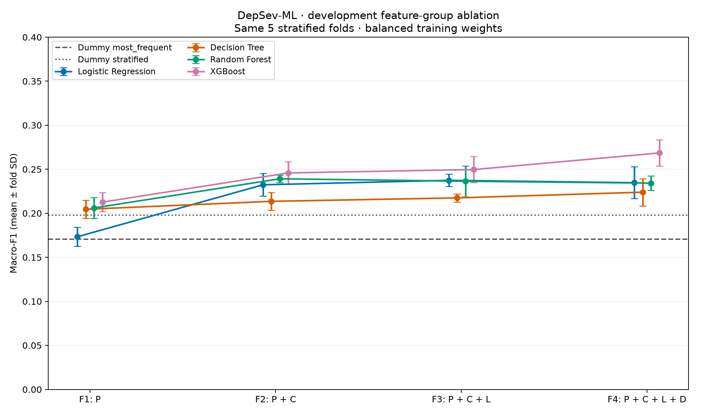
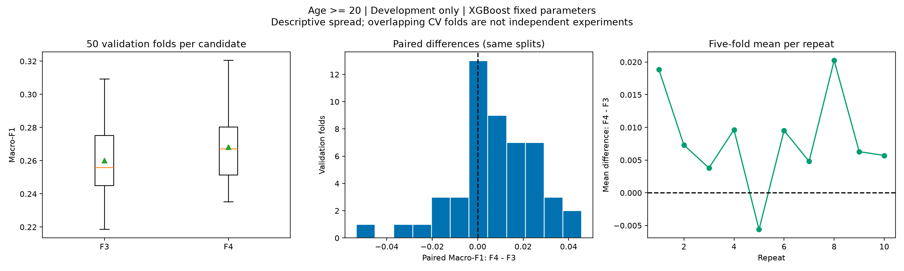

# DepSev-ML — Protocol correction và robustness analysis

Protocol: `age20_v2`. Ngày chạy: 2026-09-29. Tất cả metric dưới đây chỉ từ development CV/OOF. Không chạy held-out evaluation, tuning, SMOTE, Voting, Stacking hoặc SHAP. Target là mức độ triệu chứng PHQ-9, không phải chẩn đoán lâm sàng.

## 1. Cohort và thay đổi protocol

Áp dụng `RIDAGEYR >= 20` vì survey eligibility, không dựa trên model score. Ví dụ DMDEDUC2 và MCQ160B chỉ áp dụng tuổi 20+. [CDC DEMO_H](https://wwwn.cdc.gov/Nchs/Data/Nhanes/Public/2013/DataFiles/DEMO_H.htm), [CDC MCQ_H](https://wwwn.cdc.gov/Nchs/Data/Nhanes/Public/2013/DataFiles/MCQ_H.htm).

- Raw questionnaire: 10.175 participants.
- Có đủ 9 PHQ-9 items với mỗi item thuộc {0,1,2,3}: 5.372.
- Loại vì tuổi <20: **318**; thiếu tuổi: **0**.
- Primary cohort mới: **5.054**; development **4.043**; held-out **1.011**.
- Con số 252 trong audit trước thuộc development cũ, không phải tổng số bị loại trên toàn cohort.
- Giữ DPQ010–DPQ090, tổng điểm 0–27 và C0–C4; không đưa PHQ items, tổng điểm, severity hay SEQN vào predictors.
- Rebuild từ raw, merge one-to-one theo SEQN; không đưa medications một-nhiều vào cohort khi chưa có aggregation rule.
- Tạo lại stratified split 80/20 với random_state=42 theo yêu cầu. `artifacts/split_indices.json` có version, lý do, eligibility, thời điểm, hash cohort và hash split cũ.
- CV mới: StratifiedKFold(5, shuffle=True, random_state=42), thứ tự development theo cohort; cùng indices cho mọi cấu hình.
- Split/cohort/code/results cũ đã sao lưu kèm SHA-256 tại `artifacts/archive/pre_age20_v1/` trước khi cập nhật.

| Lớp | Điểm PHQ-9 | Toàn cohort | % cohort | Development |
| --- | --- | --- | --- | --- |
| C0 | 0–4 | 3764 | 74.48 | 3011 |
| C1 | 5–9 | 800 | 15.83 | 640 |
| C2 | 10–14 | 303 | 6.00 | 242 |
| C3 | 15–19 | 132 | 2.61 | 106 |
| C4 | 20–27 | 55 | 1.09 | 44 |

Đây là số đếm cohort trước split và số đếm development; không đánh giá metric hoặc phân tích riêng test.

### Giới hạn quan trọng của việc chia lại split

Theo đối chiếu **ID**, 815 người thuộc development cũ chuyển vào test mới; 813 người thuộc test cũ chuyển vào development mới; 196 người giữ vai trò test. Vì vậy test mới **không hoàn toàn chưa từng tham gia quá trình phát triển** xét toàn lịch sử. Không dùng kết quả test cũ/mới để chọn model; tất cả fit/predict hiện tại chỉ dùng development của age20_v2. Không được mô tả split mới như một test độc lập hoàn toàn chưa từng được nhìn tới trong nghiên cứu.

## 2. Feature definitions và preprocessing

Giữ nguyên representation đã audit; không thêm/bớt feature vì score:

P (10): `BMXBMI, BMXWAIST, BPXPLS, SBP_mean, DBP_mean, LBXGH, LBXTC, LBDHDD, LBXSCR, LBXSAL`

C (9): `BPQ020, DIQ010, MCQ160B, MCQ160C, MCQ160D, MCQ160E, MCQ160F, MCQ220, HUQ010`

L (10): `PAQ605, PAQ620, PAQ650, PAQ665, PAD680, smoking_status, ALQ101, alcohol_status, alcohol_quantity_code, SLD010H`

D (5): `RIDAGEYR, RIAGENDR, RIDRETH1, DMDEDUC2, INDFMPIR`

P=Physiological; C=Clinical; L=Lifestyle; D=Demographic. F1=P (10 cột), F2=P+C (19), F3=P+C+L (29), F4=P+C+L+D (34). Số cột là trước one-hot. Các cột smoking_status, alcohol_status, alcohol_quantity_code là dẫn xuất, không phải tên biến NHANES nguyên bản.

- Numerical: median imputation → StandardScaler.
- Categorical: missing_or_unknown → OneHotEncoder(handle_unknown="ignore").
- Preprocessor và estimator mới được clone/fit trong từng training fold.
- LR/DT/RF: class_weight="balanced". XGBoost: w(c)=n_train/(K × n_class_train), chỉ tính từ y_train fold; K=5 primary/repeated và K=4 sensitivity. Truyền model__sample_weight vào Pipeline.
- Đây là class-balancing weights, không phải NHANES survey weights. Validation metric không dùng weights.
- LR max_iter=2000; DT default; RF 300 trees; XGB 200 trees, depth=4, learning_rate=0.05, subsample=0.8, colsample_bytree=0.8; random_state=42. Không tìm hyperparameters, không early stopping trên test.
- Giữ primary y với 5 lớp; sensitivity chỉ tạo bản sao y đã clip C3/C4 thành S3.

## 3. Missingness mới

Cột toàn cohort dưới đây là số ô trống thô được ghi nhận khi rebuild, **trước recode các mã nonresponse**. Cột development là sau recode và deterministic questionnaire routing, **trước imputation**. Hai cột có mẫu số và representation khác nhau, không được diễn giải chênh lệch là hiệu quả imputation. Không mở subset test để lập bảng này.

| Nhóm | Feature | Thiếu thô toàn cohort (N=5054) | Thiếu sau coding, trước impute, development (N=4043) |
| --- | --- | --- | --- |
| P | BMXBMI | 48 (0.950%) | 41 (1.014%) |
| P | BMXWAIST | 175 (3.463%) | 140 (3.463%) |
| P | BPXPLS | 124 (2.454%) | 101 (2.498%) |
| P | SBP_mean | 132 (2.612%) | 107 (2.647%) |
| P | DBP_mean | 132 (2.612%) | 107 (2.647%) |
| P | LBXGH | 136 (2.691%) | 109 (2.696%) |
| P | LBXTC | 176 (3.482%) | 140 (3.463%) |
| P | LBDHDD | 176 (3.482%) | 140 (3.463%) |
| P | LBXSCR | 190 (3.759%) | 151 (3.735%) |
| P | LBXSAL | 190 (3.759%) | 151 (3.735%) |
| C | BPQ020 | 0 (0.000%) | 4 (0.099%) |
| C | DIQ010 | 0 (0.000%) | 3 (0.074%) |
| C | MCQ160B | 0 (0.000%) | 4 (0.099%) |
| C | MCQ160C | 0 (0.000%) | 9 (0.223%) |
| C | MCQ160D | 0 (0.000%) | 3 (0.074%) |
| C | MCQ160E | 0 (0.000%) | 2 (0.049%) |
| C | MCQ160F | 0 (0.000%) | 3 (0.074%) |
| C | MCQ220 | 0 (0.000%) | 0 (0.000%) |
| C | HUQ010 | 0 (0.000%) | 3 (0.074%) |
| L | PAQ605 | 0 (0.000%) | 0 (0.000%) |
| L | PAQ620 | 0 (0.000%) | 2 (0.049%) |
| L | PAQ650 | 0 (0.000%) | 0 (0.000%) |
| L | PAQ665 | 0 (0.000%) | 0 (0.000%) |
| L | PAD680 | 5 (0.099%) | 20 (0.495%) |
| L | SMQ020 | 0 (0.000%) | không đưa trực tiếp vào model |
| L | SMQ040 | 2845 (56.292%) | không đưa trực tiếp vào model |
| L | ALQ101 | 1 (0.020%) | 6 (0.148%) |
| L | ALQ130 | 1614 (31.935%) | không đưa trực tiếp vào model |
| L | SLD010H | 3 (0.059%) | 6 (0.148%) |
| L | smoking_status | — cột dẫn xuất | 1 (0.025%) |
| L | alcohol_status | — cột dẫn xuất | 3 (0.074%) |
| L | alcohol_quantity_code | — cột dẫn xuất | 5 (0.124%) |
| D | RIDAGEYR | 0 (0.000%) | 0 (0.000%) |
| D | RIAGENDR | 0 (0.000%) | 0 (0.000%) |
| D | RIDRETH1 | 0 (0.000%) | 0 (0.000%) |
| D | DMDEDUC2 | 0 (0.000%) | 1 (0.025%) |
| D | INDFMPIR | 364 (7.202%) | 286 (7.074%) |

CSV đầy đủ: [cohort_missingness.csv](tables/cohort_missingness.csv), [ablation_feature_inventory.csv](tables/ablation_feature_inventory.csv), [structural_missingness_audit.csv](tables/structural_missingness_audit.csv).

### Structural missingness và coding

- MCQ160B–F/MCQ220 và DMDEDUC2 không còn ô trống do eligibility dưới 20. Tuy nhiên nonresponse vẫn có: ví dụ DMDEDUC2 còn 1/4043 missing sau recode, MCQ160C còn 9. Không được đồng nhất ô trống thô = toàn bộ missing.
- SMQ040 trống 2.262/4.043 (55,95%) development; 2.261 thuộc nhánh SMQ020=2. smoking_status giữ under_100_lifetime, former, current_some_days, current_daily; 1 unknown. under_100_lifetime không có nghĩa chưa từng hút. Không mode-impute SMQ040. [CDC SMQ_H](https://wwwn.cdc.gov/Nchs/Data/Nhanes/Public/2013/DataFiles/SMQ_H.htm).
- ALQ130 trống 1.272 (31,46%): 594 dưới 12 drinks cả đời và 675 không uống năm qua, tổng 1.269 structural; 3 trống chưa biết. Hai mã 999 chuyển missing; quantity cuối còn 5 unknown, status còn 3 unknown. ALQ110/ALQ120Q chỉ đọc trên development để giải mã nhánh. alcohol_quantity_code=0 ở nhánh không áp dụng luôn đi cùng alcohol_status; với dưới 12 lifetime đây là placeholder, không phải alcohol exposure thực sự bằng 0. Không mode-impute ALQ130. [CDC ALQ_H](https://wwwn.cdc.gov/Nchs/Data/Nhanes/Public/2013/DataFiles/ALQ_H.htm).
- Giữ coding như phase trước: DIQ010=3 hợp lệ; PAD680 7777/9999 và SLD010H 77/99 là nonresponse, nhưng SLD010H=9 và top-code 12 được giữ. Không tự sửa representation theo điểm số.
- INDFMPIR vẫn thiếu 7,07% development; không kết luận cơ chế missing là random chỉ vì dùng median.

## 4. Dummy và 16 experiments primary

Mean/SD từ 5 validation folds; SD mẫu ddof=1. Balanced Accuracy bằng Macro Recall trong bài toán multiclass này. Không coi SD là confidence interval. LR=Logistic Regression; DT=Decision Tree; RF=Random Forest; XGB=XGBoost.

| Dummy strategy | Macro-F1 mean ± SD | Balanced Acc | Macro Precision | Macro Recall | Weighted F1 |
| --- | --- | --- | --- | --- | --- |
| Dummy most_frequent | 0.170740 ± 0.000076 | 0.2000 | 0.1489 | 0.2000 | 0.6358 |
| Dummy stratified | 0.197798 ± 0.014031 | 0.1977 | 0.1980 | 0.1977 | 0.5841 |

| Set | Model | n features | Macro-F1 mean ± SD | Balanced Acc | Macro Precision | Macro Recall | Weighted F1 |
| --- | --- | --- | --- | --- | --- | --- | --- |
| F1 | LR | 10 | 0.1733 ± 0.0108 | 0.2208 | 0.2079 | 0.2208 | 0.4848 |
| F1 | DT | 10 | 0.2045 ± 0.0104 | 0.2039 | 0.2056 | 0.2039 | 0.5835 |
| F1 | RF | 10 | 0.2061 ± 0.0119 | 0.2113 | 0.2057 | 0.2113 | 0.6340 |
| F1 | XGB | 10 | 0.2126 ± 0.0108 | 0.2239 | 0.2188 | 0.2239 | 0.5544 |
| F2 | LR | 19 | 0.2324 ± 0.0128 | 0.2714 | 0.2432 | 0.2714 | 0.5757 |
| F2 | DT | 19 | 0.2136 ± 0.0100 | 0.2136 | 0.2142 | 0.2136 | 0.5967 |
| F2 | RF | 19 | 0.2392 ± 0.0042 | 0.2397 | 0.2474 | 0.2397 | 0.6637 |
| F2 | XGB | 19 | 0.2458 ± 0.0129 | 0.2607 | 0.2465 | 0.2607 | 0.6060 |
| F3 | LR | 29 | 0.2374 ± 0.0070 | 0.3023 | 0.2497 | 0.3023 | 0.5670 |
| F3 | DT | 29 | 0.2175 ± 0.0045 | 0.2184 | 0.2174 | 0.2184 | 0.6096 |
| F3 | RF | 29 | 0.2364 ± 0.0176 | 0.2367 | 0.2621 | 0.2367 | 0.6666 |
| F3 | XGB | 29 | 0.2496 ± 0.0149 | 0.2604 | 0.2493 | 0.2604 | 0.6287 |
| F4 | LR | 34 | 0.2347 ± 0.0180 | 0.3059 | 0.2477 | 0.3059 | 0.5622 |
| F4 | DT | 34 | 0.2240 ± 0.0155 | 0.2255 | 0.2230 | 0.2255 | 0.6116 |
| F4 | RF | 34 | 0.2342 ± 0.0082 | 0.2369 | 0.2484 | 0.2369 | 0.6755 |
| F4 | XGB | 34 | 0.2685 ± 0.0149 | 0.2829 | 0.2658 | 0.2829 | 0.6362 |

**XGB/F4 có Macro-F1 mean cao nhất trong 16 thí nghiệm fixed-CV: 0,268512 ± 0,014905.** Đây là xếp hạng development, không phải kết luận final-test hoặc model đã sẵn sàng dùng lâm sàng.

[feature_ablation_results.csv](tables/feature_ablation_results.csv), [dummy_cv_results.csv](tables/dummy_cv_results.csv), [ablation_fold_results.csv](tables/ablation_fold_results.csv).



## 5. Per-class Recall/F1 và majority behavior

Mỗi ô là **F1 / Recall**, tính trên pooled development OOF (mỗi người đúng một prediction). Support C0–C4 = 3011 / 640 / 242 / 106 / 44. Pooled OOF F1 không nhất thiết bằng trung bình F1 của folds. CSV còn có precision, support, predicted_count, true_positive và fold mean/std.

| Set | Model | C0 | C1 | C2 | C3 | C4 |
| --- | --- | --- | --- | --- | --- | --- |
| Dummy | Dummy most_frequent | 0.854 / 1.000 | 0.000 / 0.000 | 0.000 / 0.000 | 0.000 / 0.000 | 0.000 / 0.000 |
| Dummy | Dummy stratified | 0.746 / 0.749 | 0.150 / 0.145 | 0.065 / 0.066 | 0.028 / 0.028 | 0.000 / 0.000 |
| F1 | LR | 0.623 / 0.508 | 0.108 / 0.087 | 0.041 / 0.050 | 0.076 / 0.255 | 0.022 / 0.205 |
| F1 | DT | 0.742 / 0.734 | 0.160 / 0.163 | 0.062 / 0.066 | 0.057 / 0.057 | 0.000 / 0.000 |
| F1 | RF | 0.809 / 0.860 | 0.192 / 0.175 | 0.019 / 0.012 | 0.014 / 0.009 | 0.000 / 0.000 |
| F1 | XGB | 0.688 / 0.610 | 0.221 / 0.261 | 0.095 / 0.140 | 0.049 / 0.085 | 0.013 / 0.023 |
| F2 | LR | 0.719 / 0.623 | 0.200 / 0.206 | 0.098 / 0.128 | 0.114 / 0.264 | 0.028 / 0.136 |
| F2 | DT | 0.758 / 0.747 | 0.164 / 0.172 | 0.082 / 0.083 | 0.063 / 0.066 | 0.000 / 0.000 |
| F2 | RF | 0.830 / 0.851 | 0.253 / 0.263 | 0.082 / 0.066 | 0.029 / 0.019 | 0.000 / 0.000 |
| F2 | XGB | 0.748 / 0.677 | 0.246 / 0.297 | 0.133 / 0.190 | 0.073 / 0.094 | 0.032 / 0.045 |
| F3 | LR | 0.708 / 0.603 | 0.177 / 0.170 | 0.141 / 0.198 | 0.123 / 0.311 | 0.039 / 0.227 |
| F3 | DT | 0.775 / 0.770 | 0.163 / 0.163 | 0.097 / 0.099 | 0.034 / 0.038 | 0.021 / 0.023 |
| F3 | RF | 0.839 / 0.880 | 0.242 / 0.239 | 0.048 / 0.033 | 0.016 / 0.009 | 0.043 / 0.023 |
| F3 | XGB | 0.776 / 0.716 | 0.257 / 0.303 | 0.142 / 0.194 | 0.058 / 0.066 | 0.017 / 0.023 |
| F4 | LR | 0.704 / 0.595 | 0.169 / 0.166 | 0.146 / 0.219 | 0.104 / 0.255 | 0.053 / 0.295 |
| F4 | DT | 0.776 / 0.773 | 0.165 / 0.166 | 0.091 / 0.091 | 0.070 / 0.075 | 0.021 / 0.023 |
| F4 | RF | 0.849 / 0.902 | 0.245 / 0.233 | 0.077 / 0.050 | 0.000 / 0.000 | 0.000 / 0.000 |
| F4 | XGB | 0.781 / 0.722 | 0.266 / 0.319 | 0.175 / 0.236 | 0.087 / 0.094 | 0.041 / 0.045 |

- Dummy most_frequent luôn dự đoán C0; recall C1–C4 bằng 0.
- RF/F4 lệch mạnh về majority: 3.390/4.043 predictions là C0 (83,85%); chỉ dự đoán C3 5 lần và C4 2 lần, đều không đúng. Không phải mọi prediction đều C0, nhưng C3/C4 hoàn toàn không được nhận diện đúng.
- XGB/F4 nhận diện đúng C3 10/106 (recall 9,43%; F1 0,0866) và C4 2/44 (recall 4,55%; F1 0,0408). XGB/F3 tương ứng 7/106 và 1/44. Severe classes vẫn rất khó.
- LR/F4 recall C4 cao hơn (13/44=29,55%) nhưng dự đoán C4 450 lần, precision chỉ 2,89%, F1 0,0526. Recall cao riêng lẻ không có nghĩa severe classification tốt.
- C4 validation mỗi fold chỉ 8–9 người, training 35–36 người; C3 validation 21–22 người. Một vài predictions có thể làm metric minority biến động rõ rệt.

[per_class_cv_results.csv](tables/per_class_cv_results.csv), [ablation_oof_predictions.csv](tables/ablation_oof_predictions.csv), [ablation_confusion_matrices.csv](tables/ablation_confusion_matrices.csv).

### Incremental value theo cùng folds

| Model | ΔF2−F1 | ΔF3−F2 | ΔF4−F3 |
| --- | --- | --- | --- |
| LR | +0.0590 | +0.0051 | -0.0027 |
| DT | +0.0090 | +0.0039 | +0.0065 |
| RF | +0.0331 | -0.0028 | -0.0021 |
| XGB | +0.0332 | +0.0038 | +0.0189 |

Không phải F4 tốt nhất cho mọi model: LR tốt nhất ở F3, RF ở F2, DT/XGB ở F4 theo Macro-F1 mean fixed-CV. Không so score cũ/mới như tác động riêng của age correction vì participants và split cùng thay đổi.

## 6. XGB/F3 và XGB/F4 trên từng fixed fold

| Fold | F3 Macro-F1 | F4 Macro-F1 | ΔF4−F3 |
| --- | --- | --- | --- |
| 1 | 0.247309 | 0.273172 | +0.025864 |
| 2 | 0.237812 | 0.279500 | +0.041689 |
| 3 | 0.245696 | 0.272333 | +0.026637 |
| 4 | 0.241844 | 0.242314 | +0.000470 |
| 5 | 0.275554 | 0.275240 | -0.000314 |

Mean ΔF4−F3 = +0,018869; paired fold SD = 0,018279. F4 thắng 4/5 folds, nhưng fold 4 gần hòa và fold 5 giảm nhẹ. Đây chưa phải cải thiện đồng đều qua tất cả folds.

[xgb_fixed_F3_F4_comparison.csv](tables/xgb_fixed_F3_F4_comparison.csv).

## 7. Repeated-CV robustness

Chỉ XGB/F3 và XGB/F4, RepeatedStratifiedKFold(n_splits=5, n_repeats=10, random_state=42). 50 validation folds/candidate trên development, cùng split trong từng cặp. Không tuning; cùng model parameters và weighting protocol. Repeat đầu tái lập fixed-CV kể cả từng OOF prediction; 50 folds bao gồm 5 folds đầu, không phải 50 đánh giá độc lập bổ sung. [Scikit-learn RepeatedStratifiedKFold](https://scikit-learn.org/stable/modules/generated/sklearn.model_selection.RepeatedStratifiedKFold.html).

| XGB | Folds | Mean | SD | Median | Min | Max |
| --- | --- | --- | --- | --- | --- | --- |
| F3 | 50 | 0.260035 | 0.020734 | 0.255924 | 0.218509 | 0.309212 |
| F4 | 50 | 0.268095 | 0.019941 | 0.267081 | 0.235237 | 0.320482 |

| Phạm vi | Mean Δ | SD Δ | Median Δ | Min Δ | Max Δ | Dương / âm / bằng 0 |
| --- | --- | --- | --- | --- | --- | --- |
| 50_paired_validation_folds | 0.008060 | 0.018117 | 0.006982 | -0.053381 | 0.045748 | 37 / 13 / 0 |
| 10_paired_repeat_means | 0.008060 | 0.007417 | 0.006804 | -0.005615 | 0.020249 | 9 / 1 / 0 |

Khoảng phân vị thực nghiệm 2,5%–97,5% của paired fold difference: **−0,030164 đến +0,039825**, không phải confidence interval. F4 thắng 37/50 folds (74%) và 9/10 repeat means. Lợi ích trung bình chỉ +0,008060, nhỏ hơn +0,018869 ở lần chia fixed ban đầu. Độ phân tán F4 không còn lớn hơn F3 trong run mới.

| Repeat | Mean F3 | Mean F4 | Mean ΔF4−F3 |
| --- | --- | --- | --- |
| 1 | 0.2496 | 0.2685 | +0.0189 |
| 2 | 0.2614 | 0.2687 | +0.0073 |
| 3 | 0.2727 | 0.2765 | +0.0038 |
| 4 | 0.2547 | 0.2644 | +0.0097 |
| 5 | 0.2717 | 0.2661 | -0.0056 |
| 6 | 0.2580 | 0.2676 | +0.0095 |
| 7 | 0.2607 | 0.2655 | +0.0048 |
| 8 | 0.2449 | 0.2651 | +0.0202 |
| 9 | 0.2672 | 0.2735 | +0.0063 |
| 10 | 0.2596 | 0.2653 | +0.0057 |

Kết luận: có bằng chứng mô tả nghiêng về F4, nhưng không được tuyên bố F4 luôn tốt hơn hoặc có ý nghĩa thống kê. Các folds/repeats dùng lại participants và training sets chồng lấp; không dùng t-test IID ngây thơ hoặc SD/√50 để khẳng định significance. Chỉ số này mô tả độ nhạy với cách chia development, không đo uncertainty của một quần thể mới. [Scikit-learn cross-validation](https://scikit-learn.org/stable/modules/cross_validation.html).

[repeated_cv_summary.csv](tables/repeated_cv_summary.csv), [50 paired differences](tables/repeated_cv_paired_differences.csv), [10 repeat means](tables/repeated_cv_repeat_means.csv), [per-class theo repeat](tables/repeated_cv_per_class.csv).



## 8. Sensitivity 4-class

S0=0–4, S1=5–9, S2=10–14, S3=15–27. Development counts: 3011 / 640 / 242 / 150. Dùng lại **đúng primary fixed 5 folds**, không tạo split mới hoặc đổi cohort. C3/C4 chỉ gộp trong local y của sensitivity. Chỉ hai thí nghiệm XGB; không repeated-CV 4-class và không thay primary target.

| XGB | Macro-F1 mean ± SD | Balanced Acc | Macro Precision | Macro Recall | Weighted F1 |
| --- | --- | --- | --- | --- | --- |
| F3 | 0.3186 ± 0.0113 | 0.3314 | 0.3161 | 0.3314 | 0.6338 |
| F4 | 0.3334 ± 0.0159 | 0.3476 | 0.3289 | 0.3476 | 0.6391 |

Per-class pooled OOF:

| XGB | S0 F1 / Recall | S1 F1 / Recall | S2 F1 / Recall | S3 F1 / Recall |
| --- | --- | --- | --- | --- |
| F3 | 0.7830 / 0.7330 | 0.2420 / 0.2719 | 0.1388 / 0.1818 | 0.1114 / 0.1400 |
| F4 | 0.7861 / 0.7380 | 0.2502 / 0.2875 | 0.1354 / 0.1653 | 0.1617 / 0.2000 |

[sensitivity_4class_results.csv](tables/sensitivity_4class_results.csv), [sensitivity_4class_per_class.csv](tables/sensitivity_4class_per_class.csv), [sensitivity_4class_fold_results.csv](tables/sensitivity_4class_fold_results.csv).

### Severe scarcity: so sánh trên cùng định nghĩa 4 lớp

Không so trực tiếp Macro-F1 5-class với 4-class để kết luận cải thiện: mẫu số classes và tiêu chí đúng/sai đã đổi. Vì vậy thêm đối chứng dùng **primary 5-class OOF predictions gộp C3/C4 sau dự đoán**, chấm trên cùng 4 nhãn, cùng người, cùng folds với model train 4-class:

| XGB | Cách tạo predictions | Macro-F1 pooled, cùng 4 nhãn | S3 Precision | S3 Recall | S3 F1 | S3 TP / 150 | C3 gốc nhận diện S3 / 106 | C4 gốc nhận diện S3 / 44 |
| --- | --- | --- | --- | --- | --- | --- | --- | --- |
| F3 | Train 5-class, gộp predictions | 0.3204 | 0.0909 | 0.1267 | 0.1058 | 19 | 12 | 7 |
| F3 | Train 4-class | 0.3188 | 0.0925 | 0.1400 | 0.1114 | 21 | 14 | 7 |
| F4 | Train 5-class, gộp predictions | 0.3418 | 0.1341 | 0.1600 | 0.1459 | 24 | 17 | 7 |
| F4 | Train 4-class | 0.3333 | 0.1357 | 0.2000 | 0.1617 | 30 | 21 | 9 |

- F3: train lại 4-class tăng S3 recall 12,67% → 14,00% (19 → 21 ca đúng), F1 0,1059 → 0,1114.
- F4: S3 recall 16,00% → 20,00% (24 → 30 ca đúng), F1 0,1459 → 0,1617; precision vẫn chỉ 13,57%.
- F4 4-class vẫn bỏ sót 120/150 người S3. Chỉ 9/44 người vốn thuộc C4 được gán S3; sensitivity không còn phân biệt được C3 với C4.
- Macro-F1 pooled trên cùng 4 nhãn của train 4-class không tăng so với gộp predictions từ train 5-class: F3 0,3188 < 0,3204; F4 0,3333 < 0,3418.
- **Có cải thiện severe recall/F1 nhỏ về mặt mô tả; chưa có cải thiện lớn hoặc bằng chứng về ý nghĩa thống kê.** Thí nghiệm này phù hợp với khả năng scarcity góp phần gây khó khăn, nhưng không chứng minh đây là nguyên nhân chính. Gộp lớp cũng thay đổi ranh giới bài toán; primary 5-class vẫn giữ nguyên.

[sensitivity_severe_comparison.csv](tables/sensitivity_severe_comparison.csv).

## 9. Kiểm chứng, tái lập và phạm vi

14 automated tests đạt: age eligibility; input/archive hashes; split disjointness; fixed/repeated assignments; repeat 1 tái lập fixed OOF; mỗi development ID đúng một prediction mỗi repeat; không có current-test IDs trong OOF; tính lại fold/per-class metrics từ predictions thật; same-label severe comparison; weighting theo y_train từng fold (K=5/4); train-fold imputation/scaling; giữ primary 5-class target; chặn legacy baseline ghi đè protocol mới.

```bash
# Cohort age20 đã được rebuild, split đã khóa: không cần rebuild để rerun experiments.
python src/05_feature_ablation.py --audit-only
python src/05_feature_ablation.py
python src/05_robustness.py
python -m unittest discover -s tests -v
```

`04_train_baselines.py` là legacy unweighted-XGB runner, nay dừng trước khi nạp cohort khi gặp age20_v2. `baseline_F1_results.csv` hiện được bước 05 ghi từ F1 weighted cùng fixed folds. Hai khóa chính: `artifacts/ablation_config.json` và `artifacts/robustness_config.json`; cùng fixed/repeated assignments và hashes giúp phát hiện thay đổi inputs/code.

Chưa train final model hoặc đánh giá test. Không notebook, framework, thư viện hay dữ liệu giả mới. Kết quả là nghiên cứu dự đoán trong cohort này, không phải bằng chứng nhân quả, độ chính xác quần thể dùng survey weights, hay công cụ chẩn đoán.

